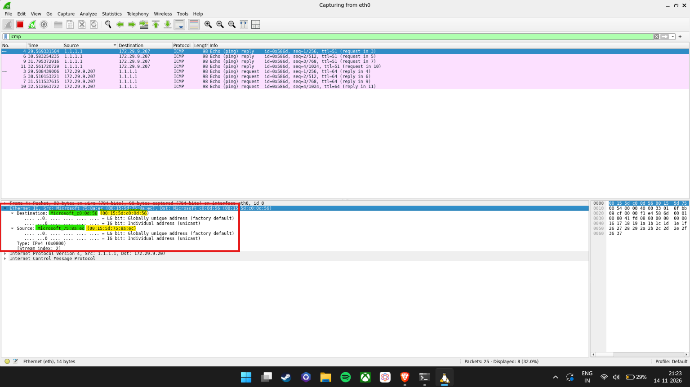
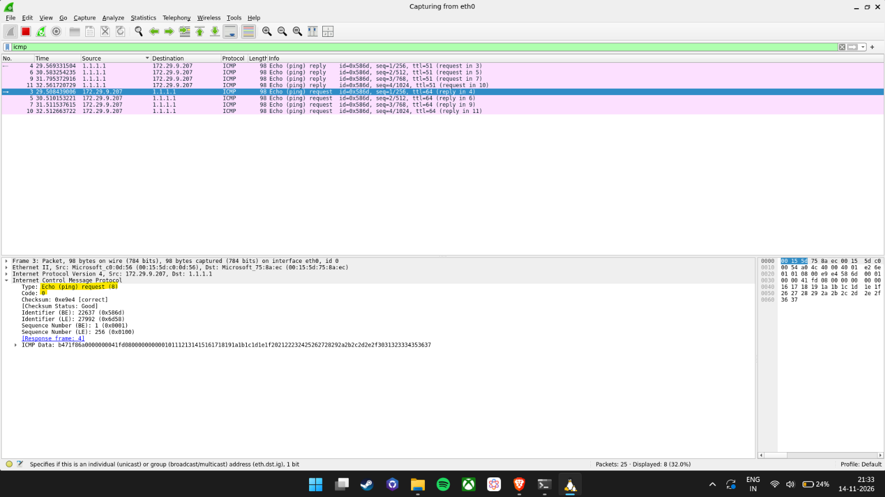
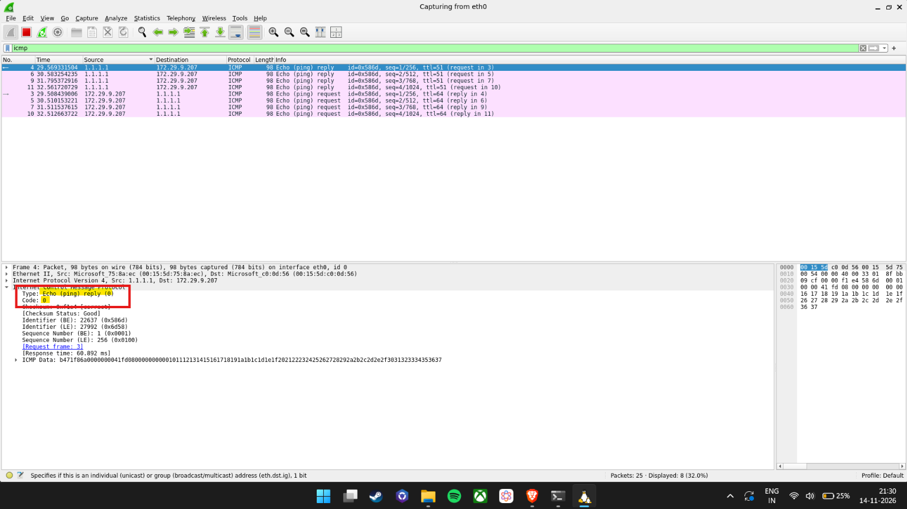
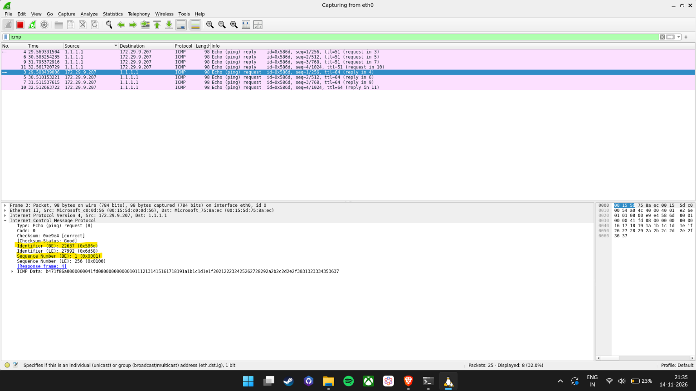
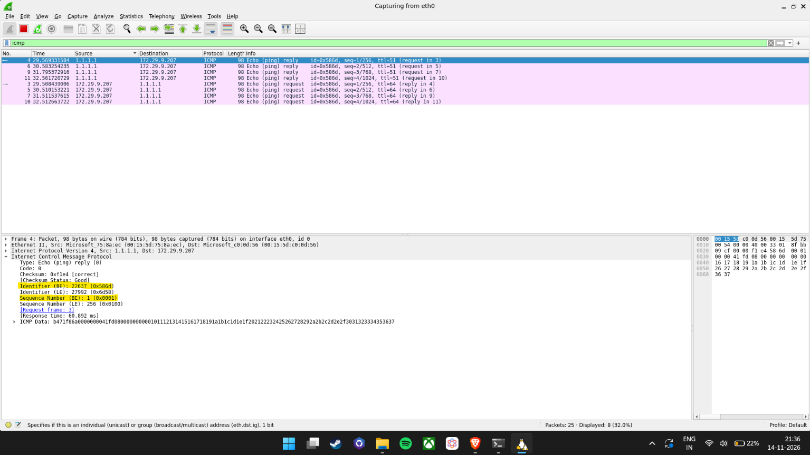

# Lab 03 — ICMP Packet Structure & Analysis

## 1. Objective

The objective of this lab was to examine the internal structure of ICMP packets using Wireshark and understand how Ethernet, IPv4, and ICMP work together during network communication.

The investigation focused on:

- Understanding Ethernet frames and MAC addressing.
- Identifying source and destination IPv4 addresses.
- Examining ICMP Echo Requests and Echo Replies.
- Understanding ICMP Type and Code fields.
- Investigating Identifier and Sequence Number fields.
- Matching ICMP requests with their corresponding replies.
- Understanding how packet inspection helps troubleshoot network communication.

This experiment builds upon Lab 01 by examining the information contained inside individual ICMP packets rather than only observing their transmission.

---

## 2. Lab Environment

| Component | Configuration |
|---|---|
| Operating System | Kali Linux (WSL2) |
| Host Operating System | Windows 11 |
| Packet Analyzer | Wireshark |
| Capture Interface | `eth0` |
| Protocol | ICMP over IPv4 |
| Destination IP | `1.1.1.1` |
| Local IP | `172.29.9.207` |
| Display Filter | `icmp` |
| Traffic Generation | Linux `ping` utility |

All traffic was generated from the local Kali environment for educational network analysis.

---

## 3. Background and Concepts

### 3.1 Network Packets and Protocol Headers

A network packet is a unit of information transmitted across an IP network.

During network communication, different protocols add information that helps devices deliver and process the data.

This information is stored in **headers**.

A header is a section containing information such as the source address, destination address, or message type.

### 3.2 Protocol Encapsulation

Encapsulation is the process of adding protocol information as data moves through networking layers.

The ICMP traffic examined in this experiment followed this structure:

```text
Ethernet Frame
│
└── IPv4 Packet
    │
    └── ICMP Message
        │
        └── ICMP Data
```

Each protocol has a different responsibility.

| Protocol | Responsibility |
|---|---|
| Ethernet | Local-link communication using MAC addresses |
| IPv4 | Addressing and forwarding packets between networks |
| ICMP | Network control and diagnostic messages |

Unlike TCP and UDP, ICMP Echo messages do not use port numbers.

### 3.3 MAC Addresses and IP Addresses

A MAC address identifies a network interface for communication on a local link.

An IP address identifies a network interface for communication across IP networks.

When a destination is outside the local network, the computer normally sends its Ethernet frame to the default gateway.

The default gateway is a router that forwards traffic toward other networks.

Therefore, the final destination IP address and the destination MAC address of an Ethernet frame do not necessarily identify the same device.

### 3.4 ICMP Echo Request and Echo Reply

ICMP stands for **Internet Control Message Protocol**.

The Linux `ping` utility uses ICMP Echo messages to test whether a destination responds.

- **Echo Request:** A message sent to request a response.
- **Echo Reply:** A message sent in response to an Echo Request.

ICMP also supports error-reporting messages, such as Destination Unreachable.

### 3.5 ICMP Type and Code

The Type field identifies the category of ICMP message.

The Code field provides additional information specific to that Type.

| Type | Code | Meaning |
|---|---|---|
| 8 | 0 | Echo Request |
| 0 | 0 | Echo Reply |
| 3 | 0 | Destination Network Unreachable |
| 3 | 1 | Destination Host Unreachable |
| 3 | 3 | Destination Port Unreachable |

An unsuccessful ping does not automatically generate a Destination Unreachable message. A firewall or another network device may silently discard the traffic.

### 3.6 Identifier and Sequence Number

ICMP Echo messages contain an Identifier and a Sequence Number.

**Identifier:** A value used to help associate Echo Requests and Echo Replies with a particular ping exchange.

**Sequence Number:** A value used to distinguish individual Echo Requests within that exchange.

A corresponding Echo Reply normally contains the same Identifier and Sequence Number as the request.

For example:

| Message | Identifier | Sequence Number |
|---|---|---|
| Echo Request | 22637 | 1 |
| Echo Reply | 22637 | 1 |
| Echo Request | 22637 | 2 |
| Echo Reply | 22637 | 2 |
| Echo Request | 22637 | 3 |
| No matching reply observed | — | — |

These values help identify requests for which no matching reply appears in a capture.

A missing reply does not automatically prove packet loss because the capture may be incomplete or traffic may have been filtered.

---

## 4. Methodology

### Step 1 — Starting the Packet Capture

Wireshark was launched in the Kali Linux environment.

The `eth0` interface was selected to capture network traffic.

### Step 2 — Generating ICMP Traffic

The following command was executed:

```bash
ping -c 4 1.1.1.1
```

Command explanation:

- `ping` sends ICMP Echo Requests.
- `-c 4` sends four requests.
- `1.1.1.1` specifies the destination IPv4 address.

The final capture contained four Echo Requests and four corresponding Echo Replies.

**Total ICMP packets observed: 8**

### Step 3 — Filtering ICMP Traffic

The following Wireshark display filter was applied:

```text
icmp
```

A display filter controls which captured packets are visible in the packet list. It does not delete other captured packets.

### Step 4 — Inspecting Packet Details

Individual Echo Request and Echo Reply packets were selected.

The Packet Details panel was used to inspect the Ethernet, IPv4, and ICMP headers.

The investigation focused on MAC addresses, IP addresses, Type, Code, Identifier, and Sequence Number.

---

## 5. Observations and Analysis

### 5.1 Ethernet Header Analysis

The selected Echo Request contained the following Ethernet addresses:

| Field | Observed Value |
|---|---|
| Source MAC | `00:15:5d:c0:0d:56` |
| Destination MAC | `00:15:5d:75:8a:ec` |
| Ethernet Type | IPv4 (`0x0800`) |

Both MAC addresses used the `00:15:5d` prefix, which Wireshark associated with Microsoft.

This was consistent with the experiment running inside WSL2, which uses virtual networking.

**Finding:** The destination MAC identifies the next interface receiving the Ethernet frame on the local link, not necessarily the remote system identified by the destination IP.

### 5.2 IPv4 Address Analysis

The first Echo Request contained:

| Field | Observed Value |
|---|---|
| Source IPv4 | `172.29.9.207` |
| Destination IPv4 | `1.1.1.1` |

The source IP represented the Kali WSL network interface.

The destination IP identified the remote system being tested.

In the corresponding Echo Reply, the source and destination IP addresses were reversed.

**Finding:** IPv4 addressing identifies the sender and intended receiver of a packet, while Ethernet addresses are used for delivery on the current local link.

### 5.3 ICMP Echo Request — Type and Code

The first Echo Request contained:

```text
Type: Echo (ping) request (8)
Code: 0
```

Type 8 identified the message as an ICMP Echo Request.

Code 0 was the defined code value for this message type.

**Finding:** ICMP Type and Code fields identify the purpose of the message.

### 5.4 ICMP Echo Reply — Type and Code

The corresponding Echo Reply contained:

```text
Type: Echo (ping) reply (0)
Code: 0
```

Type 0 identified the message as an ICMP Echo Reply.

The Code field remained 0 because that is the defined value for an Echo Reply.

**Finding:** Echo Requests and Echo Replies are distinguished by their Type fields, not by treating Code as a request/reply indicator.

### 5.5 Echo Request — Identifier and Sequence Number

The first Echo Request contained:

```text
Identifier (BE): 22637 (0x586d)
Sequence Number (BE): 1 (0x0001)
```

**BE** means *big-endian*, a convention for ordering bytes when representing numbers.

The Identifier helped associate the message with its ping exchange.

The Sequence Number identified this as the first request in the observed sequence.

### 5.6 Echo Reply — Identifier and Sequence Number

The corresponding Echo Reply contained:

```text
Identifier (BE): 22637 (0x586d)
Sequence Number (BE): 1 (0x0001)
```

These values matched the first Echo Request.

Wireshark also displayed a reference connecting the reply to its corresponding request.

**Finding:** Matching Identifier and Sequence Number values help associate an Echo Reply with the request it answers.

### 5.7 Request–Reply Matching

The final capture showed four Echo Requests and four matching Echo Replies.

| Echo Request Sequence | Corresponding Reply |
|---|---|
| 1 | Observed |
| 2 | Observed |
| 3 | Observed |
| 4 | Observed |

No unmatched Echo Request was identified in the final capture.

---

## 6. Evidence and Screenshots

The following screenshots were captured during the experiment using Wireshark. Each image highlights specific protocol fields and supports the observations recorded above.

### Evidence 01 — Ethernet Header and MAC Addresses

This screenshot shows the Ethernet II header and highlights the source and destination MAC addresses.



**Observation:** The Ethernet header contains MAC addresses used for communication on the local link.

### Evidence 02 — ICMP Echo Request: Type and Code

This screenshot highlights the Type and Code fields of an ICMP Echo Request.



**Observation:** Type 8 and Code 0 identify an ICMP Echo Request.

### Evidence 03 — ICMP Echo Reply: Type and Code

This screenshot highlights the Type and Code fields of an ICMP Echo Reply.



**Observation:** Type 0 and Code 0 identify an ICMP Echo Reply.

### Evidence 04 — ICMP Echo Request: Identifier and Sequence Number

This screenshot highlights the Identifier and Sequence Number fields of the first Echo Request.



**Observation:** The request contained Identifier 22637 and Sequence Number 1.

### Evidence 05 — ICMP Echo Reply: Identifier and Sequence Number

This screenshot highlights the Identifier and Sequence Number fields of the corresponding Echo Reply.



**Observation:** The reply contained the same Identifier 22637 and Sequence Number 1.

### Evidence Summary

| Evidence | Purpose |
|---|---|
| 01 | Identify Ethernet source and destination MAC addresses |
| 02 | Verify Echo Request Type and Code |
| 03 | Verify Echo Reply Type and Code |
| 04 | Examine the request Identifier and Sequence Number |
| 05 | Confirm matching values in the corresponding reply |

---

## 7. Troubleshooting and Learning Notes

### 7.1 Unexpected Duplicate Response

During an earlier capture attempt, the terminal reported an additional duplicate ICMP response.

The earlier capture also showed more ICMP traffic than expected.

Because the earlier capture was not fully investigated and preserved, the precise cause was not established.

After restarting the environment, a new capture showed the expected four requests and four replies.

**Lesson learned:** Unexpected packet counts should be investigated rather than immediately attributed to a particular network fault.

### 7.2 Microsoft-Associated MAC Addresses

Wireshark displayed Microsoft-associated names for the Ethernet addresses.

This initially appeared unusual because the traffic was generated from Kali Linux.

The explanation was that Kali was running inside the Windows WSL2 virtual networking environment.

**Lesson learned:** MAC address vendor labels do not necessarily identify the operating system or final remote destination.

### 7.3 Understanding Type and Code

Initially, the Type and Code fields were confused with request and reply indicators.

Further inspection established that Type identifies the message category, while Code provides details specific to that category.

**Lesson learned:** Understanding the purpose of protocol fields is more useful than memorizing values without context.

---

## 8. Real-World Applications

### Network Troubleshooting

ICMP packet inspection can help determine whether Echo Requests leave a system and whether corresponding replies are observed.

### Packet Loss Investigation

Identifier and Sequence Number values help identify requests without matching replies.

Further investigation is needed to determine whether the cause is packet loss, filtering, or a capture limitation.

### Local Network Analysis

Comparing Ethernet MAC addresses with IPv4 addresses helps explain how traffic is forwarded through local gateways toward remote networks.

### Security Monitoring

Understanding normal ICMP behavior provides a foundation for identifying unusual ICMP traffic patterns during authorized network investigations.

Unusual ICMP traffic does not automatically indicate malicious activity.

---

## 9. Key Learnings

Through this experiment, I learned that:

1. Network communication involves multiple protocol headers with different responsibilities.
2. Ethernet MAC addresses and IPv4 addresses are used for different aspects of packet delivery.
3. A remote IP destination does not require the Ethernet destination MAC to belong to that remote system.
4. ICMP Type 8 identifies an Echo Request, while Type 0 identifies an Echo Reply.
5. ICMP Code provides additional information specific to the message Type.
6. Identifier and Sequence Number fields help associate Echo Requests with their replies.
7. Wireshark reveals protocol information that is not immediately visible from the terminal's `ping` output.
8. Unexpected network behavior should be documented and investigated rather than explained through assumptions.

---

## 10. Conclusion

Lab 03 demonstrated how ICMP communication can be examined at the Ethernet, IPv4, and ICMP protocol levels using Wireshark.

The investigation established the difference between MAC and IP addressing, identified the fields that distinguish Echo Requests from Echo Replies, and demonstrated how Identifier and Sequence Number values help match related packets.

The experiment provided a foundation for more detailed packet inspection and network troubleshooting.

---

## 11. Continuation — Lab 04

**The broader Packet Anatomy & Protocol Dissection module is not yet complete.**

The remaining topics will be investigated in:

**Lab 04 — Advanced Packet Inspection**

Planned topics include:

- IPv4 Time to Live (TTL).
- Packet lengths and header sizes.
- Understanding the Packet Bytes panel.
- Hexadecimal representation of network data.
- Connecting raw bytes to decoded protocol fields.
- Practical applications in network troubleshooting.

Lab 04 will build directly on the packet structure and analysis concepts established in this experiment.

---

**Author:** xnsh  
**Repository:** xnsh-cybersecurity-journal  
**Lab:** 03 — ICMP Packet Structure & Analysis