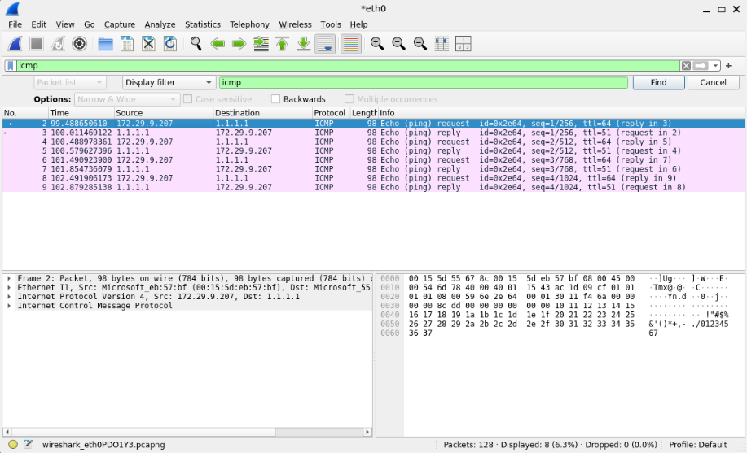

# Lab 01 — ICMP Packet Analysis

**Author:** xnsh  
**Environment:** Kali Linux (WSL2)  
**Tools:** Wireshark 4.6.6, Linux terminal  
**Status:** Completed

## 1. Objective

Understand how ICMP Echo Requests and Echo Replies work by generating network traffic and examining captured packets in Wireshark.

## 2. Lab Setup

- Operating system: Kali Linux running on WSL2
- Capture interface: `eth0`
- Source IP: `172.29.9.207`
- Destination IP: `1.1.1.1`
- Wireshark display filter: `icmp`

## 3. Command Used

```bash
ping -c 4 1.1.1.1
```

The command sends four ICMP Echo Requests to the destination address.

## 4. Observations

Wireshark displayed eight relevant ICMP packets:

- 4 Echo Requests
- 4 Echo Replies

For an Echo Request:

- Source: `172.29.9.207`
- Destination: `1.1.1.1`

For an Echo Reply:

- Source: `1.1.1.1`
- Destination: `172.29.9.207`

This shows how ICMP can be used to test whether a destination responds to Echo Requests.

## 5. Troubleshooting

Initially, I entered `icmp` into Wireshark's **Find Packet** search field instead of its display filter field.

As a result, unrelated mDNS and SSDP packets remained visible.

After applying `icmp` in the correct display filter field, only the eight relevant ICMP packets appeared.

I also configured Wireshark capture permissions by enabling non-root capture, adding my Linux user to the `wireshark` group, and restarting WSL.

## 6. What I Learned

- ICMP is used for network diagnostics and error reporting.
- `ping` uses ICMP Echo Requests and Echo Replies.
- Source and destination IP addresses reverse between these requests and their replies.
- Wireshark display filters hide unrelated packets without deleting them.
- WSL2 uses virtual networking interfaces.

## 7. Evidence

Screenshot: `01-icmp-echo-request-reply.png`



The screenshot shows the eight filtered ICMP packets, including their source and destination addresses.

## 8. Conclusion

Successfully generated, captured and analyzed ICMP traffic using Kali Linux and Wireshark.

This experiment reinforced my understanding of IP addressing, packet direction and basic network diagnostics.