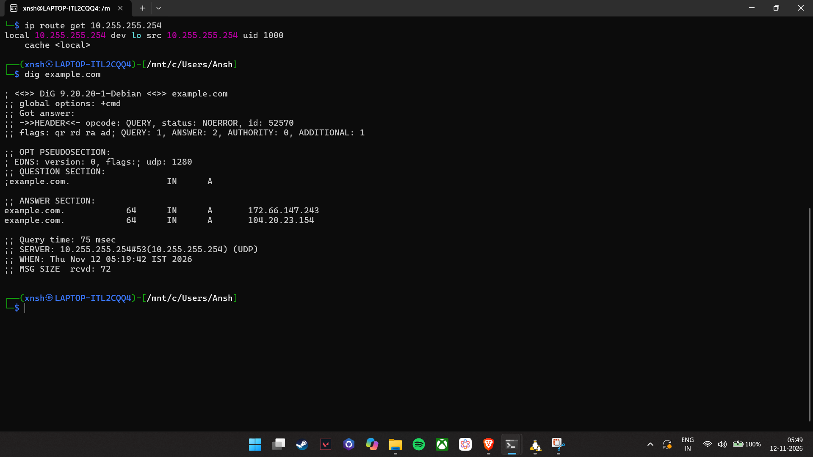
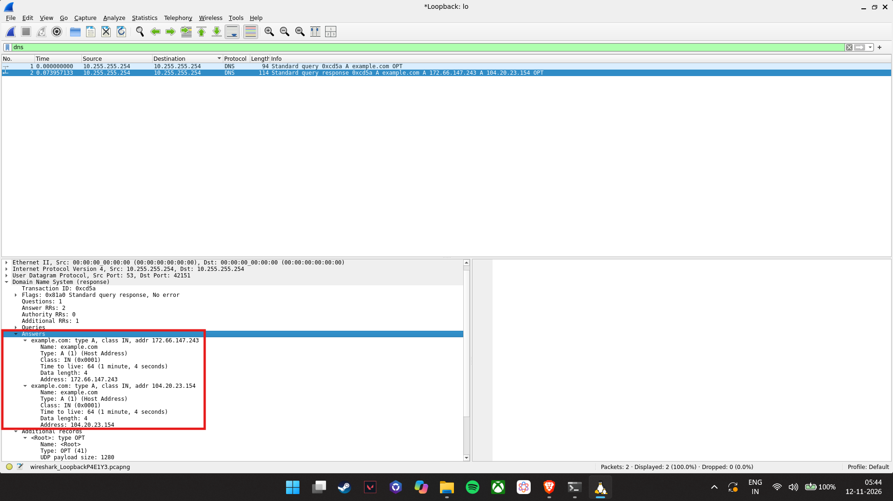

# Lab 02 — DNS Packet Analysis

**Author:** xnsh  
**Environment:** Kali Linux (WSL2)  
**Tools:** Wireshark 4.6.6, dig, Linux terminal  
**Status:** Completed

## 1. Objective

Investigate how DNS resolves domain names into IPv4 addresses by generating DNS traffic and examining queries and responses using Wireshark.

## 2. Lab Environment

- Operating system: Kali Linux on WSL2
- Initial capture interface: `eth0`
- Successful capture interface: `lo` (loopback)
- DNS resolver: `10.255.255.254`
- Test domain: `example.com`
- Transport protocol: UDP
- DNS server port: 53
- Wireshark display filter: `dns`

## 3. Commands Executed

**Generate a DNS lookup:**

```bash
dig example.com
```

**Investigate the route to the DNS resolver:**

```bash
ip route get 10.255.255.254
```

Observed routing output:

```text
local 10.255.255.254 dev lo src 10.255.255.254 uid 1000
    cache <local>
```

This indicated that Linux treated the DNS resolver address as local and routed traffic through the loopback interface.

## 4. DNS Query Analysis

The DNS query contained:

| Field | Observed Value |
|---|---|
| Domain | example.com |
| Transaction ID | 0xcd5a |
| Query type | A (IPv4 address) |
| Query class | IN |
| Questions | 1 |
| Transport | UDP |

The query requested IPv4 address records for `example.com`.

## 5. DNS Response Analysis

The DNS response used the same transaction ID, `0xcd5a`, allowing it to be associated with the original query.

**Answer records:**

| Domain | Record Type | IPv4 Address |
|---|---|---|
| example.com | A | 172.66.147.243 |
| example.com | A | 104.20.23.154 |

The response reported two answer records and no DNS error.

The response also showed a remaining DNS TTL of 64 seconds, indicating how long those records could be cached according to that TTL value.

## 6. Troubleshooting — Missing DNS Packets

Initially, Wireshark was capturing traffic on `eth0`, but no DNS packets appeared after running `dig example.com`.

The DNS lookup itself succeeded.

The terminal output identified the resolver as:

`10.255.255.254:53`

Running `ip route get 10.255.255.254` showed `dev lo`.

After switching the Wireshark capture interface from `eth0` to `lo`, the DNS query and response became visible.

**Lesson:** Choosing the correct network interface is essential when capturing packets.

## 7. Evidence

**Terminal output:**



**Wireshark capture:**



## 8. Key Learnings

- DNS translates domain names into associated resource records, including IPv4 addresses.
- A records contain IPv4 addresses.
- A domain can have multiple A records.
- Transaction IDs help associate DNS responses with their queries.
- DNS commonly uses UDP port 53.
- DNS TTL controls caching behavior and differs from the IPv4 packet TTL.
- Wireshark display filters help isolate relevant traffic.
- WSL2's network configuration can affect which interface carries observable traffic.

## 9. Conclusion

Successfully generated and analyzed a DNS query and response using Kali Linux and Wireshark.

The experiment demonstrated DNS resolution, response records, transaction IDs and DNS caching information.

Troubleshooting the capture interface also improved my understanding of Linux routing and loopback networking.