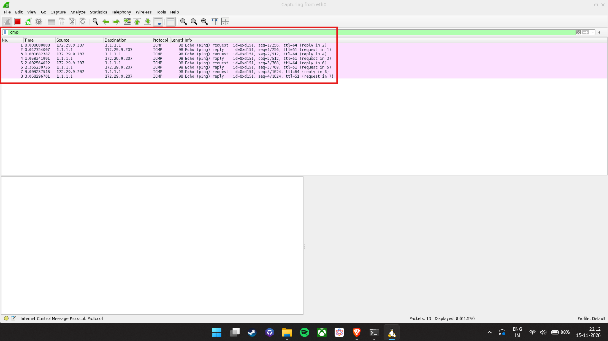
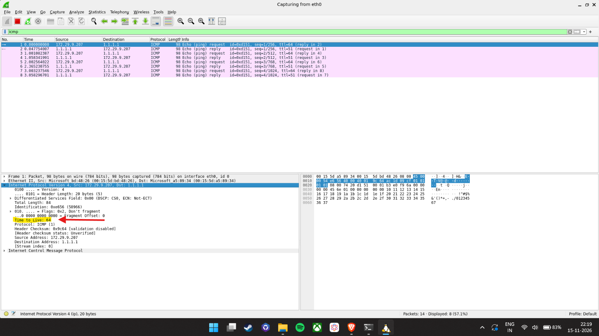
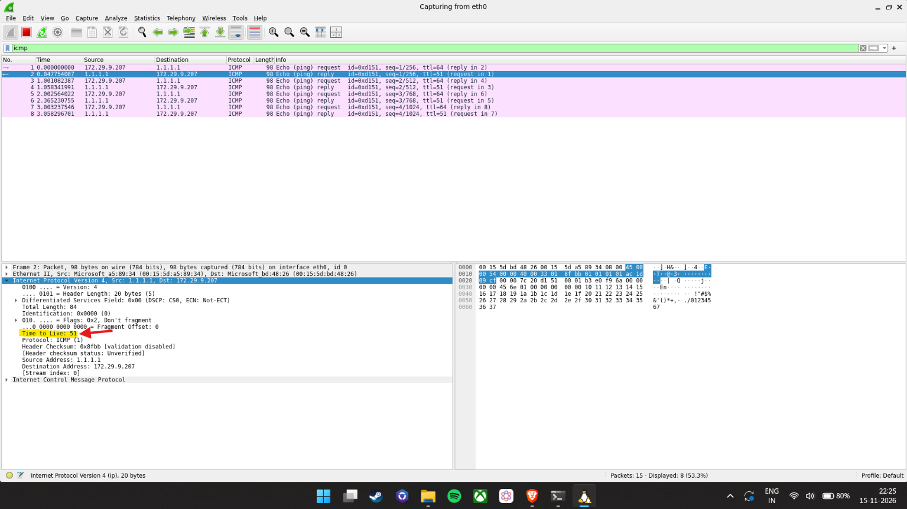
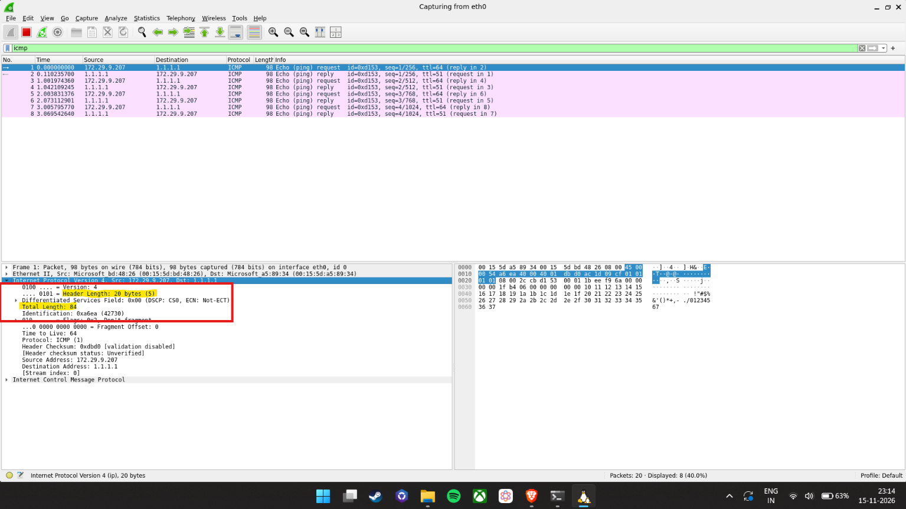
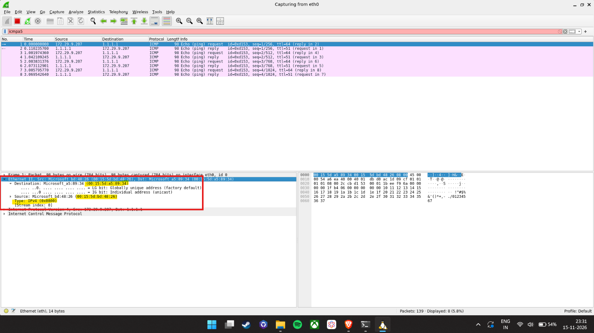

# Lab 04 — Advanced Packet Inspection with Wireshark

**Author:** xnsh  
**Date:** November 15, 2026  
**Category:** Networking & Traffic Analysis  
**Tools:** Kali Linux, Wireshark, Linux Terminal  
**Status:** Part 1 Complete — Hexadecimal Analysis Pending

---

## 1. Objective

The objective of this lab was to investigate network packets at a deeper level using Wireshark.

Unlike previous labs, which focused primarily on ICMP communication and packet structure, this investigation focused on understanding the information contained inside IPv4 and Ethernet headers.

The main objectives were to:

- Capture and identify ICMP Echo Request and Echo Reply packets.
- Investigate the Time To Live (TTL) field.
- Understand how TTL changes as packets travel through networks.
- Compare packet lengths reported by Linux and Wireshark.
- Examine the IPv4 header length and total length fields.
- Identify Ethernet source and destination MAC addresses.
- Understand the relationship between Ethernet frames, IP packets, and ICMP messages.
- Connect packet inspection concepts to practical cybersecurity investigations.

This lab was performed using traffic generated from my own Kali Linux environment.

---

## 2. Lab Environment

| Component | Configuration |
|---|---|
| Operating System | Kali Linux (WSL2) |
| Host Operating System | Windows 11 |
| Packet Analyzer | Wireshark |
| Network Interface | eth0 |
| Source IPv4 Address | 172.29.9.207 |
| Destination IPv4 Address | 1.1.1.1 |
| Protocol | ICMP over IPv4 |
| Test Command | `ping -c 4 1.1.1.1` |

### Why 1.1.1.1?

The address `1.1.1.1` belongs to Cloudflare's public DNS service.

Cloudflare is an internet infrastructure company that provides services including DNS resolution, content delivery, and network security.

For this experiment, the address was used as a publicly reachable destination for generating ICMP traffic.

The purpose was to study packet communication, not to assess or attack Cloudflare's infrastructure.

---

## 3. Methodology

### Step 1 — Generate ICMP Traffic

The following command was executed in Kali Linux:

```bash
ping -c 4 1.1.1.1
```

The `ping` utility sends ICMP Echo Request messages to a destination and waits for Echo Reply messages.

The `-c 4` option limits the test to four requests.

### Terminal Observations

The initial connectivity test produced:

```text
4 packets transmitted, 4 received, 0% packet loss

rtt min/avg/max/mdev =
51.096/60.300/70.035/8.063 ms
```

The destination responded to all four requests.

The average round-trip time was approximately 60.3 milliseconds.

Round-trip time measures the time between sending an Echo Request and receiving its corresponding Echo Reply.

### Step 2 — Capture Traffic

Wireshark was opened and the `eth0` interface was selected.

A new ping test was performed while packet capture was active.

The following display filter was applied:

```wireshark
icmp
```

The filter displays ICMP packets while hiding unrelated traffic from the packet list.

### Capture Results

The capture contained:

- Four ICMP Echo Requests.
- Four corresponding ICMP Echo Replies.
- Source and destination IPv4 addresses.
- Packet lengths.
- TTL values.
- ICMP identifiers and sequence numbers.

Eight ICMP packets were visible after filtering.

### Evidence 01 — ICMP Traffic Capture



**Observation:** The packet list shows communication between `172.29.9.207` and `1.1.1.1`, including the outgoing requests and incoming replies.

---

## 4. Time To Live (TTL) Investigation

### 4.1 What Is TTL?

Time To Live (TTL) is a field in the IPv4 header that limits how far a packet can travel through a network.

Despite its name, IPv4 TTL is effectively used as a hop limit during normal routing.

A router forwarding an IPv4 packet normally decreases its TTL by one.

If the TTL expires, the packet is discarded instead of being forwarded indefinitely.

This helps prevent packets from circulating endlessly because of routing loops.

### 4.2 Echo Request TTL

The first outgoing ICMP Echo Request was selected.

Inside the IPv4 header, Wireshark displayed:

```text
Time to Live: 64
```

The request was captured on Kali's network interface before travelling through the external network.

Therefore, the observed TTL represents the outgoing packet's TTL at the capture point.

It does not reveal the TTL remaining when the request reached its final destination.

### Evidence 02 — Echo Request TTL



**Observation:** The outgoing Echo Request has TTL 64.

### 4.3 Echo Reply TTL

The corresponding incoming Echo Reply was inspected.

Wireshark displayed:

```text
Time to Live: 51
```

Unlike the outgoing request, the reply had already travelled through the network before reaching the capture interface.

### Evidence 03 — Echo Reply TTL



**Observation:** The incoming Echo Reply arrived with TTL 51.

### 4.4 Why Are the TTL Values Different?

The Echo Request and Echo Reply are two separate IP packets.

Each packet receives its own initial TTL from its sender.

The reply does not inherit the TTL from the original request.

For example, if the reply started with TTL 64 and arrived with TTL 51:

```text
Initial TTL:    64
Observed TTL:   51
------------------
TTL decrements: 13
```

This suggests approximately 13 forwarding hops on the return path.

However, the reply's original TTL was not directly observed.

Therefore, 13 hops is an estimate based on an assumed initial TTL, not a confirmed measurement.

The number of hops taken by the outgoing request also cannot be determined from this capture alone.

### 4.5 Practical Cybersecurity Applications

TTL inspection can assist with:

- Understanding routing behavior.
- Investigating unexpected network paths.
- Analyzing packets involved in routing loops.
- Comparing network responses during troubleshooting.
- Supporting network fingerprinting investigations.

TTL values alone cannot reliably identify an operating system or prove the exact number of routers crossed.

---

## 5. IPv4 Packet Length Analysis

### 5.1 The Length Difference

During the investigation, the Linux terminal and Wireshark displayed different packet sizes.

The terminal showed:

```text
56(84) bytes of data
```

Wireshark displayed:

```text
Frame Length: 98 bytes
IPv4 Total Length: 84
```

These values describe different portions of the network communication.

The difference is explained by encapsulation.

### 5.2 What Is Encapsulation?

Encapsulation is the process of adding protocol information around data as it moves through the networking layers.

For this ICMP Echo Request, the structure was:

```text
Ethernet Frame — 98 bytes
|
+-- Ethernet Header — 14 bytes
|
+-- IPv4 Packet — 84 bytes
    |
    +-- IPv4 Header — 20 bytes
    |
    +-- ICMP Message — 64 bytes
        |
        +-- ICMP Header — 8 bytes
        |
        +-- ICMP Data — 56 bytes
```

The total captured frame size was:

```text
14 + 20 + 8 + 56 = 98 bytes
```

The IPv4 packet size was:

```text
20 + 8 + 56 = 84 bytes
```

The ICMP message size was:

```text
8 + 56 = 64 bytes
```

The additional 14 bytes in Wireshark came from the Ethernet header.

### 5.3 IPv4 Header Length

The IPv4 header displayed:

```text
Header Length: 20 bytes (5)
```

The value `5` represents five 32-bit words.

Each word contains four bytes.

Therefore:

```text
5 × 4 = 20 bytes
```

This is the standard IPv4 header length when no IP options are present.

The header contains fields such as:

- Source IPv4 address.
- Destination IPv4 address.
- TTL.
- Protocol identifier.
- Total packet length.
- Fragmentation information.
- Header checksum.

### 5.4 IPv4 Total Length

Wireshark displayed:

```text
Total Length: 84
```

This includes the IPv4 header and its contents.

It does not include the Ethernet header.

### Evidence 04 — IPv4 Header Length



**Observation:** The IPv4 header length was 20 bytes, and the IPv4 total length was 84 bytes.

### 5.5 Practical Cybersecurity Applications

Understanding packet sizes is useful when:

- Investigating packet fragmentation.
- Troubleshooting Maximum Transmission Unit (MTU) problems.
- Analyzing unexpected packet sizes.
- Understanding protocol overhead.
- Inspecting malformed or unusual network packets.

MTU refers to the maximum size of a network-layer packet that can be carried over a link without requiring fragmentation at that link.

Packet length analysis provides a foundation for more advanced network troubleshooting and packet crafting.

---

## 6. Ethernet Header Investigation

### 6.1 What Is Ethernet?

Ethernet is a networking technology used to transmit frames over local network links.

An Ethernet frame contains information used for delivery on the current link.

Unlike IP addresses, which support communication across networks, Ethernet MAC addresses identify interfaces involved in local-link communication.

### 6.2 Ethernet Header Structure

The standard Ethernet II header is 14 bytes.

| Field | Size | Purpose |
|---|---|---|
| Destination MAC | 6 bytes | Identifies the intended receiver on the local link |
| Source MAC | 6 bytes | Identifies the sender on the local link |
| EtherType | 2 bytes | Identifies the protocol carried inside the frame |

### 6.3 Observed MAC Addresses

The outgoing ICMP Echo Request contained:

```text
Destination MAC: 00:15:5d:a5:89:34

Source MAC:      00:15:5d:bd:48:26
```

Because Kali was running inside WSL2, these addresses were observed in a virtual networking environment.

The source MAC identifies the interface transmitting the captured Ethernet frame.

The destination MAC identifies the intended receiver on the local virtual link, likely the virtual gateway.

The destination MAC is not the MAC address of Cloudflare's remote server.

### 6.4 MAC Address vs IP Address

MAC and IP addresses serve different purposes.

**MAC address:**

Used for delivery on the current local Ethernet link.

**IP address:**

Used to identify network-layer endpoints and route packets across interconnected networks.

For the captured request:

```text
Source IP:       172.29.9.207
Destination IP:  1.1.1.1
```

The destination IP identifies the final network-layer destination.

The destination Ethernet MAC identifies the next receiver on the local link.

When a router forwards an IP packet over another Ethernet link, it normally creates a new Ethernet header appropriate for that link.

### 6.5 EtherType

Wireshark displayed:

```text
Type: IPv4 (0x0800)
```

The EtherType field tells the receiver which protocol is contained in the Ethernet payload.

`0x0800` is the hexadecimal identifier for IPv4.

Hexadecimal is a base-16 number system commonly used to represent binary values in networking and computer systems.

Other common EtherType values include:

| EtherType | Protocol |
|---|---|
| `0x0800` | IPv4 |
| `0x0806` | ARP |
| `0x86DD` | IPv6 |

ARP, or Address Resolution Protocol, is used to discover the MAC address associated with an IPv4 address on a local network.

### Evidence 05 — Ethernet Header



**Observation:** The Ethernet II header contained the expected source MAC, destination MAC, and IPv4 EtherType.

### 6.6 Practical Cybersecurity Applications

Ethernet header analysis is useful for:

- Investigating local network communication.
- Understanding how packets reach their next hop.
- Examining unexpected MAC address changes.
- Supporting ARP spoofing investigations.
- Analyzing traffic redirection on local networks.

ARP spoofing occurs when a device sends misleading ARP information to associate an IP address with an incorrect MAC address.

Understanding normal IP-to-MAC relationships is necessary before investigating such behavior.

---

## 7. Summary of Findings

| Field | Observed Value |
|---|---|
| Source IP | 172.29.9.207 |
| Destination IP | 1.1.1.1 |
| Protocol | ICMP |
| Echo Requests | 4 |
| Echo Replies | 4 |
| Request TTL | 64 |
| Reply TTL | 51 |
| Ethernet Frame Length | 98 bytes |
| IPv4 Total Length | 84 bytes |
| IPv4 Header Length | 20 bytes |
| ICMP Header Length | 8 bytes |
| ICMP Payload Length | 56 bytes |
| Ethernet Header Length | 14 bytes |
| Destination MAC | 00:15:5d:a5:89:34 |
| Source MAC | 00:15:5d:bd:48:26 |
| EtherType | IPv4 (0x0800) |

---

## 8. Key Learnings

This investigation improved my understanding of how packet information is structured and interpreted.

The most important takeaways were:

1. Outgoing and incoming packets have independent TTL values.
2. A captured outgoing TTL does not reveal the packet's TTL at the remote destination.
3. An incoming TTL can support hop-count estimates, but the initial TTL must be considered.
4. The Ethernet frame length includes the Ethernet header.
5. The IPv4 total length excludes the Ethernet header.
6. IPv4 header length is measured in four-byte units.
7. Ethernet MAC addresses and IPv4 addresses serve different networking purposes.
8. EtherType identifies the protocol carried inside an Ethernet frame.
9. Wireshark allows individual protocol fields to be examined rather than treating packets as a single block of data.

---

## 9. Next Investigation

The next part of Lab 04 will focus on the Packet Bytes panel.

Planned topics:

- Understanding hexadecimal representation.
- Reading byte offsets.
- Comparing hexadecimal values with decoded protocol fields.
- Identifying Ethernet, IPv4, and ICMP bytes.
- Understanding the relationship between raw packet bytes and Wireshark's protocol interpretation.

These topics will be documented after completing the practical investigation.

---

## 10. Conclusion

Lab 04 Part 1 focused on inspecting real ICMP traffic beyond basic request-and-reply communication.

By examining TTL values, packet lengths, IPv4 headers, and Ethernet information, I developed a clearer understanding of how data is represented at different networking layers.

The investigation also demonstrated why understanding packet structure is important for troubleshooting and cybersecurity analysis.

The next stage will extend this work by examining raw hexadecimal packet data and connecting individual bytes to their corresponding protocol fields.

---

**Lab Status:** Part 1 Complete  
**Documentation:** xnsh Cybersecurity Learning Journal  
**Author:** xnsh
