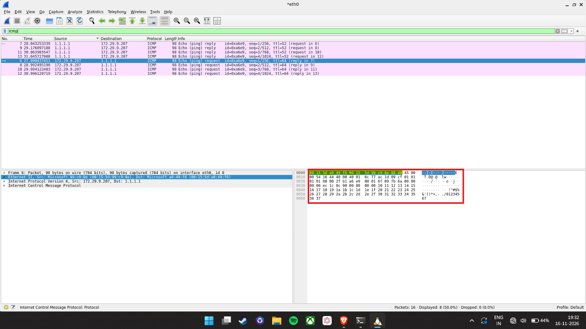
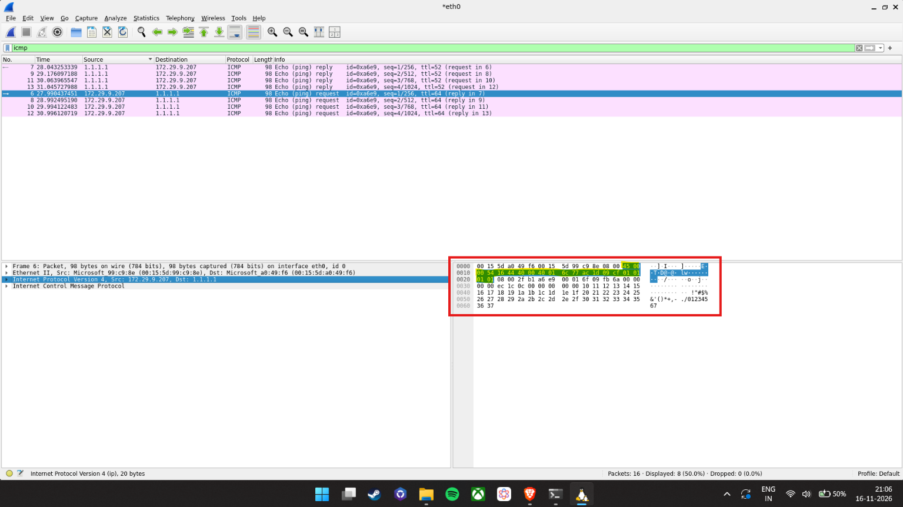
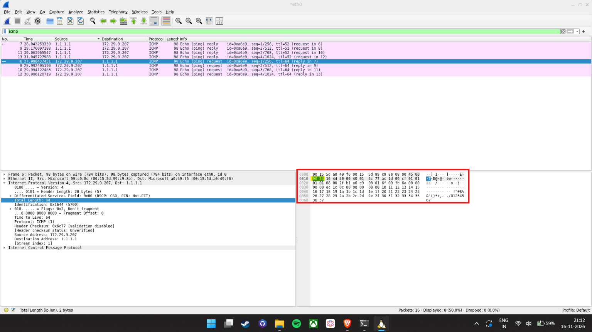
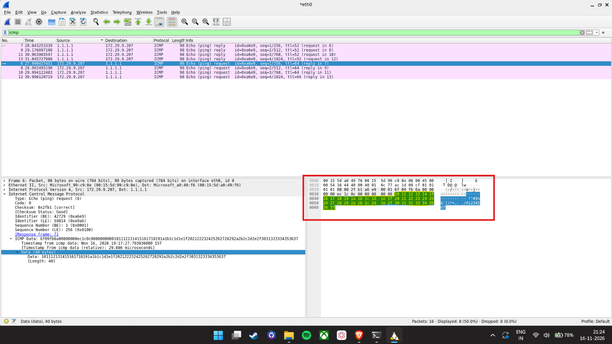

# Lab 04.2 — Hexadecimal Packet Analysis

**Author:** xnsh  
**Environment:** Kali Linux (WSL2)  
**Tools:** Wireshark, Linux terminal  
**Status:** Completed

## 1. Objective

Understand how network packets are represented in hexadecimal and how Wireshark translates raw bytes into readable protocol information.

This lab continues Lab 04.1 by examining Ethernet, IPv4, and ICMP at the byte level.

The investigation focused on:

- Understanding bits, bytes, binary, and hexadecimal.
- Inspecting Ethernet and IPv4 headers in hexadecimal.
- Decoding IPv4 header length and total length.
- Examining ICMP control fields and payload data.
- Understanding how raw packet inspection supports cybersecurity investigations.

## 2. Lab Environment

| Component | Configuration |
|---|---|
| Operating System | Kali Linux (WSL2) |
| Packet Analyzer | Wireshark |
| Capture Interface | `eth0` |
| Source IP | `172.29.9.207` |
| Destination IP | `1.1.1.1` |
| Protocol | ICMP over IPv4 |
| Display Filter | `icmp` |
| Captured Frame Length | 98 bytes |

All traffic was generated using my own Kali Linux environment.

## 3. Background and Concepts

### 3.1 Binary and Hexadecimal

Binary is a base-2 number system consisting of `0` and `1`. Each binary digit is called a bit.

Hexadecimal is a base-16 number system using digits `0–9` and letters `A–F`.

Hexadecimal makes binary data easier to read.

| Representation | Size |
|---|---|
| 1 binary digit | 1 bit |
| 4 bits | 1 hexadecimal digit |
| 8 bits | 1 byte |
| 2 hexadecimal digits | 1 byte |

For example:

```text
Binary:       01000101
Hexadecimal:  45
Decimal:      69
```

These represent the same numerical value.

A sequence such as `45 00 00 54` contains four bytes because each pair of hexadecimal digits represents one byte.

### 3.2 Wireshark Packet Bytes Panel

Wireshark provides three main inspection panels:

- **Packet List:** Displays captured packets.
- **Packet Details:** Displays decoded protocol fields.
- **Packet Bytes:** Displays raw packet data in hexadecimal and ASCII.

ASCII represents characters using numerical values. Not all packet bytes correspond to readable characters.

Selecting a field in Packet Details highlights its corresponding bytes in the Packet Bytes panel.

This helps connect protocol information to the actual captured data.

## 4. Methodology

### Step 1 — Generate Traffic

The following command generated ICMP traffic:

```bash
ping -c 4 1.1.1.1
```

### Step 2 — Capture and Filter

Wireshark captured traffic on `eth0`.

After stopping the capture, the display filter was applied:

```text
icmp
```

An outgoing ICMP Echo Request was selected.

### Step 3 — Inspect Raw Bytes

The Ethernet II, Internet Protocol Version 4, and Internet Control Message Protocol sections were selected individually.

Wireshark highlighted the corresponding hexadecimal bytes for each protocol.

## 5. Observations and Analysis

### 5.1 Ethernet Header in Hexadecimal

The selected Ethernet II header contained:

```text
00 15 5d a0 49 f6 00 15 5d 99 c9 8e 08 00
```

The header occupied 14 bytes.

| Field | Hexadecimal Value | Size |
|---|---|---|
| Destination MAC | `00 15 5d a0 49 f6` | 6 bytes |
| Source MAC | `00 15 5d 99 c9 8e` | 6 bytes |
| EtherType | `08 00` | 2 bytes |

The EtherType value `0x0800` identifies IPv4.

The MAC addresses belonged to the local virtual networking environment used by WSL2.

**Finding:** Ethernet headers provide local-link addressing information, and their fields can be identified directly from hexadecimal bytes.

### 5.2 IPv4 Header Analysis

Selecting the IPv4 heading highlighted 20 bytes immediately after the Ethernet header.

The first IPv4 byte was:

```text
45
```

Its binary representation is:

```text
0100 0101
```

The first four bits (`0100`) represent IPv4 version 4.

The next four bits (`0101`) represent an Internet Header Length (IHL) of 5.

IPv4 header length is measured in four-byte units:

```text
5 × 4 = 20 bytes
```

**Finding:** A single byte can contain multiple protocol fields. Understanding binary helps interpret these fields correctly.

### 5.3 IPv4 Total Length

The IPv4 Total Length field contained:

```text
00 54
```

This is hexadecimal `0x0054`.

Converting to decimal:

```text
(5 × 16) + 4 = 84 bytes
```

The observed packet structure was:

| Component | Size |
|---|---|
| Ethernet Header | 14 bytes |
| IPv4 Header | 20 bytes |
| ICMP Header | 8 bytes |
| ICMP Payload | 56 bytes |
| Total Ethernet Frame | 98 bytes |

The IPv4 Total Length was 84 bytes because it included the IPv4 header and ICMP message, but excluded the Ethernet header.

**Finding:** Hexadecimal inspection confirmed the packet lengths previously observed in Lab 04.1.

### 5.4 ICMP Header Analysis

The outgoing ICMP packet contained:

| Field | Observed Value |
|---|---|
| Type | 8 — Echo Request |
| Code | 0 |
| Checksum | Correct |
| Identifier | 42729 |
| Sequence Number | 1 |

The ICMP Type field was represented by hexadecimal `08`.

A standard ICMP Echo Request header occupies 8 bytes and contains Type, Code, Checksum, Identifier, and Sequence Number fields.

**Finding:** ICMP control information can be identified from individual bytes, allowing analysts to distinguish message types and associate requests with replies.

### 5.5 ICMP Payload Investigation

The captured ICMP message contained 56 bytes of payload.

However, Wireshark displayed:

```text
Data (40 bytes)
```

Further inspection showed that Wireshark had separately interpreted 16 bytes of timestamp-related information.

```text
Timestamp-related portion: 16 bytes
Remaining data:            40 bytes
-----------------------------------
Total ICMP payload:        56 bytes
```

Linux ping commonly includes timestamp information to help measure round-trip time.

Wireshark displayed the remaining 40 bytes separately and highlighted them in the Packet Bytes panel.

**Finding:** A decoded Data field may represent only part of the complete payload. Analysts must examine the full protocol structure before concluding that bytes are missing.

## 6. Evidence

### Ethernet Header in Hexadecimal



The screenshot shows the 14-byte Ethernet header highlighted in the Packet Bytes panel.

### IPv4 Header in Hexadecimal



The screenshot shows the 20-byte IPv4 header, beginning with `45`.

### IPv4 Total Length



The screenshot highlights `00 54`, representing 84 bytes in decimal.

### ICMP Header and Payload



The screenshot shows the expanded ICMP fields and the highlighted 40-byte remaining Data field.

## 7. Key Learnings

- Binary uses individual bits, while hexadecimal represents groups of four bits.
- Two hexadecimal digits represent one byte.
- Wireshark's Packet Bytes panel displays the raw bytes of captured traffic.
- The Ethernet II header occupied 14 bytes in this capture.
- The first IPv4 byte, `45`, represented the protocol version and header length.
- Hexadecimal `00 54` represented an IPv4 Total Length of 84 bytes.
- ICMP Echo Request uses Type 8 and Code 0.
- The ICMP payload contained 56 bytes, including timestamp-related information.
- Wireshark may display interpreted payload sections separately.
- Inspecting raw bytes helps validate protocol fields and investigate unusual network traffic.

## 8. Conclusion

Successfully examined the hexadecimal representation of Ethernet, IPv4, and ICMP packets using Wireshark.

The investigation reinforced my understanding of binary and hexadecimal, packet headers, protocol encapsulation, and ICMP payload structure.

This lab provides a foundation for future network troubleshooting, packet forensics, and security traffic analysis.

**Next Lab:** TCP Three-Way Handshake Analysis.
