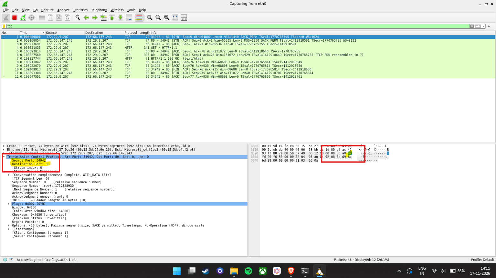
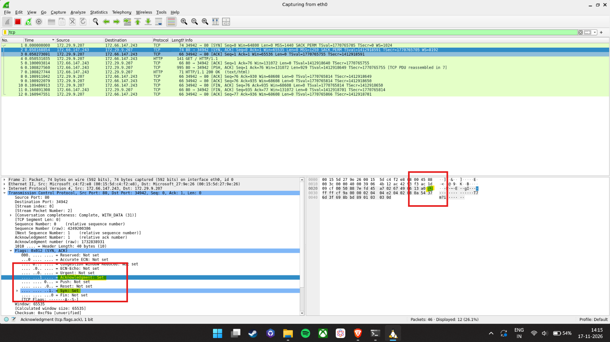
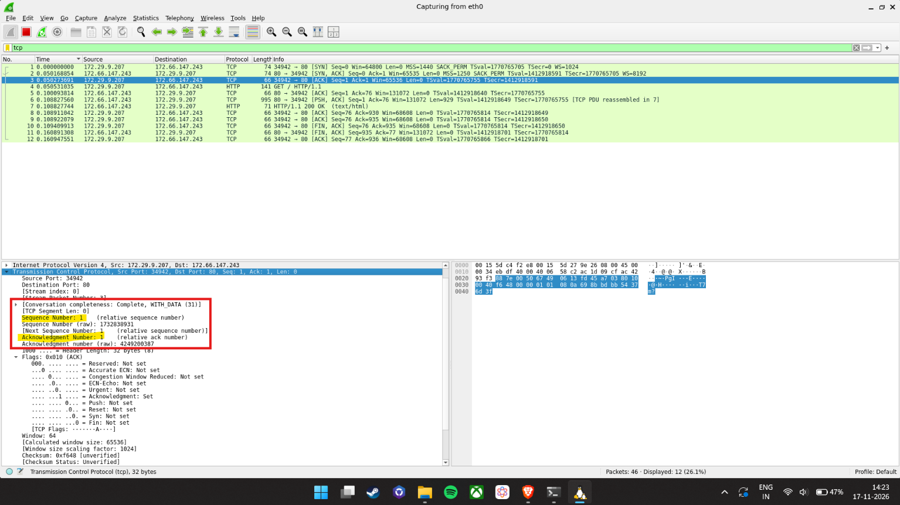
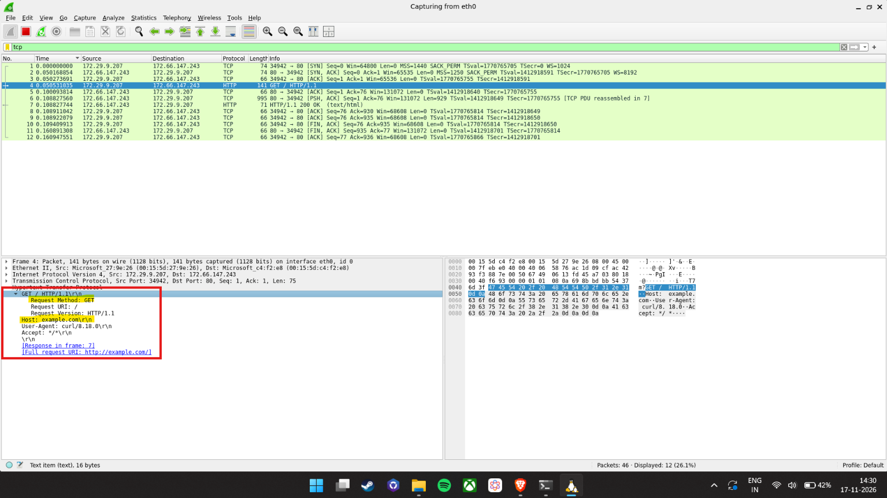
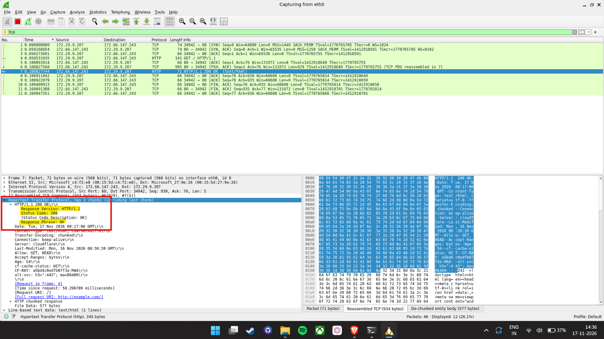
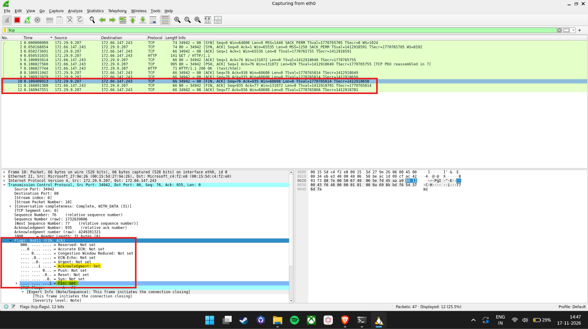

# Lab 05 — TCP Three-Way Handshake & HTTP Traffic Analysis

**Author:** xnsh  
**Date:** 17 November 2026  
**Category:** Networking & Traffic Analysis  
**Tools:** Kali Linux (WSL2), Wireshark, Linux Terminal  
**Status:** Completed

---

## 1. Objective

The objective of this lab was to capture and analyze a complete TCP connection using Wireshark.

The investigation focused on understanding how TCP establishes connections, how HTTP requests and responses travel through them, and how connections terminate gracefully.

We also examined TCP ports, flags, sequence numbers, acknowledgment numbers, and HTTP status codes.

## 2. Lab Environment

| Component | Details |
|---|---|
| Operating System | Kali Linux (WSL2) |
| Host System | Windows 11 |
| Packet Analyzer | Wireshark |
| Capture Interface | eth0 |
| Client IP | 172.29.9.207 |
| Server IP | 172.66.147.243 |
| Source Port | 34942 |
| Destination Port | 80 |
| Protocols | TCP, HTTP |
| Display Filter | `tcp` |

## 3. Concepts Covered

**TCP (Transmission Control Protocol)**

A transport-layer protocol that provides reliable, ordered communication between applications.

**Three-Way Handshake**

TCP establishes a connection through three steps:

1. SYN — The client requests a connection.
2. SYN-ACK — The server acknowledges the request and sends its own SYN.
3. ACK — The client acknowledges the server, completing the handshake.

**TCP Ports**

Ports identify application endpoints. In this lab, Kali used temporary source port `34942`, while the HTTP server listened on port `80`.

**Sequence Numbers**

Sequence numbers track positions in the TCP byte stream, helping TCP maintain ordered communication.

**Acknowledgment Numbers**

Acknowledgment numbers indicate the next sequence number expected from the other endpoint.

**HTTP (Hypertext Transfer Protocol)**

An application-layer protocol used for communication between web clients and servers.

**FIN (Finish)**

A TCP flag indicating that a device has finished sending data and wants to close its sending side of the connection.

## 4. Methodology

### Step 1 — Capturing TCP Traffic

Started Wireshark and selected the `eth0` interface.

Generated HTTP traffic using the Kali terminal:

```bash
curl -4 -v --http1.1 http://example.com/
```

Command explanation:

- `curl` — Sends a request to a web server.
- `-4` — Forces IPv4 communication.
- `-v` — Displays detailed connection information.
- `--http1.1` — Requests HTTP/1.1.
- `http://example.com/` — Target website.

Stopped the capture and applied the display filter:

```text
tcp
```

The captured packets showed the TCP handshake, HTTP communication, and connection termination.

### Step 2 — TCP Source and Destination Ports

Selected packet No. 1, containing the initial SYN request.

Observed:

| Field | Value |
|---|---|
| Source IP | 172.29.9.207 |
| Destination IP | 172.66.147.243 |
| Source Port | 34942 |
| Destination Port | 80 |

The source port was an ephemeral port assigned to the client connection.

The destination port `80` identified the HTTP service.

When the server responded, the source and destination ports were reversed.

**Evidence: TCP Source and Destination Ports**



### Step 3 — TCP Three-Way Handshake

Inspected the first three TCP packets.

| Packet | Direction | Flags | Hex Value |
|---|---|---|---|
| 1 | Kali → Server | SYN | 0x02 |
| 2 | Server → Kali | SYN, ACK | 0x12 |
| 3 | Kali → Server | ACK | 0x10 |

**Packet 1 — SYN**

Kali initiated the TCP connection by sending a SYN packet.

The SYN flag tells the server that the client wants to establish communication.

**Packet 2 — SYN-ACK**

The server responded with both SYN and ACK flags set.

- SYN indicated that the server was synchronizing its own sequence numbers.
- ACK acknowledged the client's SYN request.

The combined hexadecimal flag value was `0x12`.

**Evidence: TCP SYN-ACK Flags**



**Packet 3 — ACK**

Kali sent the final acknowledgment, completing the handshake.

Observed relative values:

| Field | Value |
|---|---|
| Sequence Number | 1 |
| Acknowledgment Number | 1 |
| ACK Flag | Set |

The SYN packets each consumed one sequence number.

Wireshark displayed relative sequence numbers, making the connection easier to analyze.

**Evidence: TCP Sequence and Acknowledgment Numbers**



### Step 4 — HTTP GET Request

After the TCP connection was established, Kali sent an HTTP request.

Selected packet No. 4.

Observed:

```http
GET / HTTP/1.1
Host: example.com
```

Explanation:

- `GET` — Requests a resource from the server.
- `/` — Represents the website's root path.
- `HTTP/1.1` — Specifies the HTTP protocol version.
- `Host: example.com` — Identifies the requested website.

This showed how HTTP application data is transmitted after the TCP handshake.

**Evidence: HTTP GET Request**



### Step 5 — HTTP Response Analysis

Selected packet No. 7 to inspect the server's response.

Observed:

| Field | Value |
|---|---|
| Response Version | HTTP/1.1 |
| Status Code | 200 |
| Response Phrase | OK |
| Content Type | text/html |
| Server Header | cloudflare |

The response contained:

```http
HTTP/1.1 200 OK
```

**HTTP 200 OK** indicates that the server successfully handled the HTTP request.

A successful TCP handshake does not necessarily mean that an HTTP request will succeed. The HTTP response status provides additional information about the application's response.

Wireshark also showed that the HTTP response was reassembled from TCP segments.

**Evidence: HTTP 200 OK Response**



### Step 6 — TCP Connection Termination

Finally, inspected packets No. 10, 11, and 12.

| Packet | Direction | Flags |
|---|---|---|
| 10 | Kali → Server | FIN, ACK |
| 11 | Server → Kali | FIN, ACK |
| 12 | Kali → Server | ACK |

**Packet 10 — FIN-ACK**

Kali initiated graceful connection closure.

The FIN flag indicated that Kali had finished sending data.

**Packet 11 — FIN-ACK**

The server acknowledged Kali's FIN and indicated that it had finished sending data.

**Packet 12 — ACK**

Kali acknowledged the server's FIN, completing the observed closing exchange.

The FIN-ACK hexadecimal flag value was `0x11`.

Wireshark identified packet No. 10 as initiating the connection closure.

**Evidence: TCP Connection Termination**



## 5. Observations

The capture demonstrated the complete lifecycle of a TCP connection.

- Kali initiated communication using a temporary source port.
- The server accepted the connection through the TCP three-way handshake.
- TCP sequence and acknowledgment numbers confirmed the handshake progression.
- Kali sent an HTTP GET request after establishing the connection.
- The server returned HTTP `200 OK`.
- The HTTP response contained HTML content.
- TCP FIN and ACK flags were used for graceful connection termination.
- Wireshark displayed both decoded protocol fields and hexadecimal packet data.

## 6. Troubleshooting and Notes

**HTTP packets appearing with the TCP filter**

Although the `tcp` display filter was applied, some packets appeared as HTTP.

This happened because Wireshark recognized the HTTP application data carried inside TCP segments.

**Relative sequence numbers**

Wireshark displayed relative sequence numbers instead of the original raw TCP sequence numbers.

This made the handshake easier to follow.

**Evidence collection**

Screenshots were collected for the important stages of communication, including the handshake, HTTP exchange, and connection closure.

## 7. Real-World Cybersecurity Applications

**Network Troubleshooting**

TCP flags and acknowledgment numbers help identify failed connections, unexpected resets, and retransmissions.

**Port Scanning**

Understanding SYN and SYN-ACK packets helps explain how authorized TCP SYN scans work in Nmap.

**Web Application Security**

HTTP methods, headers, and response codes are important when analyzing web applications using tools such as Burp Suite.

**Network Traffic Investigation**

Wireshark allows security analysts to reconstruct communication sequences and investigate unusual network activity.

## 8. Key Learnings

Through this lab, I learned:

1. How TCP establishes a connection using SYN, SYN-ACK, and ACK.
2. How source and destination ports identify communication endpoints.
3. How TCP sequence and acknowledgment numbers work.
4. How HTTP requests and responses travel over TCP.
5. How to identify a successful HTTP response using status code `200`.
6. How TCP gracefully closes connections using FIN and ACK.
7. How to inspect TCP flags and hexadecimal packet data in Wireshark.
8. How to document network communication using packet-level evidence.

## 9. Conclusion

Successfully captured and analyzed a complete TCP connection using Kali Linux and Wireshark.

The investigation followed the communication from the initial TCP SYN packet through the HTTP GET request, successful HTTP response, and graceful connection termination.

This lab strengthened my understanding of TCP communication and provided practical experience relevant to network troubleshooting, web application security, and packet analysis.

**Lab Status:** Completed  
**Evidence Collected:** 6 screenshots  
**Next Focus:** TCP retransmissions, resets, and connection troubleshooting.
