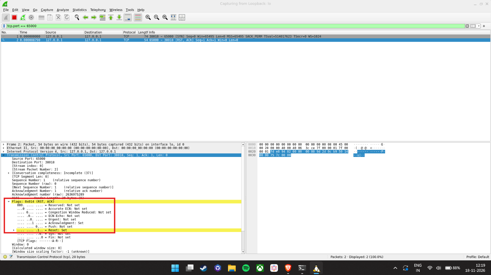
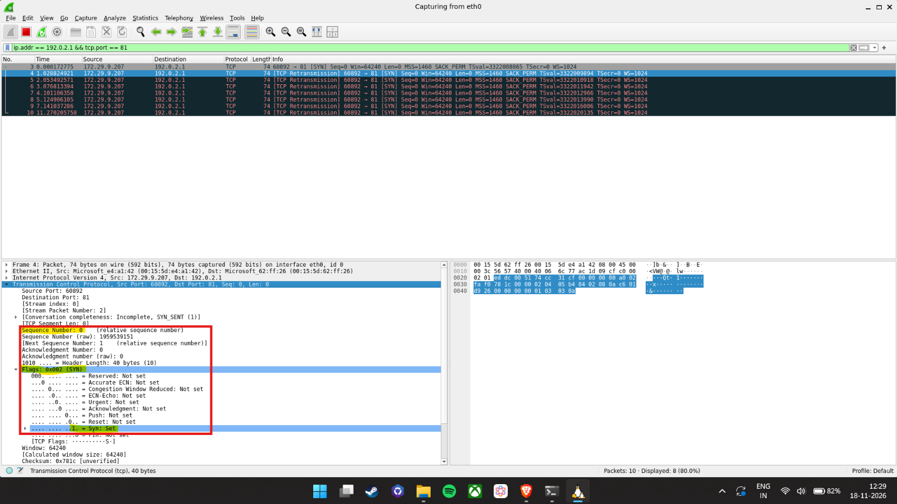
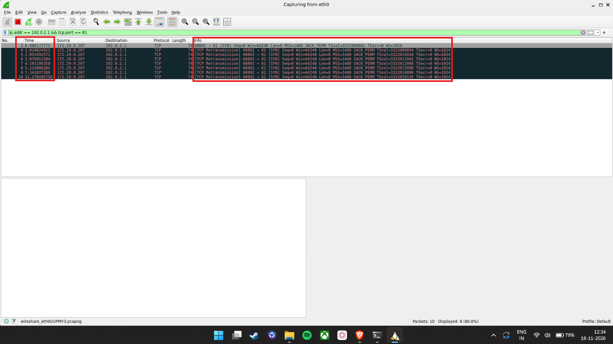

# Lab 06 — TCP Retransmissions, Resets & Connection Troubleshooting

**Author:** xnsh  
**Date:** 18 November 2026  
**Category:** Networking & Traffic Analysis  
**Tools:** Kali Linux (WSL2), Wireshark, Linux Terminal, curl  
**Status:** Completed

---

## 1. Objective

The objective of this lab was to investigate how TCP behaves when a connection cannot be established successfully.

In Lab 05, I studied the normal TCP three-way handshake, HTTP communication, sequence numbers, acknowledgments, and graceful connection termination.

In this lab, I wanted to understand what happens when TCP communication fails.

The main objectives were:

- Capture and analyze a TCP connection reset (RST).
- Understand why a closed TCP port rejects a connection.
- Generate and observe TCP SYN retransmissions.
- Examine retransmission timing and TCP backoff.
- Understand the difference between a connection timeout and a connection refusal.
- Learn how these behaviors help cybersecurity professionals identify network connectivity problems.
- Relate TCP packet analysis to Nmap port states such as `closed` and `filtered`.

All experiments were performed using my own Kali Linux environment and controlled test connections.

---

## 2. Lab Environment

**Operating System:** Kali Linux running through WSL2 on Windows 11  
**Packet Analyzer:** Wireshark  
**Command-Line Tool:** curl  
**Network Interfaces:** `lo` (loopback) and `eth0`

### Network Details

| Parameter | Value |
|---|---|
| Kali IPv4 address | 172.29.9.207 |
| Loopback address | 127.0.0.1 |
| Closed-port test destination | 127.0.0.1:65000 |
| Timeout test destination | 192.0.2.1:81 |
| TCP reset test source port | 38018 |
| TCP retransmission test source port | 60892 |
| Capture interfaces | lo and eth0 |

The address `127.0.0.1` refers to the local machine.

The address `192.0.2.1` belongs to an IPv4 range reserved for documentation and examples. It was used here as a test destination that did not respond to our connection attempts.

The absence of a response does not establish the exact reason why the connection failed.

---

## 3. Concepts Covered

### 3.1 TCP Connection Establishment

TCP is a connection-oriented transport-layer protocol.

Before normal application data can be exchanged, TCP generally establishes a connection using the three-way handshake:

1. **SYN:** The client requests a connection.
2. **SYN, ACK:** The server acknowledges the request and responds with its own SYN.
3. **ACK:** The client acknowledges the server's response.

After this exchange, the connection enters the established state.

However, not every connection attempt succeeds.

This lab focuses on two important failure behaviors: connection resets and connection timeouts.

### 3.2 TCP RST (Reset)

RST stands for Reset.

The TCP RST flag is used to reject or abruptly terminate a TCP connection.

For example, when a client attempts to connect to a TCP port where no application is listening, the destination operating system can respond with an RST.

This is different from the FIN flag studied in Lab 05.

- **FIN:** Used during an orderly TCP connection shutdown.
- **RST:** Used to reject or abort a TCP connection.

A reset can happen during connection establishment or during an existing connection.

### 3.3 TCP SYN Retransmission

TCP uses acknowledgments and retransmissions to support reliable communication.

When a client sends a SYN but does not receive the expected response, its TCP implementation may retransmit the SYN.

The retransmitted SYN belongs to the same connection attempt and normally uses the same initial sequence number.

Repeated SYN packets can indicate that a connection is not progressing.

Possible causes include:

- Packet loss.
- Network filtering.
- An unreachable destination.
- Routing or connectivity problems.
- A destination that is not responding.

A retransmission does not prove which of these conditions is responsible.

### 3.4 TCP Retransmission Backoff

TCP does not necessarily retransmit packets at a constant interval forever.

Retransmission timers can increase after unsuccessful attempts.

This behavior helps avoid excessive repeated traffic when the network or destination is not responding.

The exact timing depends on the operating system, TCP implementation, and connection state.

### 3.5 Connection Refused vs. Connection Timed Out

These two errors represent different observable behaviors.

**Connection refused:**

A TCP connection attempt is explicitly rejected, commonly by an RST response.

**Connection timed out:**

The connection attempt does not complete within the allowed time.

A timeout does not automatically mean the destination port is closed.

It may result from dropped packets, filtering, routing issues, or other connectivity failures.

### 3.6 Nmap Port States

Nmap uses network responses to help determine the state of TCP ports.

During a TCP SYN scan:

- **Open:** A SYN-ACK response generally indicates an open port.
- **Closed:** An RST response generally indicates a closed port.
- **Filtered:** No conclusive response, or certain filtering-related ICMP errors, can indicate that filtering prevents the port state from being determined.

A filtered port is not necessarily closed.

---

## 4. Methodology

### Step 1 — Generating a TCP Connection Reset

I started Wireshark and selected the `lo` loopback interface.

This interface was necessary because the destination address was `127.0.0.1`, which represents the local machine.

In the Kali terminal, I executed:

```bash
curl -4 -v --connect-timeout 5 http://127.0.0.1:65000/
```

Command explanation:

- `curl` attempts to communicate with the specified destination.
- `-4` forces IPv4.
- `-v` enables verbose connection information.
- `--connect-timeout 5` limits the time allowed for connection establishment.
- `127.0.0.1` is the loopback address.
- `65000` is the destination TCP port.

The terminal returned:

```text
Trying 127.0.0.1:65000...
connect to 127.0.0.1 port 65000 from 127.0.0.1 port 38018 failed: Connection refused
curl: (7) Failed to connect to 127.0.0.1 port 65000
```

This indicated that the connection was rejected.

To inspect the traffic, I applied the Wireshark display filter:

```text
tcp.port == 65000
```

Wireshark displayed two TCP packets:

| Packet | Source Port | Destination Port | Flags |
|---|---|---|---|
| 1 | 38018 | 65000 | SYN |
| 2 | 65000 | 38018 | RST, ACK |

The first packet represented the connection attempt.

The second packet represented the rejection.

No successful three-way handshake occurred.

### Step 2 — Inspecting TCP RST and ACK Flags

I selected the second packet and expanded:

**Transmission Control Protocol → Flags**

The packet details showed:

```text
Flags: 0x014 (RST, ACK)
Reset: Set
Acknowledgment: Set
Sequence Number: 1 (relative)
Acknowledgment Number: 1 (relative)
```

The RST flag confirmed that the connection attempt was rejected.

The ACK flag acknowledged the client's SYN.

This demonstrated that the destination TCP stack had actively responded rather than remaining silent.

#### Evidence 01 — TCP RST and ACK Flags



**Observation:**

The destination port `65000` returned a TCP RST-ACK packet to the client source port `38018`.

**What I learned:**

A failed connection does not always mean that the destination is unreachable.

Sometimes the destination is reachable but explicitly rejects the connection because the requested service is not listening.

This distinction is important when troubleshooting TCP services and interpreting port scan results.

---

### Step 3 — Generating a TCP Connection Timeout

Next, I investigated what happens when a TCP connection attempt receives no successful response.

I switched Wireshark to the `eth0` interface.

In Kali, I executed:

```bash
curl -4 -v --connect-timeout 12 http://192.0.2.1:81/
```

Command explanation:

- `-4` uses IPv4.
- `-v` displays detailed connection information.
- `--connect-timeout 12` limits the connection attempt to approximately 12 seconds.
- `192.0.2.1` is the test destination.
- `81` is the destination TCP port.

The terminal returned:

```text
Trying 192.0.2.1:81...
Connection timed out after 12003 milliseconds
curl: (28) Connection timed out after 12003 milliseconds
```

Unlike the first experiment, this connection did not fail immediately.

The client waited and eventually reported a timeout.

To inspect the relevant packets, I used:

```text
ip.addr == 192.0.2.1 && tcp.port == 81
```

The capture showed an initial SYN followed by repeated SYN retransmissions.

No SYN-ACK or RST response appeared in the filtered packet list.

This demonstrated a connection attempt that did not progress beyond the initial SYN stage.

---

### Step 4 — Inspecting TCP SYN Retransmissions

I selected Packet 4, which Wireshark identified as a TCP retransmission.

I expanded:

**Transmission Control Protocol → Flags**

The packet details showed:

```text
Source Port: 60892
Destination Port: 81
Sequence Number: 0 (relative)
Acknowledgment Number: 0
Flags: 0x002 (SYN)
SYN: Set
ACK: Not set
```

The retransmitted packet used the same relative sequence number as the original SYN.

This was an important observation.

The retransmission was not a new connection attempt. It was another transmission of the SYN belonging to the existing connection attempt.

Because the handshake had not progressed, the ACK flag was not set.

#### Evidence 02 — TCP SYN Retransmission



**Observation:**

Wireshark identified repeated SYN packets from `172.29.9.207:60892` to `192.0.2.1:81`.

The inspected retransmission retained the SYN flag and the original relative sequence number.

**What I learned:**

TCP can retry connection establishment when it does not receive a response.

A retransmission does not mean that a new connection has been established.

It means TCP is still attempting to complete the original connection request.

---

### Step 5 — Analyzing TCP Retransmission Timing

I examined the Time and Info columns in Wireshark.

The capture showed eight SYN packets in total: one original SYN and seven retransmissions.

The observed packet timestamps were:

| Packet | Time (seconds) | Observation |
|---|---:|---|
| 3 | 0.000 | Original SYN |
| 4 | 1.029 | First retransmission |
| 5 | 2.053 | Second retransmission |
| 6 | 3.077 | Third retransmission |
| 7 | 4.101 | Fourth retransmission |
| 8 | 5.125 | Fifth retransmission |
| 9 | 7.141 | Sixth retransmission |
| 10 | 11.270 | Seventh retransmission |

The initial retransmissions occurred approximately one second apart.

Later retransmissions were separated by longer intervals of approximately two and four seconds.

This provided visible evidence of retransmission timing behavior.

#### Evidence 03 — TCP Retransmission Timing



**Observation:**

The same source and destination ports appeared repeatedly, with Wireshark labeling the later SYN packets as TCP retransmissions.

The retry intervals increased toward the end of the capture.

**What I learned:**

TCP does not simply send packets continuously when a connection fails.

It waits for responses and may increase the time between retries.

This behavior helps avoid generating unnecessary traffic while the connection remains unsuccessful.

---

### Step 6 — Comparing TCP Reset and Timeout Behavior

After completing both experiments, I compared the packet behavior.

| Feature | TCP Reset Test | TCP Timeout Test |
|---|---|---|
| Destination | 127.0.0.1:65000 | 192.0.2.1:81 |
| Interface | lo | eth0 |
| Initial packet | SYN | SYN |
| Response observed | RST, ACK | No response in filtered capture |
| Retransmissions observed | None | Seven |
| curl result | Connection refused | Connection timed out |
| Connection established | No | No |
| Main interpretation | Explicit rejection | No successful response |

The most important difference was whether the client received an explicit response.

In the reset experiment, the destination immediately rejected the connection.

In the timeout experiment, the client repeatedly attempted to establish the connection but received no successful response.

This helped me understand why packet analysis is more informative than relying only on application error messages.

---

## 5. Observations

The following observations were confirmed during this lab:

1. A TCP connection attempt to a non-listening local port produced a SYN followed by an RST-ACK response.
2. The RST-ACK packet had the TCP flags value `0x014`.
3. The TCP reset test failed immediately with a connection-refused error.
4. A connection attempt to `192.0.2.1:81` timed out after approximately 12 seconds.
5. Wireshark captured an initial SYN and seven retransmitted SYN packets.
6. The retransmissions retained the same relative sequence number.
7. The retransmission intervals were initially close to one second and later increased.
8. No successful three-way handshake occurred in either experiment.
9. The timeout capture did not establish whether filtering, packet loss, or another network problem caused the missing responses.

These observations demonstrate how TCP failures can be investigated through packet captures.

---

## 6. Troubleshooting and Notes

### 6.1 Selecting the Correct Capture Interface

Initially, I had difficulty seeing packets in Wireshark.

The important lesson was understanding which interface carried the traffic.

For the loopback test:

```text
127.0.0.1 → lo
```

For the external destination test:

```text
192.0.2.1 → eth0
```

Selecting the correct interface was necessary to observe the expected packets.

### 6.2 Capturing Traffic Before Running Commands

Wireshark must be capturing when the traffic occurs.

If a command is executed before the capture begins, the relevant packets may not appear.

I learned to start capturing first and then generate traffic.

### 6.3 Using Display Filters

I used the following filters:

**TCP reset test:**

```text
tcp.port == 65000
```

**TCP timeout test:**

```text
ip.addr == 192.0.2.1 && tcp.port == 81
```

These filters helped isolate the relevant TCP conversations from unrelated traffic.

### 6.4 Using Wireshark Packet Coloring

During the lab, I discovered how useful Wireshark's packet coloring and field highlighting can be.

This made it easier to identify important packets and inspect TCP fields without manually highlighting every detail.

I also learned to expand the relevant protocol fields so screenshots clearly show the actual packet evidence.

### 6.5 Understanding What a Timeout Does Not Prove

At first, I thought that waiting long enough during a timeout might eventually cause my operating system to receive or generate an RST.

After comparing the two experiments, I understood that this is not guaranteed.

A timeout can occur without any RST response.

If a firewall silently drops SYN packets before they reach the destination TCP stack, the destination may never know that the client attempted to connect.

The client may continue retransmitting until its connection attempt times out.

This corrected my earlier understanding of TCP failures.

---

## 7. Real-World Cybersecurity Applications

### 7.1 Network Reconnaissance

Tools such as Nmap interpret TCP responses to help classify port states.

A TCP RST response can indicate a closed port.

Missing responses can result in a filtered classification during a SYN scan, depending on the scan conditions.

Understanding the underlying packets helps me interpret scan results rather than memorizing labels.

### 7.2 Firewall Troubleshooting

Firewalls can reject or silently drop connection attempts.

Packet captures help distinguish an explicit TCP rejection from an unanswered connection attempt.

However, a timeout alone does not prove that a firewall caused the failure.

### 7.3 Diagnosing Service Availability

When a service cannot be reached, TCP packet analysis can help answer questions such as:

- Did the client send a SYN?
- Did the destination respond?
- Was the connection rejected?
- Were SYN packets retransmitted?
- Did the connection establish successfully?

These questions are useful when diagnosing web servers, SSH services, APIs, and other TCP-based applications.

### 7.4 Security Monitoring

Repeated connection attempts, TCP resets, and retransmissions can provide useful information during network investigations.

They may help identify:

- Connectivity problems.
- Unavailable services.
- Network filtering behavior.
- Unusual connection patterns.
- Potential scanning activity.

These patterns require context before drawing security conclusions.

### 7.5 Penetration Testing Foundations

As an aspiring web application penetration tester, I need to understand the networking behavior behind the tools I use.

This lab helped connect practical Wireshark observations with concepts used by Nmap and other network assessment tools.

It also reinforced the importance of testing only systems and networks where I have authorization.

---

## 8. Key Learnings

This lab improved both my theoretical understanding and practical troubleshooting skills.

### 8.1 A TCP Reset Is an Explicit Response

I learned that a connection can fail because the destination actively rejects it.

In my local test, the RST-ACK packet showed that the destination TCP stack responded to the connection attempt.

### 8.2 A Timeout Is Different From a Reset

A timeout means the connection did not complete within the allowed time.

It does not mean that the operating system will eventually receive an RST.

This was one of the most important corrections to my understanding.

### 8.3 TCP Retransmissions Are Retries

I learned that repeated SYN packets are attempts to establish the same TCP connection.

The relative sequence number remained unchanged because the SYN was being retransmitted.

### 8.4 TCP Waits Before Retrying

I understood that TCP waits for a response and retransmits when the expected response does not arrive.

Retransmission timing can increase to avoid excessive repeated traffic.

### 8.5 Closed and Filtered Are Different

I learned that an RST response generally provides stronger evidence of a closed TCP port than a silent timeout.

A filtered classification means that the scan cannot conclusively determine whether the port is open or closed.

### 8.6 Packet Captures Provide Evidence

Instead of relying only on curl error messages, I used Wireshark to examine what happened at the TCP level.

This helped me connect application errors with actual network behavior.

### 8.7 My Practical Skills Improved

During this lab, I practiced:

- Selecting the correct network interface.
- Generating controlled TCP connection failures.
- Applying Wireshark display filters.
- Inspecting TCP flags.
- Reading TCP sequence and acknowledgment numbers.
- Identifying SYN retransmissions.
- Comparing packet timestamps.
- Recording packet evidence.
- Explaining network failures using observed data.

---

## 9. Conclusion

Lab 06 focused on understanding TCP behavior when connection establishment fails.

I successfully generated and captured two different failure scenarios.

The first experiment produced an immediate TCP RST-ACK response when attempting to connect to a non-listening local port.

The second experiment produced repeated TCP SYN retransmissions and eventually a connection timeout.

By comparing these captures, I learned the difference between an explicitly rejected connection and a connection that receives no successful response.

I also understood why TCP retransmits SYN packets, how retransmission timing can change, and why a timeout does not automatically prove that a destination port is closed.

The most valuable lesson from this lab was learning to investigate connection failures using actual packet evidence rather than making assumptions based only on error messages.

This lab strengthened my foundation in TCP troubleshooting, Wireshark packet analysis, firewall behavior, and network reconnaissance.

**Lab 06 Status: Completed**

**Next Goal:** Continue developing practical network traffic analysis skills and apply these fundamentals to more advanced cybersecurity tools and troubleshooting scenarios.
