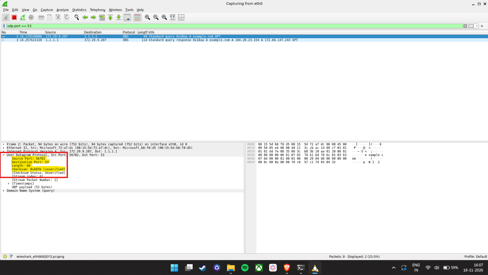
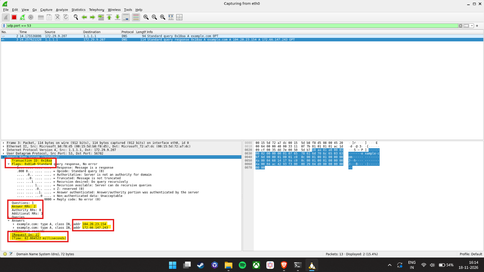
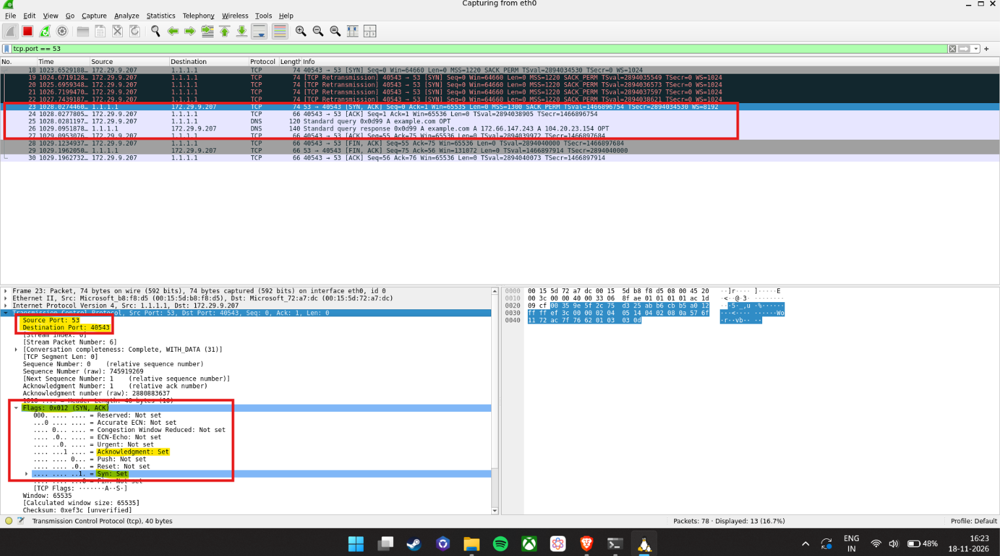
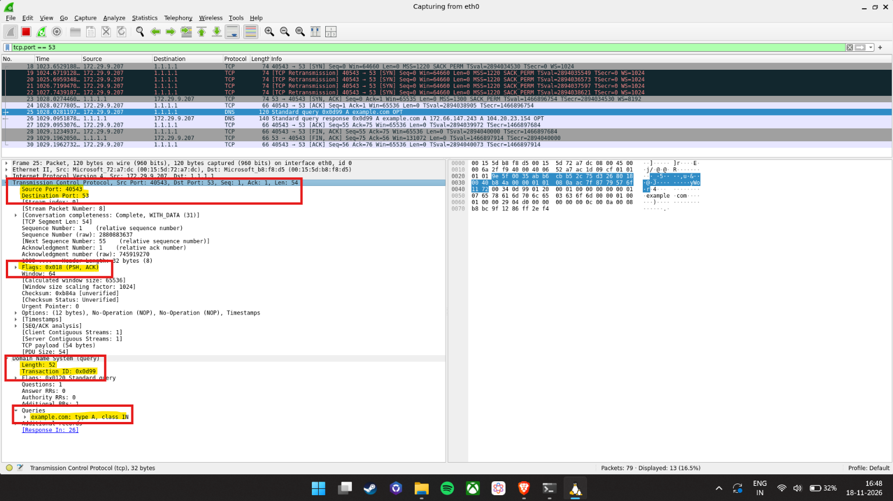

# Lab 07 — TCP vs UDP Traffic Analysis

**Author:** xnsh  
**Date:** 18 November 2026  
**Category:** Networking & Traffic Analysis  
**Tools:** Kali Linux (WSL2), Wireshark, Linux Terminal, dig  
**Status:** Completed

---

## 1. Objective

The objective of this lab was to investigate and compare TCP and UDP communication through real packet captures using Wireshark.

The experiment focused on understanding how DNS queries operate over both transport protocols, identifying differences in connection establishment, packet structure, reliability, and application-level communication.

The main objectives were:

- Capture and analyze DNS traffic over UDP.
- Inspect UDP header fields and packet structure.
- Examine DNS queries, responses, and transaction IDs.
- Generate DNS traffic over TCP.
- Observe the TCP three-way handshake and connection termination.
- Identify TCP sequence numbers, acknowledgment numbers, and flags.
- Compare TCP and UDP behavior using actual network evidence.
- Understand how these protocols are used in network troubleshooting and cybersecurity investigations.

---

## 2. Lab Environment

| Component | Configuration |
|---|---|
| Operating System | Kali Linux (WSL2) |
| Host Operating System | Windows 11 |
| Packet Analyzer | Wireshark |
| Network Interface | eth0 |
| Client IP Address | 172.29.9.207 |
| DNS Resolver | 1.1.1.1 (Cloudflare) |
| Domain Tested | example.com |
| Transport Protocols | TCP and UDP |
| Destination Port | 53 |
| Command-Line Utility | dig |

All traffic was generated from my own Kali Linux environment using legitimate DNS queries to a public DNS resolver.

---

## 3. Concepts Covered

### 3.1 Transmission Control Protocol (TCP)

TCP is a connection-oriented transport-layer protocol that provides reliable, ordered delivery of data between applications.

Before exchanging application data, TCP establishes a connection using the three-way handshake:

1. SYN — The client requests a connection.
2. SYN-ACK — The server acknowledges the request and responds.
3. ACK — The client acknowledges the server's response.

TCP uses sequence numbers, acknowledgments, and retransmissions to maintain reliable communication.

TCP is commonly used by SSH, HTTP/1.1, HTTPS over TCP, and DNS over TCP.

### 3.2 User Datagram Protocol (UDP)

UDP is a connectionless transport-layer protocol.

Unlike TCP, UDP does not establish a connection using a three-way handshake before sending application data.

UDP does not provide built-in:

- Reliable delivery guarantees.
- Packet retransmissions.
- Delivery acknowledgments.
- Ordered delivery.

UDP has a fixed 8-byte header containing:

1. Source Port
2. Destination Port
3. Length
4. Checksum

UDP is commonly used for DNS queries, online gaming, voice communication, and other applications where low overhead is useful.

### 3.3 DNS Communication

The Domain Name System (DNS) translates domain names into records such as IPv4 addresses.

DNS commonly uses UDP port 53 for ordinary queries but also supports TCP port 53.

In this lab, both transport protocols were used to resolve the same domain:

`example.com`

### 3.4 DNS Transaction ID

DNS uses a transaction ID to help associate responses with their corresponding queries.

The transaction ID is a 16-bit value included in the DNS message.

A DNS client checks the transaction ID along with other information, including the query details and network endpoints, when matching responses.

This mechanism is important in understanding DNS response validation and DNS spoofing attacks.

### 3.5 TCP Retransmissions

TCP retransmissions occur when a sender retransmits data or connection-establishment segments after not receiving the expected response.

During the TCP DNS experiment, several SYN retransmissions were observed before the connection was successfully established.

This demonstrated how TCP can retry connection establishment when responses are delayed or missing.

---

## 4. Methodology

### Step 1 — Capturing DNS Traffic over UDP

Wireshark was started on the `eth0` network interface.

The following command was executed in the Kali Linux terminal:

```bash
dig @1.1.1.1 example.com A +notcp
```

Command explanation:

- `dig` — Performs a DNS lookup.
- `@1.1.1.1` — Specifies Cloudflare's DNS resolver.
- `example.com` — Domain being queried.
- `A` — Requests IPv4 address records.
- `+notcp` — Uses UDP for the DNS query.

The DNS query completed successfully.

The terminal reported:

```text
status: NOERROR
ANSWER: 2
Query time: 87 msec
SERVER: 1.1.1.1#53(1.1.1.1) (UDP)
```

The returned IPv4 addresses were:

```text
104.20.23.154
172.66.147.243
```

The following Wireshark display filter was applied:

```text
udp.port == 53
```

Wireshark displayed a DNS query from the Kali client to the DNS resolver and a corresponding response.

This confirmed that DNS communication occurred successfully over UDP.

### Step 2 — UDP Header Inspection

The DNS query packet was selected in Wireshark.

The User Datagram Protocol section was expanded to inspect the UDP header fields.

Observed values:

| Field | Value |
|---|---|
| Source IP | 172.29.9.207 |
| Destination IP | 1.1.1.1 |
| Source Port | 56702 |
| Destination Port | 53 |
| UDP Length | 60 bytes |
| UDP Payload | 52 bytes |
| UDP Checksum | 0x8b3b (unverified) |

The UDP length field included both the header and payload.

```text
UDP Header:   8 bytes
UDP Payload: 52 bytes
---------------------
Total:       60 bytes
```

This confirmed the fixed 8-byte UDP header structure.

The checksum was marked as unverified by Wireshark, which does not automatically indicate packet corruption.

**Evidence 01 — UDP Header Analysis**



### Step 3 — DNS Response Analysis over UDP

The DNS response packet from `1.1.1.1` was selected.

The Domain Name System response section was expanded to inspect the transaction ID, response flags, and answer records.

Observed values:

| Field | Value |
|---|---|
| DNS Transaction ID | 0x18aa |
| Response Flags | 0x81a0 |
| Response Code | NOERROR |
| Questions | 1 |
| Answer Records | 2 |
| Response Time | 82.084522 ms |

The response contained two IPv4 address records:

```text
example.com → 104.20.23.154
example.com → 172.66.147.243
```

The transaction ID matched the original DNS query.

This demonstrated how DNS associates a response with a query even when using connectionless UDP communication.

**Evidence 02 — DNS Response Analysis**



### Step 4 — Generating DNS Traffic over TCP

The next experiment performed the same DNS lookup using TCP instead of UDP.

The following command was executed:

```bash
dig @1.1.1.1 example.com A +tcp
```

The `+tcp` option forced the DNS lookup to use TCP.

The terminal confirmed:

```text
status: NOERROR
ANSWER: 2
Query time: 1063 msec
SERVER: 1.1.1.1#53(1.1.1.1) (TCP)
```

The following Wireshark display filter was applied:

```text
tcp.port == 53
```

The capture revealed:

1. An initial TCP SYN.
2. Multiple SYN retransmissions.
3. A SYN-ACK response from the DNS resolver.
4. An ACK completing the handshake.
5. A DNS query over TCP.
6. A DNS response over TCP.
7. TCP acknowledgment and connection termination packets.

The SYN retransmissions indicated that the initial connection attempts did not receive an immediate response.

The connection was eventually established successfully.

### Step 5 — TCP Three-Way Handshake Inspection

Packet 23 was selected to inspect the SYN-ACK response from the DNS resolver.

Observed values:

| Field | Value |
|---|---|
| Source IP | 1.1.1.1 |
| Destination IP | 172.29.9.207 |
| Source Port | 53 |
| Destination Port | 40543 |
| TCP Flags | 0x012 (SYN, ACK) |
| SYN Flag | Set |
| ACK Flag | Set |
| Sequence Number | 0 (relative) |
| Acknowledgment Number | 1 (relative) |

The SYN-ACK confirmed that the server responded to the client's connection request.

The following ACK packet completed the TCP three-way handshake.

Only after the connection was established did the DNS query proceed over TCP.

**Evidence 03 — TCP DNS Handshake**



### Step 6 — DNS Query Inspection over TCP

Packet 25 was selected to inspect the DNS query transmitted inside the established TCP connection.

Observed values:

| Field | Value |
|---|---|
| Source IP | 172.29.9.207 |
| Destination IP | 1.1.1.1 |
| Source Port | 40543 |
| Destination Port | 53 |
| TCP Flags | 0x018 (PSH, ACK) |
| TCP Segment Length | 54 bytes |
| DNS Message Length | 52 bytes |
| DNS Transaction ID | 0x0d99 |
| Query Name | example.com |
| Query Type | A |

Unlike DNS over UDP, DNS over TCP uses a two-byte length prefix before each DNS message.

The captured TCP payload contained:

```text
DNS-over-TCP Length Prefix:  2 bytes
DNS Query Message:          52 bytes
------------------------------------
TCP Payload:                54 bytes
```

The PSH and ACK flags indicated that the TCP segment carried application data and acknowledged previously received bytes.

The DNS transaction ID was different from the earlier UDP experiment because this was a separate DNS query.

**Evidence 04 — DNS over TCP Analysis**



---

## 5. Observations

### 5.1 TCP vs UDP Comparison

| Feature | TCP | UDP |
|---|---|---|
| Transport Layer | Layer 4 | Layer 4 |
| Connection Type | Connection-oriented | Connectionless |
| Three-Way Handshake | Required | Not required |
| Minimum Header Size | 20 bytes | 8 bytes |
| Sequence Numbers | Yes | No |
| Acknowledgments | Yes | No built-in ACK |
| Retransmissions | Built-in | Application-dependent |
| Ordered Delivery | Yes | Not guaranteed |
| DNS Port | 53 | 53 |

### 5.2 UDP DNS Observations

The UDP experiment demonstrated that DNS queries can be transmitted without establishing a TCP connection.

The capture contained a query and response, with no TCP handshake.

The UDP header contained source and destination ports, length, and checksum fields.

The DNS transaction ID helped associate the response with the original query.

### 5.3 TCP DNS Observations

The TCP experiment demonstrated that a connection must be established before exchanging DNS application data.

The capture showed:

- SYN retransmissions during connection establishment.
- A successful SYN-ACK response.
- An ACK completing the handshake.
- DNS query and response messages.
- TCP acknowledgment and connection termination.

The DNS message was transported inside a TCP segment using a two-byte message length prefix.

### 5.4 Query Time Comparison

| Experiment | Reported Query Time |
|---|---|
| DNS over UDP | 87 ms |
| DNS over TCP | 1063 ms |

The TCP experiment took longer in this capture.

However, the TCP connection also experienced SYN retransmissions.

Therefore, the difference in query times cannot be attributed solely to the TCP handshake or protocol overhead.

These measurements represent the observed behavior of this experiment, not a general performance benchmark.

---

## 6. Troubleshooting and Notes

### 6.1 Display Filters

Two Wireshark display filters were used:

```text
udp.port == 53
```

```text
tcp.port == 53
```

These filters helped isolate DNS communication over the respective transport protocols.

### 6.2 TCP SYN Retransmissions

During the TCP DNS experiment, multiple SYN retransmissions appeared before the server responded.

The connection eventually succeeded after the SYN-ACK arrived.

Possible explanations for unanswered SYN attempts include packet loss, filtering, or temporary connectivity problems.

The capture alone did not establish the exact cause.

### 6.3 DNS over TCP Message Length

The TCP payload length initially required additional inspection.

The packet contained a 54-byte TCP payload, while the DNS message itself was 52 bytes.

The difference was explained by the two-byte DNS-over-TCP length prefix.

### 6.4 Wireshark Packet Inspection

The packet details pane was used to inspect:

- TCP and UDP ports.
- Protocol flags.
- Segment lengths.
- DNS transaction IDs.
- DNS queries and responses.

Expanding the appropriate protocol sections made the packet structure easier to understand.

---

## 7. Real-World Cybersecurity Applications

### 7.1 Network Traffic Analysis

Understanding TCP and UDP helps security analysts identify how applications communicate across networks.

Wireshark can reveal whether communication is connection-oriented or connectionless and which services are being accessed.

### 7.2 DNS Investigation

DNS packet analysis can help investigate suspicious domain lookups, unexpected DNS resolvers, and unusual DNS traffic patterns.

Transaction IDs, query names, response codes, and answer records provide useful information during investigations.

### 7.3 Network Troubleshooting

TCP SYN retransmissions can indicate that a connection is experiencing problems.

Analyzing retransmissions, acknowledgments, and connection resets helps troubleshoot service availability and network connectivity.

### 7.4 Port Scanning and Service Identification

Knowledge of TCP and UDP is essential for interpreting results from tools such as Nmap.

TCP scans and UDP scans behave differently because the protocols have different connection and response mechanisms.

### 7.5 DNS Security

Understanding DNS transaction IDs and source ports provides a foundation for studying DNS spoofing and cache poisoning.

These fields help DNS clients and resolvers distinguish expected responses from unrelated or potentially forged packets.

---

## 8. Key Learnings

Through this lab, I learned:

1. TCP and UDP both operate at the transport layer but provide different communication services.
2. TCP establishes a connection using a three-way handshake.
3. UDP sends datagrams without a TCP-style connection handshake.
4. UDP has a fixed 8-byte header.
5. TCP provides built-in acknowledgments, ordered delivery, and retransmission mechanisms.
6. UDP does not automatically retransmit lost datagrams.
7. DNS can operate over both UDP and TCP port 53.
8. DNS transaction IDs help associate responses with queries.
9. DNS over TCP uses a two-byte message length prefix.
10. Wireshark can reveal protocol headers, flags, message lengths, and DNS records.
11. TCP SYN retransmissions can occur before a connection is successfully established.
12. Packet captures provide evidence for understanding and troubleshooting network communication.

This lab strengthened my ability to distinguish TCP and UDP traffic and interpret DNS communication at both the transport and application layers.

---

## 9. Conclusion

Lab 07 successfully demonstrated the differences between TCP and UDP using real DNS traffic captured in Wireshark.

The UDP experiment showed how DNS queries and responses can be exchanged without establishing a TCP connection.

The TCP experiment demonstrated connection establishment, SYN retransmissions, DNS data transfer, and connection termination.

Inspecting both protocols helped connect theoretical networking concepts with actual packet behavior.

The experiment also demonstrated how DNS transaction IDs, transport-layer ports, TCP flags, and message lengths contribute to network communication.

These skills provide a foundation for future cybersecurity labs involving network troubleshooting, DNS investigations, packet analysis, and authorized security assessments.

**Lab Status: Completed**
