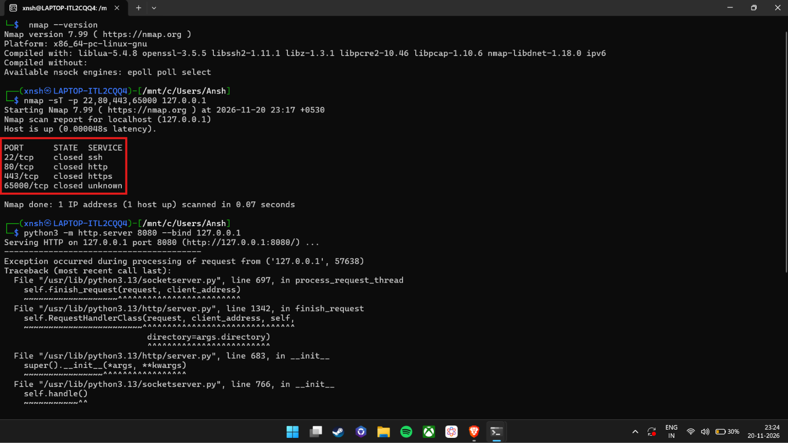
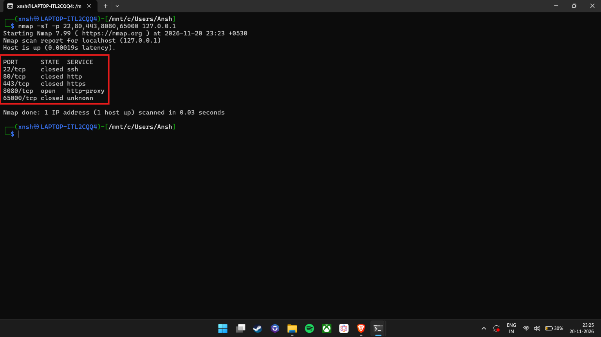
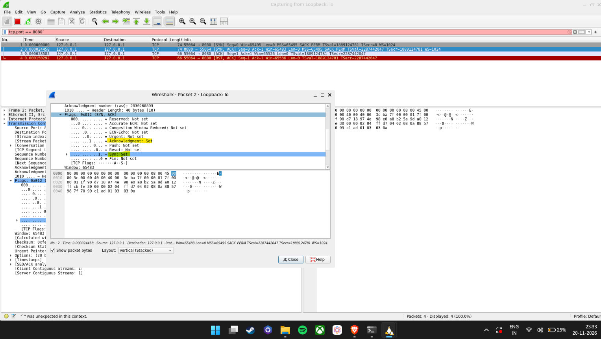
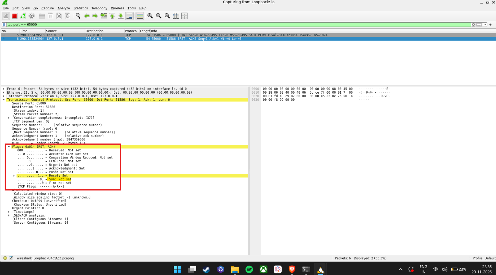
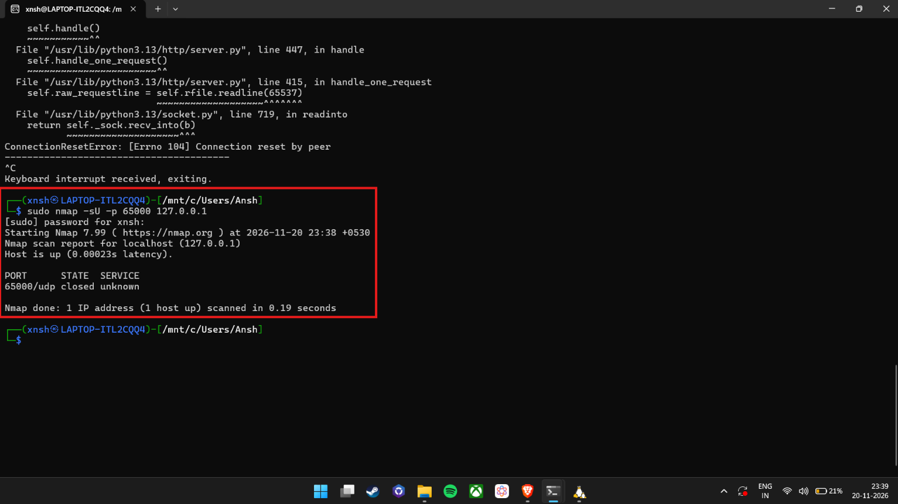
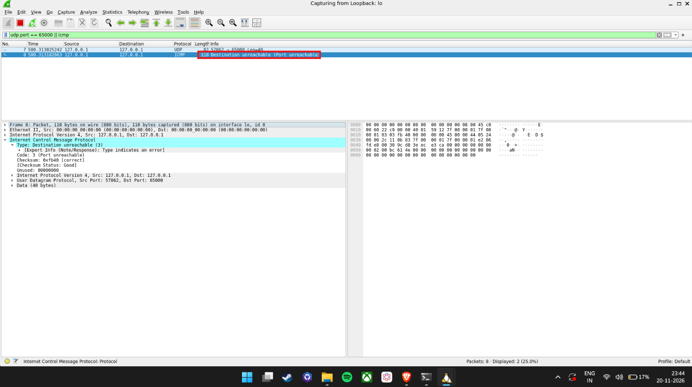

# Lab 08.1 — Nmap TCP & UDP Port Scanning Analysis

**Author:** xnsh  
**Date:** 20 November 2026  
**Category:** Networking & Security Analysis  
**Tools:** Kali Linux (WSL2), Nmap 7.99, Wireshark, Python HTTP Server  
**Status:** Completed — Part 1

---

## 1. Objective

The objective of this lab was to understand how Nmap identifies open and closed TCP and UDP ports, and to verify its scanning behavior through packet inspection in Wireshark.

The lab focused on:

- Performing TCP Connect Scans using Nmap.
- Identifying open and closed TCP ports.
- Creating a temporary HTTP server to demonstrate an open port.
- Analyzing the TCP three-way handshake.
- Inspecting TCP RST packets generated during port scanning.
- Performing a UDP port scan.
- Identifying ICMP Port Unreachable responses.
- Understanding how Nmap determines port states from network responses.

All scans were performed against the local Kali Linux environment using `127.0.0.1`.

---

## 2. Lab Environment

| Component | Configuration |
|---|---|
| Operating System | Kali Linux (WSL2) |
| Host System | Windows 11 |
| Network Interface | Loopback (`lo`) |
| Target IP Address | `127.0.0.1` |
| Scanning Tool | Nmap 7.99 |
| Packet Analyzer | Wireshark |
| Test Service | Python HTTP Server |
| Open Test Port | TCP 8080 |
| Closed Test Port | TCP/UDP 65000 |

The loopback interface was used to generate and inspect traffic locally without scanning external systems.

---

## 3. Concepts Covered

### 3.1 Network Port Scanning

Port scanning is the process of sending network probes to determine whether particular ports are accepting connections or responding to network traffic.

Security professionals use port scanning to discover exposed services, identify unnecessary network access, and understand a system's attack surface.

### 3.2 TCP Connect Scan

A TCP Connect Scan attempts to establish a complete TCP connection with the target port.

Nmap performs this scan using the `-sT` option.

A successful connection indicates that the port is open.

A connection refused by the target generally indicates that the port is closed.

### 3.3 Open, Closed, and Filtered Ports

**Open:** A service is listening and accepting connections.

**Closed:** The target is reachable, but no service is accepting connections on that port.

**Filtered:** Packet filtering prevents Nmap from determining whether the port is open or closed.

### 3.4 TCP Three-Way Handshake

TCP establishes a connection through three steps:

1. SYN — The client requests a connection.
2. SYN-ACK — The server acknowledges the request.
3. ACK — The client completes the handshake.

This process establishes connection state and synchronizes initial sequence numbers.

### 3.5 TCP Reset (RST)

The TCP RST flag indicates that a connection is being rejected or reset.

A closed TCP port commonly responds to an incoming SYN with an RST-ACK packet.

Nmap can use this response to identify closed ports.

### 3.6 UDP Port Scanning

UDP is a connectionless transport protocol and does not use the TCP three-way handshake.

When a UDP probe reaches a closed port, the operating system commonly responds with an ICMP Destination Unreachable message.

For an IPv4 UDP port that is closed, the expected response is:

- ICMP Type 3 — Destination Unreachable
- ICMP Code 3 — Port Unreachable

Nmap uses this information to classify the UDP port as closed.

---

## 4. Methodology

### Step 1 — Verifying Nmap Installation

The installed Nmap version was checked using:

```bash
nmap --version
```

**Observed result:**

```text
Nmap version 7.99
Platform: x86_64-pc-linux-gnu
```

This confirmed that Nmap was available in the Kali Linux environment.

### Step 2 — Scanning Closed TCP Ports

The first TCP Connect Scan was performed using:

```bash
nmap -sT -p 22,80,443,65000 127.0.0.1
```

**Observed output:**

```text
PORT      STATE   SERVICE
22/tcp    closed  ssh
80/tcp    closed  http
443/tcp   closed  https
65000/tcp closed  unknown
```

All four scanned TCP ports were classified as closed.

This indicated that no services were accepting TCP connections on these ports during the scan.

The service names displayed by Nmap represent common port associations and do not necessarily indicate installed or running services.

**Evidence 01 — Closed TCP Ports**



### Step 3 — Creating an Open TCP Port

A temporary HTTP server was started using Python:

```bash
python3 -m http.server 8080 --bind 127.0.0.1
```

**Observed output:**

```text
Serving HTTP on 127.0.0.1 port 8080
```

This created a listening TCP service on port 8080.

The server was bound to the loopback address so that the test remained local.

A second Nmap scan was then performed:

```bash
nmap -sT -p 22,80,443,8080,65000 127.0.0.1
```

**Observed output:**

```text
PORT      STATE   SERVICE
22/tcp    closed  ssh
80/tcp    closed  http
443/tcp   closed  https
8080/tcp  open    http-proxy
65000/tcp closed  unknown
```

Port 8080 was successfully identified as open, while the remaining ports were still closed.

Although Nmap displayed `http-proxy` as the service name, the actual application was the Python HTTP server started during the lab.

**Evidence 02 — Open TCP Port**



### Step 4 — Inspecting the TCP Handshake in Wireshark

Wireshark was started on the loopback interface (`lo`).

The following display filter was applied:

```text
tcp.port == 8080
```

A new scan was generated:

```bash
nmap -sT -p 8080 127.0.0.1
```

**Observed packet sequence:**

| Packet | TCP Flags | Description |
|---|---|---|
| 1 | SYN | Client initiates connection |
| 2 | SYN, ACK | Server accepts connection request |
| 3 | ACK | Client completes handshake |
| 4 | RST, ACK | Client resets the established connection |

The TCP handshake confirmed that port 8080 was accepting connections.

The final RST-ACK packet showed that the scanning client terminated the connection without performing an HTTP exchange.

The SYN-ACK packet contained:

```text
Flags: 0x012 (SYN, ACK)
SYN: Set
ACK: Set
```

**Evidence 03 — TCP Scan Handshake**



### Step 5 — Inspecting a Closed TCP Port

A scan was performed against TCP port 65000:

```bash
nmap -sT -p 65000 127.0.0.1
```

Wireshark display filter:

```text
tcp.port == 65000
```

**Observed packet sequence:**

| Packet | TCP Flags | Description |
|---|---|---|
| 5 | SYN | Client attempts to establish a connection |
| 6 | RST, ACK | Target rejects the connection |

The reset packet contained:

```text
Source Port: 65000
Destination Port: 51586
Flags: 0x014 (RST, ACK)
Reset: Set
Acknowledgment: Set
```

The RST-ACK response demonstrated why Nmap classified TCP port 65000 as closed.

Unlike an open port, the target did not complete the three-way handshake.

**Evidence 04 — Closed Port TCP Reset**



### Step 6 — Performing a UDP Port Scan

A UDP scan was performed using:

```bash
sudo nmap -sU -p 65000 127.0.0.1
```

**Observed output:**

```text
PORT       STATE   SERVICE
65000/udp  closed  unknown
```

The UDP port was classified as closed.

Unlike TCP, UDP does not use SYN or RST flags.

Nmap instead relies on UDP responses or relevant ICMP error messages to determine the port state.

**Evidence 05 — UDP Port Scan**



### Step 7 — Inspecting ICMP Port Unreachable

Wireshark was used to inspect the network response generated during the UDP scan.

Display filter:

```text
udp.port == 65000 || icmp
```

The UDP scan was repeated:

```bash
sudo nmap -sU -p 65000 127.0.0.1
```

**Observed packets:**

| Packet | Protocol | Description |
|---|---|---|
| 7 | UDP | Probe sent to destination port 65000 |
| 8 | ICMP | Destination Unreachable — Port Unreachable |

The ICMP packet contained:

```text
Type: 3 (Destination Unreachable)
Code: 3 (Port Unreachable)
```

The ICMP response also contained information about the original UDP packet that triggered the error.

This allowed the scanning tool to associate the error with the UDP probe.

The result confirmed that the destination UDP port was closed.

**Evidence 06 — UDP and ICMP Port Unreachable**



---

## 5. Packet Observations

The experiments demonstrated different network responses for open and closed ports.

| Scenario | Observed Network Behavior | Nmap Result |
|---|---|---|
| TCP port 8080 | SYN → SYN-ACK → ACK | Open |
| TCP port 65000 | SYN → RST-ACK | Closed |
| UDP port 65000 | UDP probe → ICMP Type 3, Code 3 | Closed |

### Key Observation

Nmap does not simply guess whether a port is open or closed.

It sends probes and interprets the responses according to the behavior of TCP, UDP, and ICMP.

The packet captures provided direct evidence supporting the Nmap scan results.

---

## 6. Troubleshooting and Notes

### Python HTTP Server Connection Reset

During the TCP Connect Scan, the Python HTTP server displayed:

```text
ConnectionResetError: [Errno 104] Connection reset by peer
```

The Wireshark capture showed that Nmap completed the TCP handshake and then sent an RST-ACK packet.

This behavior is consistent with the scanning client resetting the connection without sending an HTTP request.

The server remained capable of accepting connections during the experiment.

### Service Name Interpretation

Nmap displayed port 8080 as `http-proxy`.

This was a default port-to-service association, not confirmation that an HTTP proxy was running.

The actual service was the Python HTTP server.

### Loopback Interface

All scanning experiments targeted `127.0.0.1`.

Therefore, Wireshark capture was performed on the `lo` interface rather than `eth0`.

### Firewall Filtering

Firewall-based filtered-port analysis was not performed in Part 1.

This experiment is reserved for Lab 08.2.

---

## 7. Real-World Cybersecurity Applications

### Network Reconnaissance

Nmap helps security professionals identify accessible services on systems they are authorized to assess.

### Attack Surface Identification

Open ports can expose network services.

Identifying unnecessary open ports helps administrators reduce potential attack surfaces.

### Firewall Verification

Comparing open, closed, and filtered ports can help verify whether network filtering controls behave as intended.

### Network Troubleshooting

Wireshark can reveal whether failed connections result from TCP resets, missing responses, or other network conditions.

### Security Validation

Using Nmap and Wireshark together allows an analyst to compare scan results with the actual packets exchanged on the network.

---

## 8. Key Learnings

Through this lab, I learned that:

1. Nmap can identify open and closed TCP ports using TCP Connect Scans.
2. An open TCP port completes the three-way handshake.
3. A closed TCP port commonly responds with RST-ACK.
4. Nmap's service names do not necessarily identify the actual running application.
5. A temporary Python HTTP server can be used to create a controlled open port.
6. UDP scanning behaves differently because UDP is connectionless.
7. A closed UDP port commonly generates an ICMP Port Unreachable response.
8. ICMP Type 3, Code 3 indicates that a destination UDP port is unreachable.
9. Wireshark helps verify Nmap's conclusions through packet-level evidence.
10. The loopback interface provides a controlled environment for local security testing.

---

## 9. Conclusion

Lab 08.1 successfully demonstrated TCP and UDP port scanning using Nmap and packet inspection using Wireshark.

By comparing open and closed TCP ports, analyzing the three-way handshake, inspecting TCP reset packets, and examining ICMP Port Unreachable responses, I gained practical experience in understanding how network scanners determine port states.

The lab also demonstrated the value of combining active scanning tools with packet analysis to understand network behavior.

All testing was performed locally against the Kali Linux loopback interface.

**Lab 08.1 Status: Completed**

**Next: Lab 08.2 — Firewall Filtering and Advanced Port State Analysis**

The next part will investigate filtered ports, firewall behavior, and additional TCP/UDP scanning scenarios.
