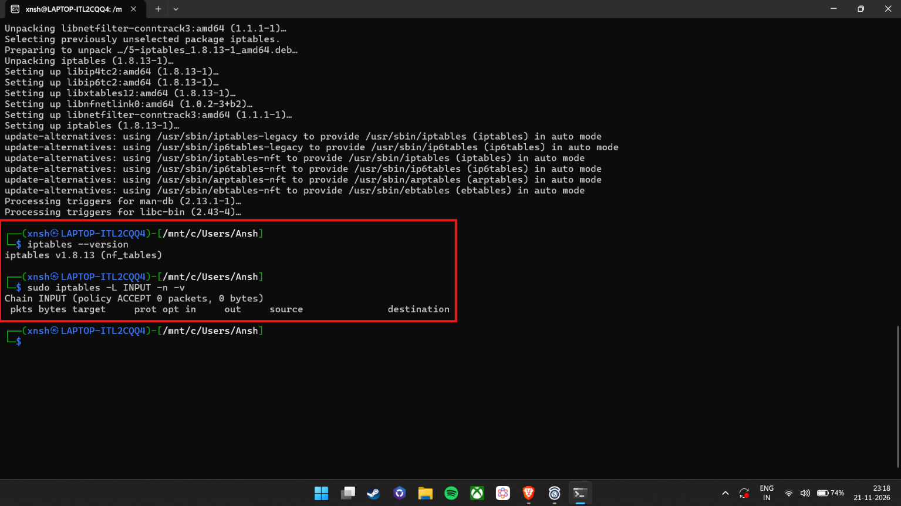
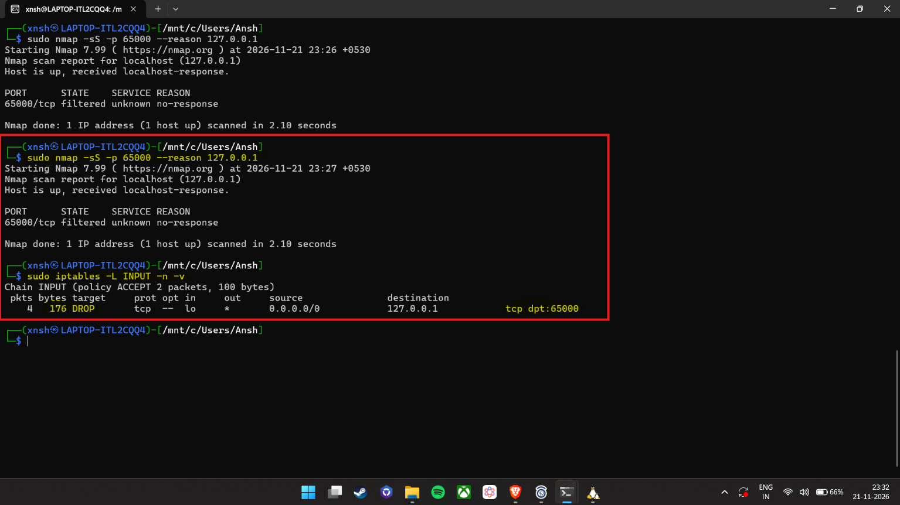
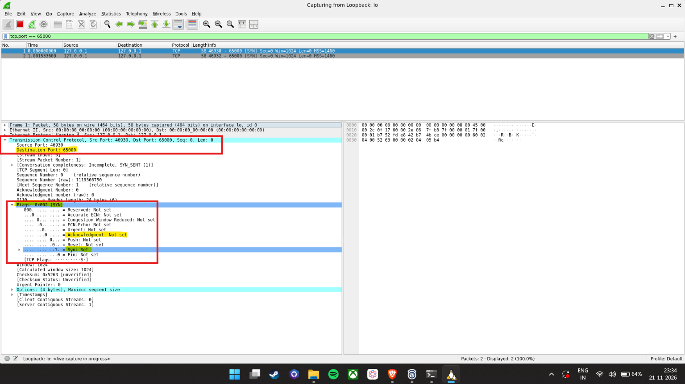
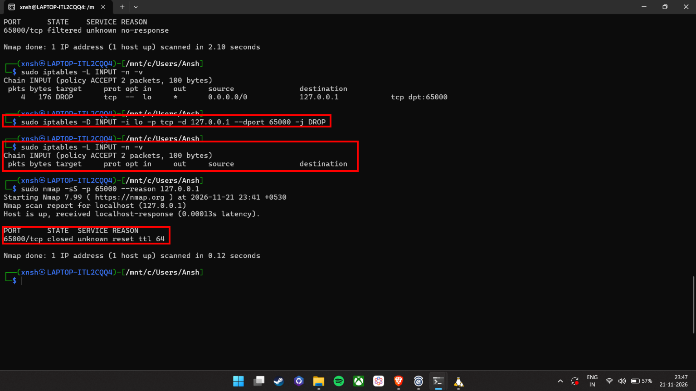

# Lab 08.2 — Firewall and Filtered Port Analysis

**Author:** xnsh  
**Date:** 21 November 2026  
**Category:** Networking & Network Security  
**Tools:** Kali Linux (WSL2), Nmap, Wireshark, iptables  
**Status:** Completed

---

## 1. Objective

The objective of this lab was to understand how firewalls influence TCP port scanning and how Nmap identifies a filtered port based on network responses.

This lab extends Lab 08.1, where open and closed TCP ports and closed UDP ports were investigated using Nmap and Wireshark.

The experiment involved creating a controlled firewall rule, observing changes in Nmap scan results, inspecting TCP SYN packets, verifying firewall packet counters, and restoring the original firewall configuration.

### Learning Objectives

- Understand the purpose and functionality of a firewall.
- Understand Linux firewall chains and iptables rules.
- Differentiate between closed and filtered TCP ports.
- Understand how Nmap SYN scanning works.
- Analyze unanswered TCP SYN probes using Wireshark.
- Verify packet filtering using firewall counters.
- Safely remove experimental firewall rules.

---

## 2. Lab Environment

| Component | Details |
|---|---|
| Operating System | Kali Linux (WSL2) |
| Host Operating System | Windows 11 |
| Network Interface | Loopback (lo) |
| Target IP Address | 127.0.0.1 |
| Target Port | TCP 65000 |
| Nmap Version | 7.99 |
| Firewall Tool | iptables v1.8.13 |
| Firewall Backend | nf_tables |
| Packet Analyzer | Wireshark |
| Scan Technique | TCP SYN Scan (-sS) |
| Testing Scope | Authorized local environment |

All experiments were conducted against localhost. No external systems or unauthorized networks were scanned.

---

## 3. Concepts Covered

### 3.1 Firewall

A firewall is a network security mechanism that controls incoming, outgoing, or forwarded network traffic according to predefined rules.

Firewall rules can make decisions based on parameters such as:

- Source IP address
- Destination IP address
- Source port
- Destination port
- Network protocol
- Network interface

Firewalls help reduce unauthorized access and control communication between systems.

### 3.2 iptables

iptables is a Linux command-line utility used to configure packet filtering rules implemented by the Linux kernel's Netfilter framework.

The installed version uses the nf_tables backend, allowing iptables commands to manage firewall rules through the modern nftables infrastructure.

### 3.3 Firewall Chains

| Chain | Purpose |
|---|---|
| INPUT | Handles packets destined for the local system |
| OUTPUT | Handles packets generated by the local system |
| FORWARD | Handles packets passing through the system |

The INPUT chain was used in this experiment because the target packets were destined for a local TCP port.

### 3.4 Firewall Actions

| Action | Function |
|---|---|
| ACCEPT | Allows matching packets |
| DROP | Silently discards matching packets |
| REJECT | Discards matching packets and generates an appropriate error response |

The DROP action was selected to simulate silent packet filtering.

### 3.5 TCP SYN Scan

A TCP SYN scan is a scanning technique in which Nmap sends a TCP SYN packet to a target port and analyzes the response.

Unlike a TCP Connect scan, a SYN scan does not normally complete the full TCP three-way handshake.

| Response | Nmap Port State |
|---|---|
| SYN-ACK | Open |
| RST | Closed |
| No response after retries | Filtered |
| Certain ICMP unreachable errors | Filtered |

A filtered port does not necessarily mean that the port is open or closed. It indicates that Nmap cannot determine its underlying state because of filtering or another communication obstacle.

---

## 4. Methodology

### Step 1 — Installing and Verifying iptables

Initially, the iptables command was unavailable in the Kali Linux environment.

The required package was installed using:

```bash
sudo apt update && sudo apt install iptables -y
```

The installation was verified using:

```bash
iptables --version
```

Observed output:

```text
iptables v1.8.13 (nf_tables)
```

The existing INPUT chain was inspected using:

```bash
sudo iptables -L INPUT -n -v
```

Observed output:

```text
Chain INPUT (policy ACCEPT 0 packets, 0 bytes)
pkts bytes target prot opt in out source destination
```

The INPUT chain contained no explicit rules and its default policy was ACCEPT.

This established the initial firewall configuration before conducting the experiment.

#### Evidence 01 — Firewall Baseline



---

### Step 2 — Establishing the Closed Port Baseline

Before applying any firewall rules, TCP port 65000 was scanned to determine its initial state.

```bash
sudo nmap -sS -p 65000 --reason 127.0.0.1
```

#### Command Breakdown

| Argument | Purpose |
|---|---|
| sudo | Executes Nmap with elevated privileges |
| -sS | Performs a TCP SYN scan |
| -p 65000 | Scans only TCP port 65000 |
| --reason | Displays the reason behind the detected port state |
| 127.0.0.1 | Specifies localhost as the target |

Observed output:

```text
PORT      STATE  SERVICE REASON
65000/tcp closed unknown reset ttl 64
```

The scan completed in approximately 0.09 seconds.

#### Analysis

Nmap transmitted a TCP SYN probe to port 65000 and received a TCP reset response.

This indicated that the target was reachable, but the tested TCP port was closed.

The service was reported as unknown because Nmap did not associate the tested port with a known service in this scan.

The TTL value of 64 represented the remaining IP Time to Live of the received response.

This result established the closed-port baseline for comparison with later scans.

---

### Step 3 — Creating a Firewall DROP Rule

A narrowly scoped firewall rule was inserted into the INPUT chain to silently discard TCP packets destined for port 65000.

```bash
sudo iptables -I INPUT 1 -i lo -p tcp -d 127.0.0.1 --dport 65000 -j DROP
```

#### Command Breakdown

| Argument | Purpose |
|---|---|
| -I INPUT 1 | Inserts the rule at the beginning of the INPUT chain |
| -i lo | Matches incoming traffic on the loopback interface |
| -p tcp | Matches TCP packets |
| -d 127.0.0.1 | Matches the specified destination IP |
| --dport 65000 | Matches destination port 65000 |
| -j DROP | Silently discards matching packets |

The firewall rule was verified using:

```bash
sudo iptables -L INPUT -n -v
```

Observed output:

```text
Chain INPUT (policy ACCEPT 0 packets, 0 bytes)

pkts bytes target prot opt in out source    destination
0    0     DROP   tcp  --  lo *   0.0.0.0/0 127.0.0.1 tcp dpt:65000
```

The rule was successfully added.

The initial packet and byte counters were zero because no matching scan traffic had been processed after the rule was created.

The default INPUT policy remained ACCEPT, ensuring that the experiment did not unnecessarily block unrelated traffic.

---

### Step 4 — Detecting a Filtered Port Using Nmap

After applying the firewall rule, the same TCP SYN scan was repeated.

```bash
sudo nmap -sS -p 65000 --reason 127.0.0.1
```

Observed output:

```text
PORT      STATE    SERVICE REASON
65000/tcp filtered unknown no-response
```

The scan completed in approximately 2.10 seconds.

#### Analysis

Unlike the initial scan, Nmap did not receive a TCP reset response.

The firewall silently discarded the incoming SYN probes before they could reach the TCP connection-handling logic.

Nmap therefore classified port 65000 as filtered.

The increased scan duration was associated with waiting for a response and retrying unanswered probes.

The underlying port remained closed. Only the firewall's handling of incoming traffic had changed.

### Firewall Counter Verification

The firewall counters were inspected again.

```bash
sudo iptables -L INPUT -n -v
```

Observed output:

```text
Chain INPUT (policy ACCEPT 2 packets, 100 bytes)

pkts bytes target prot opt in out source    destination
4    176   DROP   tcp  --  lo *   0.0.0.0/0 127.0.0.1 tcp dpt:65000
```

The DROP rule recorded:

- Packets dropped: 4
- Total bytes dropped: 176
- Protocol: TCP
- Interface: lo
- Destination address: 127.0.0.1
- Destination port: 65000

The increased counters provided direct confirmation that the experimental firewall rule was matching and discarding the scan traffic.

#### Evidence 02 — Filtered Port Detection and Firewall Counters



---

### Step 5 — Filtered Port Packet Analysis Using Wireshark

Wireshark was used to inspect the packet-level behavior of the filtered TCP port.

The loopback interface was selected because the scan was directed toward localhost.

Display filter:

```wireshark
tcp.port == 65000
```

A fresh capture was started and additional scan traffic was generated.

Nmap's packet-trace option was also used during capture troubleshooting.

```bash
sudo nmap -sS -p 65000 --reason --packet-trace 127.0.0.1
```

The packet-trace option allows Nmap to display information about packets sent and received during a scan.

### Packet Observations

| Field | Observed Value |
|---|---|
| Source IP | 127.0.0.1 |
| Destination IP | 127.0.0.1 |
| First Source Port | 46930 |
| Second Source Port | 46932 |
| Destination Port | 65000 |
| Transport Protocol | TCP |
| TCP Flags | 0x002 (SYN) |
| SYN Flag | Set |
| ACK Flag | Not Set |
| RST Flag | Not Set |
| Relative Sequence Number | 0 |
| TCP Payload Length | 0 bytes |
| Captured Frame Length | 58 bytes |
| Observed SYN Probes | 2 |
| Interval Between Probes | Approximately 1 second |

### TCP Flag Analysis

The first captured packet contained the following TCP flag value:

```text
Flags: 0x002 (SYN)
```

The SYN flag was set, indicating an attempt to initiate TCP communication.

The ACK and RST flags were not set.

The packet contained no application-layer payload because it was a TCP connection probe.

Two outgoing SYN probes were observed, with no corresponding SYN-ACK or RST responses in the captured traffic.

The second SYN probe used a different source port, representing an additional Nmap scan attempt rather than an ordinary same-connection TCP retransmission.

### Packet Flow

```text
Nmap Scanner             Firewall              Target Port
     |                       |                       |
     |-------- SYN --------->|                       |
     |                       X DROP                  |
     |                                               |
     |        Wait for response                      |
     |                                               |
     |-------- SYN --------->|                       |
     |                       X DROP                  |
     |                                               |
     |        No response received                   |
     |                                               |
     |        Port classified as FILTERED            |
```

Wireshark captured the outgoing probes, while the firewall discarded them before the destination TCP port could generate a response.

This demonstrated that observing an outgoing packet does not necessarily mean that the packet was accepted by the destination's networking stack.

#### Evidence 03 — TCP Filtered Port Packet Analysis



---

### Step 6 — Firewall Cleanup and Verification

After completing packet analysis, the experimental firewall rule was removed.

```bash
sudo iptables -D INPUT -i lo -p tcp -d 127.0.0.1 --dport 65000 -j DROP
```

The -D argument deletes a matching firewall rule.

The exact rule specification was used to avoid modifying unrelated firewall rules.

The INPUT chain was inspected again:

```bash
sudo iptables -L INPUT -n -v
```

Observed output:

```text
Chain INPUT (policy ACCEPT 2 packets, 100 bytes)
pkts bytes target prot opt in out source destination
```

The DROP rule was no longer present.

The target port was scanned one final time.

```bash
sudo nmap -sS -p 65000 --reason 127.0.0.1
```

Observed output:

```text
PORT      STATE  SERVICE REASON
65000/tcp closed unknown reset ttl 64
```

The final scan completed in approximately 0.12 seconds.

#### Analysis

After removing the firewall rule, TCP SYN probes were no longer silently discarded by the experimental rule.

Nmap received a TCP reset response and classified the port as closed again.

The original INPUT chain configuration was successfully restored.

#### Evidence 04 — Firewall Cleanup and Verification



---

## 5. Observations

### 5.1 Port State Comparison

| Experiment Stage | Port State | Response | Scan Duration |
|---|---|---|---|
| Before firewall rule | Closed | TCP RST | 0.09 seconds |
| During firewall filtering | Filtered | No response | 2.10 seconds |
| After firewall cleanup | Closed | TCP RST | 0.12 seconds |

The filtered scan required more time because Nmap waited for responses that were not received.

The experiment demonstrated that firewall filtering can change the externally observable state of a port without changing whether a service is listening on that port.

### 5.2 TCP Port State Comparison

Based on the networking concepts investigated in Lab 08.1 and Lab 08.2:

| Port State | Typical SYN Scan Response | Interpretation |
|---|---|---|
| Open | SYN-ACK | A TCP service is accepting connections |
| Closed | RST | The destination responds but the port is not accepting connections |
| Filtered | No response or certain ICMP errors | Nmap cannot determine whether the port is open or closed |

### 5.3 Firewall Counter Analysis

The experimental DROP rule recorded four matching packets totalling 176 bytes across the scans performed before the counter inspection.

These counters confirmed that the firewall was actively discarding matching traffic.

The later Wireshark capture contained two SYN probes. This was a separate observation from the earlier cumulative firewall counter inspection.

The firewall counters measured network-layer packet bytes, while Wireshark displayed captured frame lengths that included a link-layer header.

---

## 6. Troubleshooting and Notes

### Issue 1 — iptables Command Not Found

Initially, the iptables utility was not installed in the Kali Linux environment.

Resolution:

```bash
sudo apt update && sudo apt install iptables -y
```

The installation was verified successfully, and the required firewall configuration was accessible.

### Issue 2 — No Packets Initially Visible in Wireshark

During the initial filtered-port scan, the expected packets were not visible in Wireshark.

Troubleshooting involved:

- Restarting the capture on the loopback interface.
- Verifying the TCP destination port filter.
- Generating fresh Nmap scan traffic.
- Using the Nmap packet-trace option.
- Inspecting firewall packet counters.

The subsequent capture successfully displayed two outgoing TCP SYN probes.

### Issue 3 — Interpreting Filtered Ports

A filtered port must not automatically be interpreted as an open port.

The absence of a response may result from firewall filtering, packet loss, routing problems, or other communication obstacles.

In this controlled experiment, the firewall counters and the change in scan results after removing the DROP rule confirmed that the experimental firewall rule caused the observed filtering.

---

## 7. Real-World Cybersecurity Applications

### 7.1 Network Reconnaissance

Penetration testers use port scanning to identify accessible services and understand the network exposure of authorized target systems.

Understanding port states helps security professionals interpret reconnaissance results accurately.

### 7.2 Firewall Rule Validation

Security engineers can compare Nmap scan results before and after applying firewall configurations to determine whether rules are functioning as intended.

Firewall counters provide additional evidence that specific network traffic is being matched and processed.

### 7.3 Network Troubleshooting

Combining Wireshark packet captures with firewall counters can help distinguish between connection refusal, silent filtering, and other network communication problems.

### 7.4 Attack Surface Management

Firewalls reduce the exposure of internal services by restricting unauthorized network communication.

However, a filtered port does not prove that a service is absent or that the underlying system is secure.

### 7.5 Security Monitoring

Repeated TCP SYN probes without connection establishment may indicate scanning activity, network troubleshooting, or connectivity problems.

Security analysts can investigate such patterns using packet captures, firewall logs, and network monitoring tools.

---

## 8. Key Learnings

- Understood the functionality of Linux firewall chains.
- Installed and configured iptables in Kali Linux.
- Created a controlled firewall DROP rule.
- Learned how TCP SYN scanning determines port states.
- Used the Nmap --reason option to understand scan classifications.
- Used the --packet-trace option during packet capture troubleshooting.
- Experimentally demonstrated the difference between closed and filtered TCP ports.
- Inspected unanswered TCP SYN probes using Wireshark.
- Verified packet filtering using firewall packet and byte counters.
- Understood how firewall filtering affects scan duration.
- Learned that a filtered port does not reveal the underlying service state.
- Successfully removed the experimental firewall rule and verified the original port behavior.

---

## 9. Conclusion

This lab successfully demonstrated the relationship between firewall configuration, TCP packet behavior, and Nmap port state detection.

Initially, TCP port 65000 was classified as closed because the target returned a TCP reset response.

After applying a firewall DROP rule, the same port was classified as filtered because the incoming SYN probes were silently discarded.

Wireshark packet analysis and iptables counters provided supporting evidence of the filtering process.

Finally, the experimental firewall rule was removed, and Nmap once again detected the port as closed.

The experiment established practical knowledge of firewall behavior, TCP SYN scanning, packet filtering, and network troubleshooting, providing a foundation for future authorized penetration testing and network security projects.

**Lab Status: Successfully Completed**

---

*xnsh | Cybersecurity Learning Journal*
