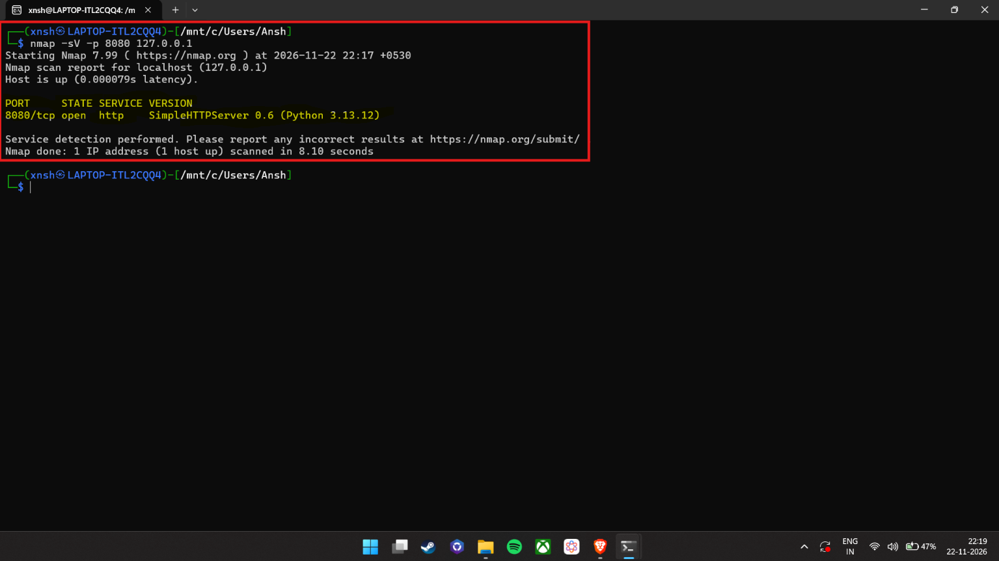
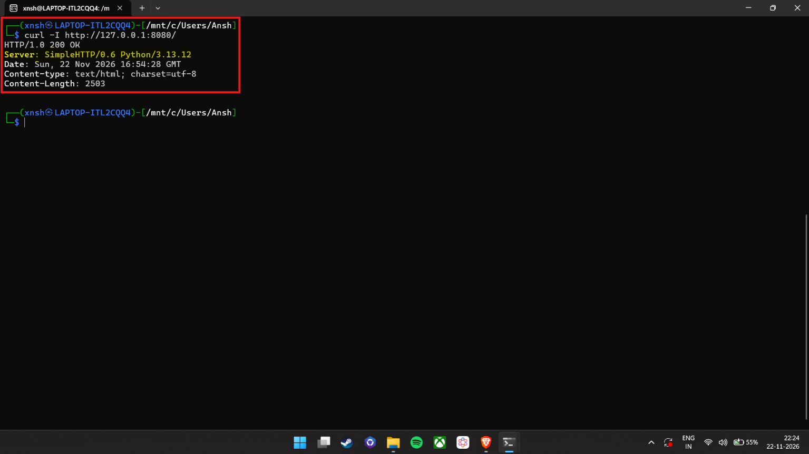
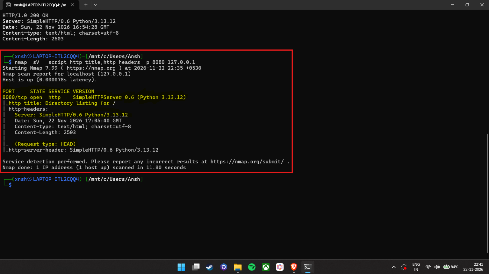
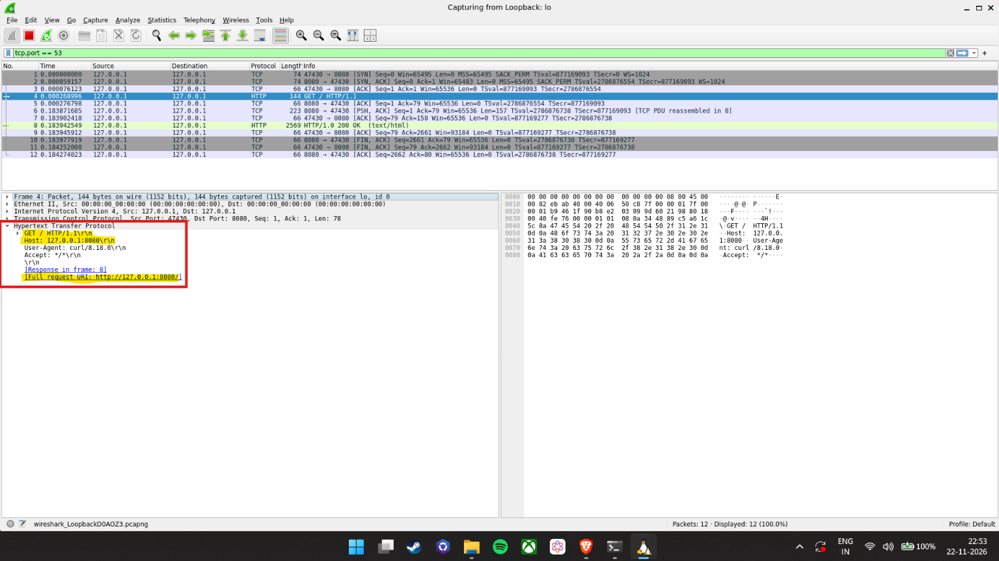
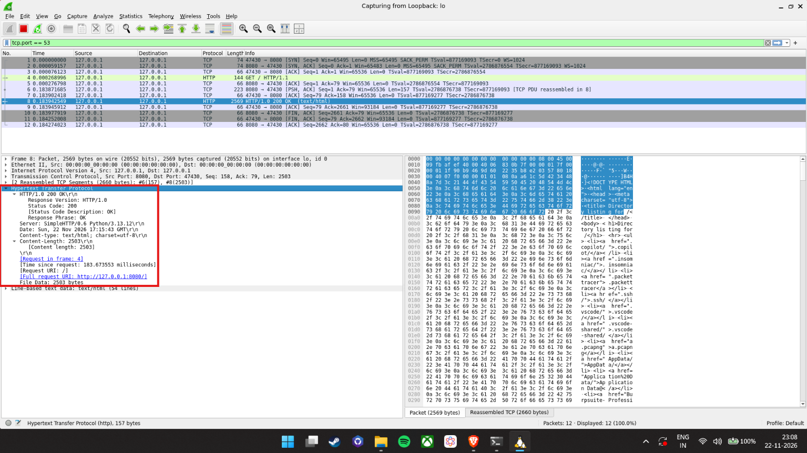

# Lab 09 — HTTP Service Enumeration & Traffic Analysis

**Author:** xnsh  
**Date:** 22 November 2026  
**Category:** Networking & Web Application Security  
**Tools:** Kali Linux (WSL2), Nmap 7.99, Curl, Wireshark, Python HTTP Server  
**Status:** Completed

---

## 1. Objective

The objective of this lab was to identify and enumerate a locally hosted HTTP service using Nmap, examine HTTP response headers using Curl, and inspect the underlying HTTP communication using Wireshark.

This lab focused on understanding how reconnaissance tools discover information about exposed services and how that information can be verified through packet analysis.

The primary objectives were to:

- Identify an open TCP port and its associated service.
- Detect the web server software and reported version.
- Perform HTTP banner grabbing.
- Use Nmap Scripting Engine (NSE) for HTTP enumeration.
- Capture and inspect HTTP requests and responses.
- Understand the cybersecurity relevance of service fingerprinting and information disclosure.

All testing was performed against a locally hosted server under my control.

---

## 2. Lab Environment

| Component | Configuration |
|---|---|
| Operating System | Kali Linux on WSL2 |
| Host Operating System | Windows 11 |
| Target IP Address | 127.0.0.1 |
| Target Port | TCP 8080 |
| Web Server | Python SimpleHTTPServer |
| Reported Python Version | 3.13.12 |
| Network Interface | Loopback (`lo`) |
| Network Scanner | Nmap 7.99 |
| HTTP Client | Curl |
| Packet Analyzer | Wireshark |

### Local HTTP Server

A Python HTTP server was started using:

```bash
python3 -m http.server 8080 --bind 127.0.0.1
```

The server reported:

```text
Serving HTTP on 127.0.0.1 port 8080
```

This created a controlled local environment for HTTP enumeration and packet inspection.

The loopback address `127.0.0.1` allows a computer to communicate with services running on itself.

---

## 3. Concepts Covered

### 3.1 Service Enumeration

Service enumeration is the process of gathering detailed information about services running on open network ports.

Port scanning identifies accessible ports, while service enumeration attempts to determine what software is operating behind those ports.

For example:

```text
8080/tcp open http
```

This indicates that TCP port 8080 is open and an HTTP service has been detected.

Service enumeration is an important part of reconnaissance because it helps security professionals understand the attack surface of a system.

### 3.2 Service Fingerprinting

Service fingerprinting involves identifying software based on its responses to network probes.

Nmap can send application-specific requests and compare the responses against known service signatures.

In this lab, Nmap identified:

```text
SimpleHTTPServer 0.6 (Python 3.13.12)
```

This information helps identify the software being used, although fingerprinting results should be verified rather than treated as absolute proof.

### 3.3 HTTP Banner Grabbing

Banner grabbing is the process of collecting information that a service exposes about itself.

HTTP servers may disclose information through response headers such as:

```text
Server: SimpleHTTP/0.6 Python/3.13.12
```

This header revealed the server implementation and its reported Python runtime version.

Exposed version information can assist defenders in maintaining an accurate software inventory. It may also help an attacker identify software worth investigating.

Version disclosure alone does not prove the presence of a vulnerability.

### 3.4 HTTP Request and Response

HTTP follows a request-response communication model.

The client sends a request, and the server returns a response.

Example:

```text
Client → GET / HTTP/1.1 → Server
Client ← HTTP/1.0 200 OK ← Server
```

The GET method requests a resource from the server.

The status code `200` indicates that the request was successfully processed.

The HTTP version used by the client and the version used by the server do not necessarily have to be identical.

### 3.5 Nmap Scripting Engine

The Nmap Scripting Engine (NSE) extends Nmap's functionality through scripts.

NSE scripts can perform tasks such as:

- HTTP header enumeration.
- Webpage title detection.
- Service information gathering.
- Security configuration checks.

In this lab, the `http-title` and `http-headers` scripts were used to collect information from the local web server.

### 3.6 HTTP Directory Listing

A directory listing is a webpage that displays files and folders available within a served directory.

Python's basic HTTP server can generate a directory listing when an index page is not available.

Directory listings are not automatically vulnerabilities, but unintended exposure may reveal files that should not be publicly accessible.

### 3.7 Wireshark Packet Inspection

Wireshark captures and analyzes network packets.

Unlike Nmap, which actively sends probes, Wireshark allows the analyst to inspect traffic exchanged between communicating systems.

In this lab, Wireshark was used to examine:

- TCP connection establishment.
- HTTP GET requests.
- HTTP response headers.
- TCP segmentation and reassembly.
- TCP connection termination.

---

## 4. Methodology

### Step 1 — Starting the Local HTTP Server

A Python HTTP server was started on TCP port 8080.

Command:

```bash
python3 -m http.server 8080 --bind 127.0.0.1
```

The server was kept running throughout the enumeration process.

This ensured that the target port remained open and available for testing.

### Step 2 — Nmap Service and Version Detection

The following command was executed:

```bash
nmap -sV -p 8080 127.0.0.1
```

Command explanation:

- `nmap`: Network scanning tool.
- `-sV`: Attempts service and version detection.
- `-p 8080`: Scans TCP port 8080.
- `127.0.0.1`: Localhost target.

Observed result:

```text
PORT     STATE SERVICE VERSION
8080/tcp open  http    SimpleHTTPServer 0.6 (Python 3.13.12)
```

The scan confirmed that port 8080 was open and identified the running HTTP service.

**Evidence 01 — Nmap Service Detection**



**Observation:** Nmap identified the web server software and reported Python version without requiring direct access to the server's source code.

### Step 3 — HTTP Banner Grabbing with Curl

The HTTP response headers were inspected using:

```bash
curl -I http://127.0.0.1:8080/
```

The `-I` option requests HTTP response headers using the HEAD method.

Observed output:

```text
HTTP/1.0 200 OK
Server: SimpleHTTP/0.6 Python/3.13.12
Date: Sun, 22 Nov 2026 16:54:28 GMT
Content-type: text/html; charset=utf-8
Content-Length: 2503
```

Important observations:

- The server successfully processed the request.
- The Server header disclosed software information.
- The returned resource was HTML.
- The response advertised a body length of 2,503 bytes.

**Evidence 02 — HTTP Banner Grabbing**



**Observation:** Curl independently confirmed the server information previously identified by Nmap.

### Step 4 — HTTP Enumeration Using Nmap NSE

The following command was executed:

```bash
nmap -sV --script http-title,http-headers -p 8080 127.0.0.1
```

The command performed service detection and executed two HTTP enumeration scripts.

- `http-title`: Retrieves the webpage title.
- `http-headers`: Retrieves HTTP response headers.

Observed output:

```text
PORT     STATE SERVICE VERSION
8080/tcp open  http    SimpleHTTPServer 0.6 (Python 3.13.12)
|_http-title: Directory listing for /
| http-headers:
|   Server: SimpleHTTP/0.6 Python/3.13.12
|   Date: Sun, 22 Nov 2026 17:05:40 GMT
|   Content-type: text/html; charset=utf-8
|   Content-Length: 2503
|
|_  (Request type: HEAD)
|_http-server-header: SimpleHTTP/0.6 Python/3.13.12
```

The scan identified the webpage title as:

```text
Directory listing for /
```

This indicated that the Python HTTP server was serving a directory listing at the root path.

The NSE results also confirmed that the HTTP Server header exposed the Python runtime information.

**Evidence 03 — Nmap HTTP Enumeration**



**Observation:** Nmap NSE gathered additional application-layer information beyond the basic open-port result.

### Step 5 — Capturing HTTP Traffic in Wireshark

Wireshark was opened and the loopback interface `lo` was selected.

The following display filter was applied:

```text
tcp.port == 8080
```

HTTP traffic was generated using:

```bash
curl -v http://127.0.0.1:8080/
```

The verbose option displayed additional request and response information in the terminal.

Wireshark captured the TCP connection and HTTP communication.

The observed sequence included:

1. TCP SYN.
2. TCP SYN-ACK.
3. TCP ACK.
4. HTTP GET request.
5. HTTP response.
6. TCP connection termination.

### Step 6 — Inspecting the HTTP GET Request

Packet 4 contained the HTTP request:

```text
GET / HTTP/1.1
Host: 127.0.0.1:8080
User-Agent: curl/8.18.0
Accept: */*
```

The full request URI was:

```text
http://127.0.0.1:8080/
```

The packet used:

```text
Source IP: 127.0.0.1
Destination IP: 127.0.0.1
Source Port: 47430
Destination Port: 8080
```

The source port was a temporary client-side port, while destination port 8080 identified the HTTP service.

**Evidence 04 — HTTP GET Request**



**Observation:** The HTTP request was carried over an established TCP connection and contained the requested path and Host header.

### Step 7 — Inspecting the HTTP Response

The HTTP response was displayed in Packet 8.

Wireshark decoded the response as:

```text
HTTP/1.0 200 OK
Server: SimpleHTTP/0.6 Python/3.13.12
Content-type: text/html; charset=utf-8
Content-Length: 2503
```

Additional Wireshark information included:

```text
Request in frame: 4
Time since request: 183.673553 milliseconds
```

The `Request in frame` field linked the HTTP response to the corresponding request.

This is useful when analyzing multiple HTTP transactions because it helps identify which response belongs to which request.

The capture also showed TCP segments being reassembled into the HTTP response.

**Evidence 05 — HTTP Response Analysis**



**Observation:** Wireshark confirmed the server's response status, software banner, content type, response size, and relationship to the original request.

---

## 5. Packet Observations

| Observation | Result |
|---|---|
| Target IP | 127.0.0.1 |
| Target TCP port | 8080 |
| Port state | Open |
| Detected protocol | HTTP |
| Server implementation | SimpleHTTPServer 0.6 |
| Reported runtime | Python 3.13.12 |
| HTTP request method | GET |
| HTTP request version | HTTP/1.1 |
| HTTP response version | HTTP/1.0 |
| HTTP status code | 200 OK |
| Response content type | text/html |
| Response body length | 2503 bytes |
| Request packet | Frame 4 |
| Response packet | Frame 8 |
| Observed request-response interval | Approximately 183.67 ms |

### TCP and HTTP Relationship

TCP provides the transport connection used by HTTP in this lab.

The TCP three-way handshake established the connection before the HTTP request was transmitted.

The server then returned its HTTP response over the same TCP connection.

Wireshark showed that the response data could be carried across multiple TCP segments and reassembled for application-layer analysis.

This demonstrated the relationship between the transport layer and application layer.

---

## 6. Troubleshooting and Notes

### Command Typing Error

While preparing the HTTP banner inspection, `url` was accidentally entered instead of `curl`.

The terminal reported that the command was not found.

The issue was resolved by executing:

```bash
curl -I http://127.0.0.1:8080/
```

### Selecting the Correct Wireshark Interface

Because the server and client were communicating through localhost, the loopback interface `lo` was used.

Capturing only on `eth0` would not show this local loopback exchange.

### HTTP Response Reassembly

Wireshark displayed TCP segmentation and reassembly information during the HTTP response.

This is normal TCP behavior and does not automatically indicate a network problem.

### Scope and Authorization

All scanning and traffic inspection were performed against a locally hosted Python HTTP server.

No third-party system was scanned.

---

## 7. Real-World Cybersecurity Applications

### 7.1 Reconnaissance

Nmap helps security professionals identify exposed ports and services.

Understanding which services are running is an important first step in assessing a system's attack surface.

### 7.2 Software Fingerprinting

Software identification can help defenders determine whether exposed services are expected and properly maintained.

Reported software versions may also guide further vulnerability research, but must be verified.

### 7.3 Information Disclosure Assessment

HTTP response headers may reveal server implementations, software versions, and other configuration details.

Directory listings may also expose filenames and directory structures.

A security assessment should determine whether this information is intentionally available.

### 7.4 Web Application Penetration Testing

Web application testing often begins with identifying the web server, available endpoints, response behavior, and HTTP configuration.

Nmap and Curl provide useful initial reconnaissance capabilities before deeper testing with tools such as Burp Suite.

### 7.5 Network Forensics

Wireshark allows analysts to reconstruct network communication and correlate HTTP requests with their responses.

This can support incident investigation, troubleshooting, and analysis of suspicious network behavior.

### 7.6 Cross-Tool Verification

This lab demonstrated how multiple tools can support the same finding.

Nmap identified the service, Curl retrieved its headers, and Wireshark displayed the actual HTTP communication.

Correlating evidence helps produce more reliable technical findings.

---

## 8. Key Learnings

Through this lab, I learned:

1. How to start and enumerate a local HTTP service.
2. How Nmap identifies open ports and attempts service version detection.
3. How to retrieve HTTP response headers using Curl.
4. How HTTP banners can reveal software information.
5. How Nmap NSE scripts extend basic scanning capabilities.
6. How directory listings may expose information about a web server.
7. How to capture HTTP traffic on the loopback interface.
8. How to inspect HTTP GET requests and server responses.
9. How Wireshark links HTTP responses to their original requests.
10. How TCP segmentation and reassembly support HTTP communication.
11. Why cross-checking results from multiple tools is valuable during security assessments.
12. Why service enumeration is a foundational skill for web application penetration testing.

---

## 9. Conclusion

Lab 09 successfully demonstrated HTTP service enumeration and packet-level traffic inspection using Nmap, Curl, and Wireshark.

A locally hosted Python HTTP server was identified on TCP port 8080. Nmap detected the HTTP service and its reported software version, while Curl confirmed the information through HTTP response headers.

Nmap NSE scripts provided additional information about the webpage title and server headers.

Wireshark captured the underlying TCP and HTTP communication, allowing the HTTP GET request, successful response, and request-response relationship to be examined.

The lab reinforced the importance of combining network scanning, service enumeration, HTTP analysis, and packet inspection during authorized cybersecurity assessments.

**Lab 09 Status: Completed**

**Next Focus:** Applying service enumeration techniques to more advanced HTTP reconnaissance and web application security labs.
