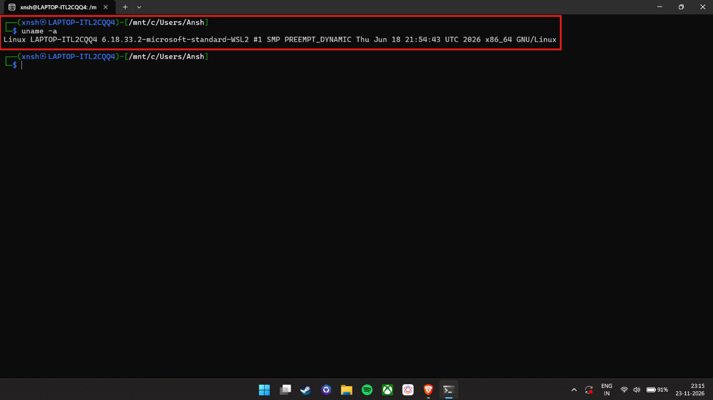
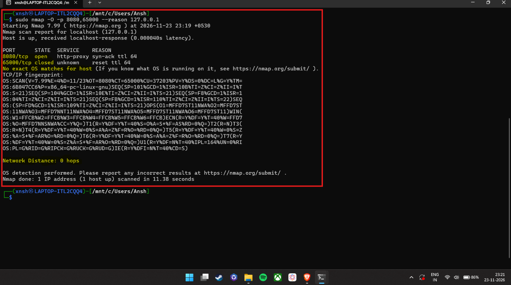
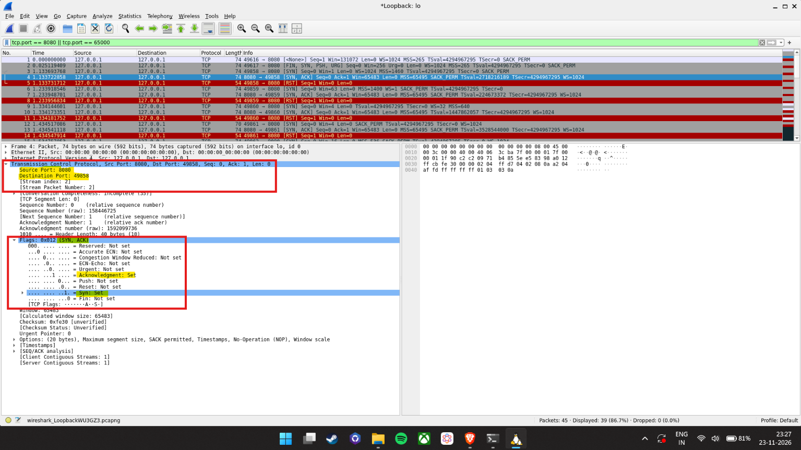
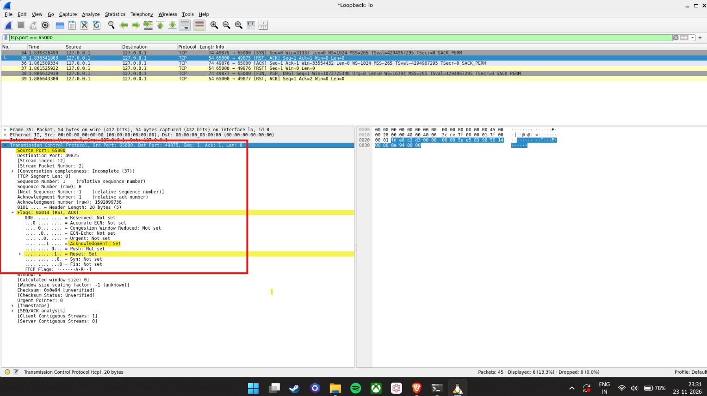

# Lab 10 — Nmap OS Detection & TCP/IP Fingerprinting

**Author:** xnsh  
**Date:** 23 November 2026  
**Category:** Network Reconnaissance & Operating System Fingerprinting  
**Tools:** Kali Linux (WSL2), Nmap 7.99, Wireshark, Python HTTP Server  
**Status:** Completed

---

## 1. Objective

The objective of this lab was to understand how Nmap attempts to identify a target operating system by examining its responses to specially crafted network packets.

The experiment focused on:

- Understanding operating system detection using Nmap.
- Identifying open and closed TCP ports.
- Comparing TCP SYN-ACK and RST responses.
- Examining TCP/IP fingerprinting techniques.
- Understanding how network stack behavior helps identify operating systems.
- Analyzing scan-generated traffic using Wireshark.
- Recognizing the limitations of OS detection in virtualized environments.

All scanning was performed against the local loopback address `127.0.0.1` in an authorized lab environment.

---

## 2. Lab Environment

| Component | Configuration |
|---|---|
| Operating System | Kali Linux running under WSL2 |
| Host Operating System | Windows 11 |
| Linux Kernel | 6.18.33.2-microsoft-standard-WSL2 |
| Nmap Version | 7.99 |
| Packet Analyzer | Wireshark |
| Network Interface | Loopback (`lo`) |
| Target IP Address | 127.0.0.1 |
| Open TCP Port | 8080 |
| Closed TCP Port | 65000 |
| Test Application | Python HTTP Server |

The loopback address represents the local machine itself.

This allowed network reconnaissance techniques to be practiced without scanning external devices or networks.

---

## 3. Concepts Covered

### 3.1 Operating System Detection

Operating system detection is the process of estimating which operating system a target device is running by analyzing its network behavior.

Different operating systems and network stacks may respond differently to TCP, UDP, and ICMP probes.

Nmap uses these differences to build a fingerprint of the target.

### 3.2 TCP/IP Fingerprinting

TCP/IP fingerprinting examines characteristics of network responses, including:

- TCP flags
- TCP window sizes
- TCP options
- Sequence number behavior
- IP Time to Live (TTL)
- Responses to unusual TCP probes
- ICMP response characteristics

Nmap compares the observed behavior against known operating system fingerprints.

A match can suggest an operating system family or version, but identification is not guaranteed.

### 3.3 Open and Closed Ports

An **open port** indicates that an application is accepting connections through that port.

A **closed port** indicates that the target is reachable, but no application is accepting connections on that port.

For a typical TCP SYN scan:

| Port State | Typical Response |
|---|---|
| Open | SYN-ACK |
| Closed | RST |
| Filtered | No response or certain ICMP errors |

These responses help Nmap classify ports and contribute to operating system fingerprinting.

### 3.4 TCP Flags

TCP flags control different stages of TCP communication.

Important flags examined during this lab:

- **SYN:** Requests the establishment of a TCP connection.
- **ACK:** Acknowledges received TCP information.
- **RST:** Resets or rejects a TCP connection.

A SYN-ACK response commonly indicates that a TCP port is open.

An RST response commonly indicates that a TCP port is closed.

### 3.5 Network Distance

Network distance describes the number of network-layer hops between the scanner and the target.

Because the target was `127.0.0.1`, Nmap reported:

```text
Network Distance: 0 hops
```

This indicates that the target was the local machine and no intermediate router was required.

---

## 4. Methodology

### Step 1 — Identifying the Linux Kernel

The first step was to identify the operating system environment.

Command:

```bash
uname -a
```

Observed output included:

```text
Linux LAPTOP-ITL2CQQ4 6.18.33.2-microsoft-standard-WSL2
```

The output confirmed that the environment was using a Linux kernel provided through Windows Subsystem for Linux 2.

This information was recorded as the known system baseline.

It would later be compared against Nmap's operating system detection results.

**Evidence 01 — System Kernel Baseline**



**Observation:**

The `uname -a` command provided direct information about the local Linux kernel.

Unlike Nmap OS detection, which estimates an operating system from network behavior, this command retrieves kernel information from the running system.

---

### Step 2 — Initial Nmap OS Detection

The next step was to perform operating system detection against localhost.

Command:

```bash
sudo nmap -O -p 8080,65000 --reason 127.0.0.1
```

Command explanation:

- `sudo` — Executes Nmap with elevated privileges.
- `nmap` — Network scanning tool.
- `-O` — Enables operating system detection.
- `-p 8080,65000` — Specifies the ports to scan.
- `--reason` — Displays why Nmap assigned each port state.
- `127.0.0.1` — Local loopback target.

Initially, both ports were closed.

Observed results:

```text
PORT      STATE   SERVICE     REASON
8080/tcp  closed  http-proxy  reset ttl 64
65000/tcp closed  unknown     reset ttl 64

Too many fingerprints match this host to give specific OS details
Network Distance: 0 hops
```

**Observation:**

Both ports returned TCP reset responses.

Nmap was unable to identify a specific operating system.

This demonstrated an important limitation: OS fingerprinting generally benefits from having both open and closed TCP ports available for comparison.

---

### Step 3 — Starting a Local HTTP Server

A Python HTTP server was started to create an open TCP port.

Command:

```bash
python3 -m http.server 8080 --bind 127.0.0.1
```

Expected server message:

```text
Serving HTTP on 127.0.0.1 port 8080
```

This command started a local web server listening on TCP port 8080.

Port 65000 was intentionally left closed.

The experiment now had two different TCP conditions:

| Port | Condition |
|---|---|
| 8080/tcp | Open |
| 65000/tcp | Closed |

This provided Nmap with more useful network behavior to examine.

---

### Step 4 — Repeating Nmap OS Detection

With the HTTP server running, the OS detection scan was repeated.

Command:

```bash
sudo nmap -O -p 8080,65000 --reason 127.0.0.1
```

Observed results:

```text
PORT      STATE   SERVICE     REASON
8080/tcp  open    http-proxy  syn-ack ttl 64
65000/tcp closed  unknown     reset ttl 64

No exact OS matches for host
```

Nmap also displayed a detailed TCP/IP fingerprint and reported:

```text
Network Distance: 0 hops
```

**Observation:**

Nmap successfully identified the difference between the open and closed ports.

However, it still could not match the collected fingerprint to a specific operating system.

This was expected to be possible in a WSL2 environment, where the networking stack and virtualized environment may differ from conventional physical Linux systems.

The result demonstrated that OS detection is an estimation technique rather than a guaranteed identification method.

**Evidence 02 — Nmap OS Detection**



---

### Step 5 — Capturing Nmap Traffic in Wireshark

Wireshark was opened and the loopback interface was selected.

Capture interface:

```text
lo
```

The following display filter was applied:

```wireshark
tcp.port == 8080 || tcp.port == 65000
```

This filter displayed TCP packets involving either of the two ports used during the experiment.

The Nmap scan was executed while Wireshark captured the network traffic.

**Observation:**

The capture showed multiple TCP probes and responses.

These packets demonstrated how Nmap interacted with the local TCP/IP stack during its fingerprinting process.

The capture also contained reset packets and unusual TCP probes associated with Nmap's OS detection activity.

---

### Step 6 — Inspecting the Open Port SYN-ACK Response

A TCP packet associated with port 8080 was selected in Wireshark.

The Transmission Control Protocol section was expanded.

Observed packet details included:

```text
Source Port: 8080
Destination Port: 49858
Flags: 0x012 (SYN, ACK)
```

The SYN and ACK flags were both set.

**Explanation:**

The SYN flag indicates participation in TCP connection establishment.

The ACK flag acknowledges the client's SYN request.

A SYN-ACK response indicates that the TCP stack is willing to establish a connection on the destination service port.

In this experiment, the response was generated by the local TCP stack because the Python HTTP server was listening on port 8080.

Nmap can analyze additional characteristics of such responses, including TCP options, window sizes, and sequence number behavior.

**Evidence 03 — TCP OS Fingerprint Response**



---

### Step 7 — Inspecting the Closed Port RST Response

Port 65000 was intentionally left without a listening service.

During the Nmap scan, the port was identified as closed.

Observed Nmap result:

```text
65000/tcp closed unknown reset ttl 64
```

**Explanation:**

When a TCP SYN probe reaches a closed port, the target TCP stack normally responds with a TCP reset.

The RST flag communicates that the requested TCP connection cannot be established.

This differs from the SYN-ACK response observed on open port 8080.

The comparison is important:

| Feature | Open Port 8080 | Closed Port 65000 |
|---|---|---|
| Listening application | Yes | No |
| Typical SYN response | SYN-ACK | RST |
| Nmap classification | Open | Closed |
| Purpose in this lab | Open-port fingerprinting | Closed-port fingerprinting |

Nmap can examine both response types to gather additional information about the target's TCP/IP implementation.

**Evidence 04 — TCP Closed Port RST Response**



---

## 5. Packet Observations

The experiment produced several important observations.

### Observation 1 — Port State Influences Responses

Port 8080 responded with SYN-ACK because the Python HTTP server was listening.

Port 65000 responded with TCP reset behavior because no application was listening.

### Observation 2 — OS Detection Uses Multiple Characteristics

Nmap does not identify an operating system from a single TCP flag.

It examines combinations of network responses, TCP options, sequence behavior, window sizes, and other protocol characteristics.

### Observation 3 — Fingerprinting Does Not Guarantee Identification

Even with one open and one closed TCP port, Nmap reported:

```text
No exact OS matches for host
```

This confirmed that obtaining a fingerprint does not guarantee finding a matching operating system in Nmap's database.

### Observation 4 — Loopback Traffic Remains Local

The target address was:

```text
127.0.0.1
```

All scan traffic remained within the local networking environment.

Nmap reported zero network hops.

### Observation 5 — Nmap and Wireshark Complement Each Other

Nmap summarized port states and fingerprinting results.

Wireshark exposed the individual packets and TCP fields underlying those observations.

Using both tools provided a clearer understanding of the scanning process.

---

## 6. Troubleshooting and Notes

### Issue 1 — Both TCP Ports Were Initially Closed

During the first scan, both ports returned reset responses.

**Resolution:**

A Python HTTP server was started on port 8080, creating an open TCP port.

The scan was repeated to compare open and closed port behavior.

### Issue 2 — Nmap Could Not Identify the Operating System

Nmap reported no exact OS match even after port 8080 was opened.

**Explanation:**

OS detection relies on matching observed network behavior against known fingerprints.

The WSL2 networking environment may produce behavior that does not correspond exactly to a known operating system fingerprint.

No exact operating system identification was claimed.

### Issue 3 — Multiple TCP Packets Appeared in Wireshark

The packet capture contained several SYN, SYN-ACK, and RST packets.

**Explanation:**

Nmap OS detection uses multiple probes to examine how the target TCP/IP stack responds under different conditions.

These packets are part of the fingerprinting process rather than necessarily representing ordinary web browsing traffic.

### Note — Service Labels Are Not Proof of Software Identity

Nmap displayed `http-proxy` for port 8080.

This is a service label associated with the port number and does not independently prove that an HTTP proxy was running.

In this lab, the actual listening application was the Python HTTP server.

---

## 7. Real-World Cybersecurity Applications

### 7.1 Network Reconnaissance

Operating system detection helps authorized security testers estimate the types of devices and systems present within a network.

### 7.2 Attack Surface Identification

Understanding which ports are open and which services are exposed helps identify areas requiring security review.

### 7.3 Vulnerability Assessment

Operating system and service information can guide further investigation into potentially outdated or vulnerable software.

However, a fingerprint alone is not sufficient evidence of a vulnerability.

### 7.4 Firewall and Network Analysis

Different network responses can help security professionals understand whether traffic is accepted, rejected, or silently filtered.

### 7.5 Incident Investigation

Packet-level analysis helps defenders investigate unusual connection attempts, scanning activity, and reconnaissance patterns.

### 7.6 Security Tool Validation

Comparing Nmap results with Wireshark packet captures helps validate conclusions and prevents overreliance on automated scanner output.

---

## 8. Key Learnings

1. Nmap uses the `-O` option to perform operating system detection.

2. OS detection works by analyzing characteristics of the target's TCP/IP stack.

3. Open TCP ports commonly respond to SYN probes with SYN-ACK packets.

4. Closed TCP ports commonly respond with TCP reset packets.

5. Both open and closed ports can provide useful fingerprinting information.

6. TCP flags, window sizes, sequence behavior, and TCP options contribute to operating system fingerprinting.

7. Nmap may collect a detailed fingerprint without identifying an exact operating system.

8. WSL2 and other virtualized environments can complicate fingerprint matching.

9. Wireshark makes it possible to inspect the individual packets behind Nmap's reported results.

10. OS detection results should be treated as evidence-based estimates, not guaranteed facts.

---

## 9. Conclusion

Lab 10 successfully demonstrated Nmap operating system detection and TCP/IP fingerprinting in a controlled local environment.

The experiment began by identifying the Linux kernel using `uname -a`.

An initial Nmap scan showed that both selected TCP ports were closed.

A Python HTTP server was then started on port 8080, creating an open TCP port while port 65000 remained closed.

The repeated scan identified port 8080 as open through a SYN-ACK response and port 65000 as closed through reset behavior.

Wireshark was used to examine TCP packets associated with the scanning activity and inspect the protocol fields involved in fingerprinting.

Although Nmap generated a detailed TCP/IP fingerprint, it did not identify an exact operating system match.

The lab reinforced an important cybersecurity principle: automated reconnaissance results must be interpreted alongside packet-level evidence and knowledge of the testing environment.

**Lab 10 Status: Completed**

**Next Learning Focus:** Advanced Nmap reconnaissance, scan interpretation, and practical network enumeration.
