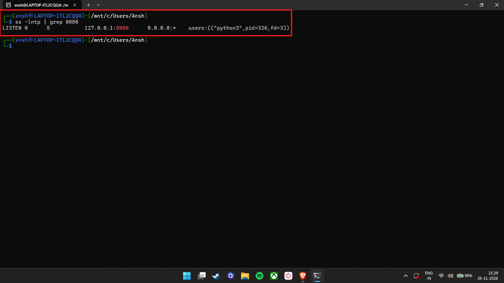
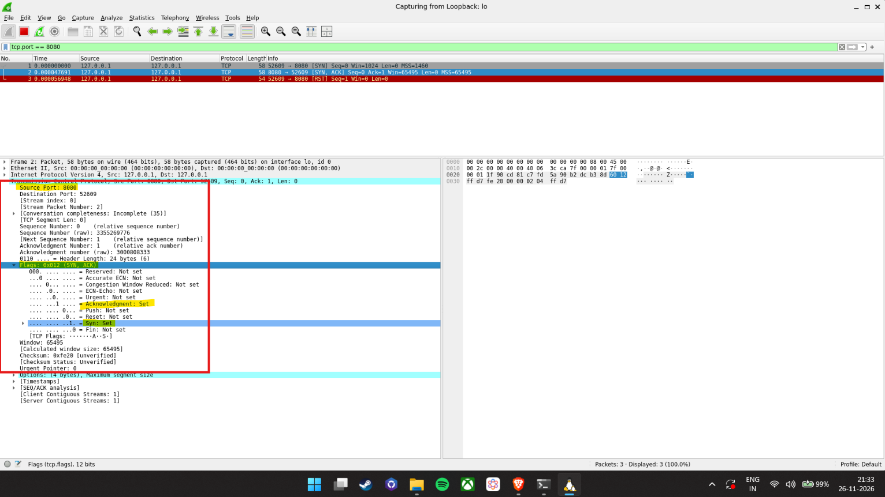
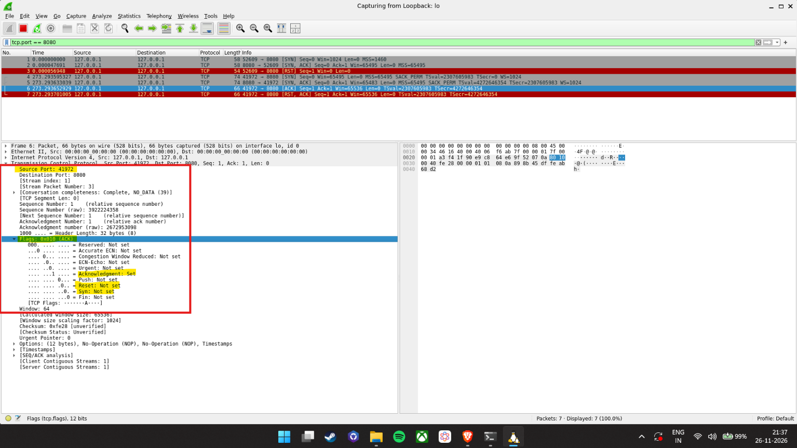
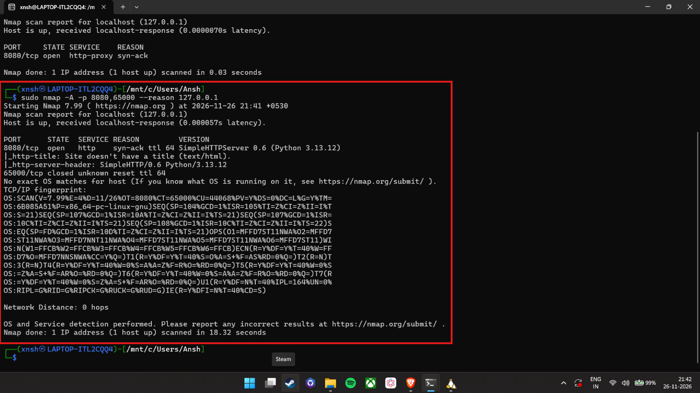
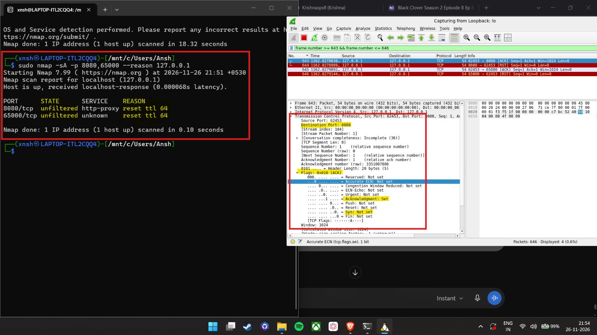
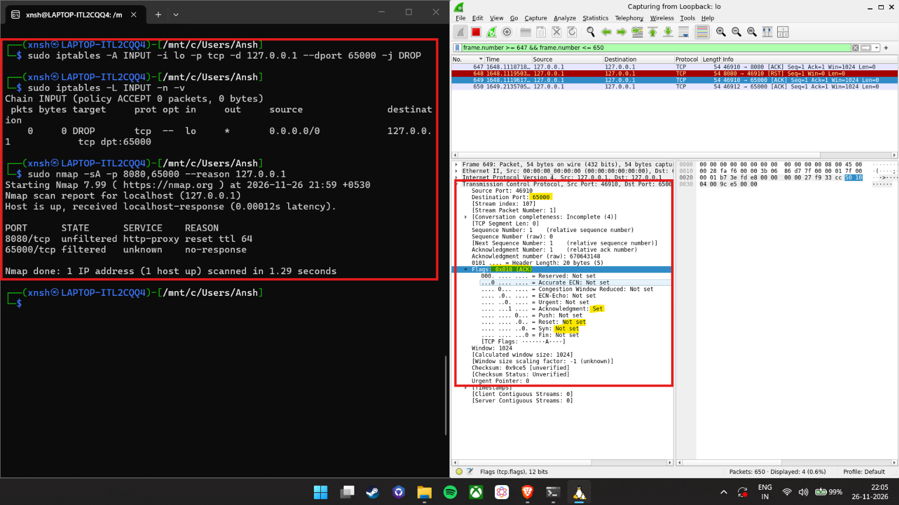
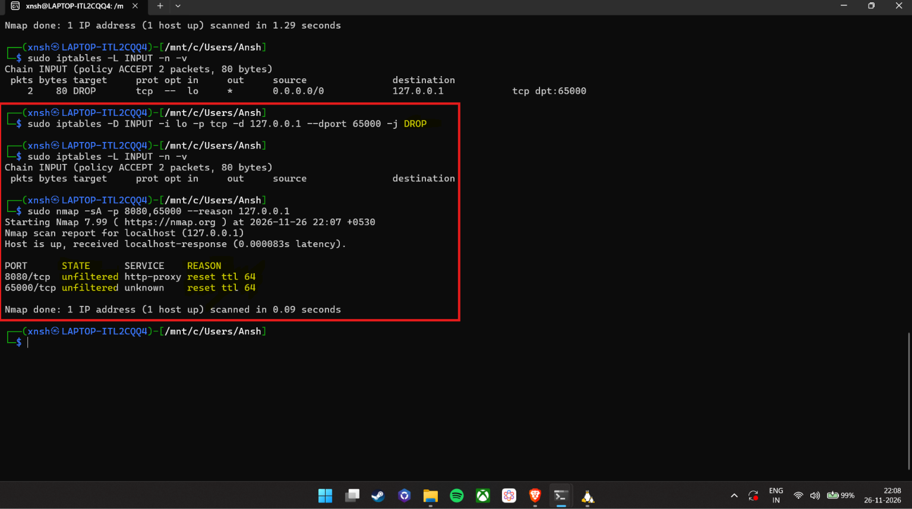

# Lab 11 — Nmap Scan Techniques & Firewall Analysis

**Author:** xnsh  
**Date:** 26 November 2026  
**Category:** Networking, Network Reconnaissance & Security Analysis  
**Tools:** Kali Linux (WSL2), Nmap, Wireshark, iptables, Python HTTP Server  
**Status:** Practical scanning completed; cleanup evidence collected

---

## 1. Objective

The objective of this lab was to investigate different Nmap scanning techniques, understand their underlying TCP packet behavior, and analyze how firewall rules influence network reconnaissance results.

The lab focused on:

- Establishing a local service baseline.
- Understanding TCP SYN scanning.
- Understanding TCP Connect scanning.
- Performing aggressive service and operating system enumeration.
- Investigating the Nmap Scripting Engine (NSE).
- Understanding traceroute and network distance.
- Performing TCP ACK scans.
- Analyzing firewall filtering behavior.
- Correlating Nmap results with Wireshark packet captures.
- Restoring the original firewall configuration after testing.

All experiments were performed against an authorized local laboratory environment.

---

## 2. Lab Environment

| Component | Details |
|---|---|
| Host Operating System | Windows 11 |
| Testing Environment | Kali Linux (WSL2) |
| Target IP Address | 127.0.0.1 |
| Network Interface | Loopback (lo) |
| Open TCP Port | 8080 |
| Closed TCP Port | 65000 |
| Local Service | Python HTTP Server |
| Python Version | 3.13.12 |
| Nmap Version | 7.99 |
| Packet Analysis Tool | Wireshark |
| Firewall Management | iptables |
| Testing Scope | Authorized localhost |

---

## 3. Concepts Covered

### 3.1 TCP SYN Scan

A TCP SYN scan identifies port states by sending SYN packets and analyzing the responses without completing the normal TCP three-way handshake.

Typical responses include:

| Target Response | Interpretation |
|---|---|
| SYN-ACK | Open port |
| RST or RST-ACK | Closed port |
| No response after retries | Filtered port |
| Certain ICMP unreachable messages | Filtered port |

The SYN scan is commonly referred to as a half-open scan.

Although it does not establish a complete TCP connection, it can still be detected by firewalls, intrusion detection systems, and network monitoring tools.

### 3.2 TCP Connect Scan

A TCP Connect scan uses the operating system's connect() system call to establish a TCP connection.

Unlike a SYN scan, it completes the three-way handshake when the destination port is open.

The connection is subsequently terminated.

TCP Connect scans generally do not require the elevated privileges needed for raw-packet SYN scanning.

### 3.3 Aggressive Scan

The Nmap -A option enables multiple reconnaissance capabilities:

- Operating system detection.
- Service and version detection.
- Default NSE script execution.
- Traceroute.

Aggressive scanning collects more information than a basic port scan but generally generates more network traffic.

It does not automatically exploit vulnerabilities or prove that a discovered service is vulnerable.

### 3.4 Nmap Scripting Engine (NSE)

The Nmap Scripting Engine allows Nmap to execute Lua-based scripts for automated network discovery and service enumeration.

NSE scripts can perform tasks such as:

- HTTP header inspection.
- Web page title extraction.
- Service information collection.
- Network discovery.
- Security configuration checks.
- Vulnerability checks, depending on the selected scripts.

In this lab, HTTP-related scripts collected information about the local Python HTTP server.

### 3.5 Traceroute

Traceroute identifies the network path between a source and a destination.

It commonly uses the IP Time To Live (TTL) field to discover intermediate routing devices.

When a packet's TTL expires at a router, the router may return an ICMP Time Exceeded message.

Because this lab targeted the loopback address, no external routers were involved.

Nmap reported a network distance of zero hops.

### 3.6 TCP ACK Scan

A TCP ACK scan sends TCP packets with the ACK flag enabled to investigate firewall filtering behavior.

Unlike SYN and Connect scans, an ACK scan cannot independently determine whether a TCP port is open or closed.

| Target Response | Nmap Classification |
|---|---|
| RST | Unfiltered |
| No response after retries | Filtered |
| Certain ICMP unreachable messages | Filtered |

An unfiltered result indicates that the ACK probe reached a responding TCP stack.

It does not establish whether an application is listening on that port.

---

## 4. Methodology

### Step 1 — Establishing the Local Service Baseline

A Python HTTP server was made available on TCP port 8080 and restricted to the loopback address.

Server setup command:

```bash
python3 -m http.server 8080 --bind 127.0.0.1
```

The listening service was verified using:

```bash
ss -lntp | grep 8080
```

Observed output:

```text
LISTEN 0 5 127.0.0.1:8080 0.0.0.0:* users:(("python3",pid=326,fd=3))
```

Command breakdown:

- ss: Displays socket information.
- -l: Displays listening sockets.
- -n: Displays numerical addresses and ports.
- -t: Displays TCP sockets.
- -p: Displays associated process information.
- grep 8080: Filters the output for port 8080.

The output confirmed that a Python process was listening on TCP port 8080.

The local binding ensured that the service was restricted to the loopback interface within the Linux networking environment.

#### Evidence 01 — Local Service Baseline



---

### Step 2 — Performing a TCP SYN Scan

A TCP SYN scan was performed against the local HTTP service.

```bash
sudo nmap -sS -p 8080 --reason 127.0.0.1
```

Command breakdown:

- sudo: Executes the command with elevated privileges.
- -sS: Performs a TCP SYN scan.
- -p 8080: Specifies the target port.
- --reason: Displays the reason behind the reported port state.
- 127.0.0.1: Specifies the localhost target.

Observed result:

```text
PORT     STATE SERVICE    REASON
8080/tcp open  http-proxy syn-ack ttl 64
```

Scan duration:

```text
0.09 seconds
```

Wireshark display filter:

```wireshark
tcp.port == 8080
```

The packet capture revealed the following sequence:

| Packet | Source Port | Destination Port | TCP Flags |
|---|---|---|---|
| 1 | 52609 | 8080 | SYN |
| 2 | 8080 | 52609 | SYN, ACK |
| 3 | 52609 | 8080 | RST |

The initial SYN packet requested a TCP connection.

The listening service responded with SYN-ACK, confirming that the destination port was open.

A reset packet was subsequently transmitted from the scanning side instead of completing the three-way handshake.

Packet 2 was inspected in Wireshark.

Observed TCP flag value:

```text
0x012 (SYN, ACK)
```

The SYN and ACK flags were both enabled.

This demonstrated how Nmap identifies an open TCP port without establishing a complete application connection.

#### Evidence 02 — TCP SYN Scan



---

### Step 3 — Performing a TCP Connect Scan

A TCP Connect scan was performed against the same service.

```bash
nmap -sT -p 8080 --reason 127.0.0.1
```

Observed result:

```text
PORT     STATE SERVICE    REASON
8080/tcp open  http-proxy syn-ack
```

Scan duration:

```text
0.03 seconds
```

Wireshark revealed the following packet sequence:

| Packet | Source Port | Destination Port | TCP Flags |
|---|---|---|---|
| 4 | 41972 | 8080 | SYN |
| 5 | 8080 | 41972 | SYN, ACK |
| 6 | 41972 | 8080 | ACK |
| 7 | 41972 | 8080 | RST, ACK |

Unlike the previous SYN scan, the Connect scan completed the TCP three-way handshake.

Packet 6 contained the final acknowledgment.

Observed TCP flag value:

```text
0x010 (ACK)
```

The ACK flag was enabled, while the SYN and RST flags were disabled.

The connection was subsequently terminated using a RST-ACK packet.

Wireshark classified the conversation as complete with no application data.

This confirmed that the Connect scan established a TCP connection without requiring an HTTP request.

#### Evidence 03 — TCP Connect Scan



---

### Step 4 — Performing an Aggressive Nmap Scan

An aggressive scan was performed against the open and closed TCP ports.

```bash
sudo nmap -A -p 8080,65000 --reason 127.0.0.1
```

Observed port states:

| Port | State | Reason |
|---|---|---|
| 8080/tcp | Open | SYN-ACK |
| 65000/tcp | Closed | Reset |

The service detection process identified:

```text
SimpleHTTPServer 0.6 (Python 3.13.12)
```

The HTTP-related NSE script output included:

```text
http-title: Site doesn't have a title (text/html)
http-server-header: SimpleHTTP/0.6 Python/3.13.12
```

This demonstrated that Nmap could collect application-layer information in addition to identifying TCP port states.

The HTTP server header disclosed the server software and Python version.

Such information can support further authorized security assessments, although version disclosure alone does not establish the presence of a vulnerability.

#### Operating System Detection

Nmap reported:

```text
No exact OS matches for host
```

A TCP/IP fingerprint was generated, but Nmap could not confidently identify an exact operating system.

The WSL2 networking environment, kernel characteristics, loopback behavior, and fingerprint database coverage may influence detection accuracy.

The exact cause of the unsuccessful fingerprint match was not independently established.

This demonstrated that operating system fingerprinting is an inference-based technique rather than a guaranteed identification method.

#### Network Distance

Nmap reported:

```text
Network Distance: 0 hops
```

Because the target was localhost, no intermediate routers were required.

#### Scan Duration

```text
18.32 seconds
```

The aggressive scan took longer than the basic SYN and Connect scans because it performed additional reconnaissance operations.

#### Evidence 04 — Aggressive Nmap Scan



---

### Step 5 — Performing a TCP ACK Scan

A TCP ACK scan was performed before introducing firewall filtering.

```bash
sudo nmap -sA -p 8080,65000 --reason 127.0.0.1
```

Observed result:

```text
PORT      STATE      SERVICE    REASON
8080/tcp  unfiltered http-proxy reset ttl 64
65000/tcp unfiltered unknown    reset ttl 64
```

Scan duration:

```text
0.10 seconds
```

Both ports were classified as unfiltered despite having different underlying port states.

Port 8080 was open, while port 65000 was closed.

Wireshark display filter:

```wireshark
frame.number >= 643 && frame.number <= 646
```

Observed packet sequence:

| Packet | Communication | TCP Flags |
|---|---|---|
| 643 | Scanner to port 8080 | ACK |
| 644 | Port 8080 to scanner | RST |
| 645 | Scanner to port 65000 | ACK |
| 646 | Port 65000 to scanner | RST |

Packet 643 was inspected.

Observed TCP flag value:

```text
0x010 (ACK)
```

The ACK flag was enabled, while the SYN flag was disabled.

Both ports responded with TCP reset packets because the unsolicited ACK probes did not belong to established TCP connections.

This confirmed that an ACK scan measures filtering behavior rather than distinguishing open ports from closed ports.

#### Evidence 05 — TCP ACK Scan



---

### Step 6 — Introducing Firewall Filtering

A temporary firewall rule was created to silently drop incoming TCP traffic directed toward port 65000 on the loopback interface.

```bash
sudo iptables -A INPUT -i lo -p tcp -d 127.0.0.1 --dport 65000 -j DROP
```

Command breakdown:

| Parameter | Purpose |
|---|---|
| -A INPUT | Appends a rule to the INPUT chain |
| -i lo | Restricts the rule to the loopback interface |
| -p tcp | Matches TCP traffic |
| -d 127.0.0.1 | Specifies the destination IP address |
| --dport 65000 | Matches destination port 65000 |
| -j DROP | Silently discards matching packets |

The firewall rule was inspected using:

```bash
sudo iptables -L INPUT -n -v
```

The INPUT chain retained its default ACCEPT policy, while the specific DROP rule targeted TCP port 65000.

The ACK scan was repeated:

```bash
sudo nmap -sA -p 8080,65000 --reason 127.0.0.1
```

Observed result:

```text
PORT      STATE      SERVICE    REASON
8080/tcp  unfiltered http-proxy reset ttl 64
65000/tcp filtered   unknown    no-response
```

Scan duration:

```text
1.29 seconds
```

Port 8080 continued responding with a reset packet.

However, port 65000 no longer returned a TCP response because the firewall discarded the incoming ACK probes.

Wireshark display filter:

```wireshark
frame.number >= 647 && frame.number <= 650
```

Observed packet sequence:

| Packet | Communication | Observation |
|---|---|---|
| 647 | ACK to port 8080 | Probe transmitted |
| 648 | RST from port 8080 | Response received |
| 649 | ACK to port 65000 | No response |
| 650 | ACK to port 65000 | Additional probe, no response |

Packet 649 was inspected.

Observed fields:

```text
Source Port: 46910
Destination Port: 65000
Flags: 0x010 (ACK)
Acknowledgment: Set
Reset: Not set
Syn: Not set
```

Although Wireshark captured the incoming ACK probes, no corresponding reset response was observed for port 65000.

This was consistent with the configured firewall DROP rule.

The underlying port remained closed, but Nmap classified it as filtered because the firewall prevented the expected response from reaching the scanner.

This demonstrated that firewall filtering can conceal the underlying state of a TCP port.

#### Evidence 06 — ACK Scan Firewall Filtering



---

### Step 7 — Firewall Cleanup and Verification

After completing the firewall filtering experiment, the temporary rule was scheduled for removal to restore the original laboratory configuration.

The firewall packet counters were checked using:

```bash
sudo iptables -L INPUT -n -v
```

The specific temporary DROP rule was removed using:

```bash
sudo iptables -D INPUT -i lo -p tcp -d 127.0.0.1 --dport 65000 -j DROP
```

The firewall configuration was then inspected using:

```bash
sudo iptables -L INPUT -n -v
```

The final ACK scan command was:

```bash
sudo nmap -sA -p 8080,65000 --reason 127.0.0.1
```

Expected post-cleanup result:

```text
PORT      STATE      REASON
8080/tcp  unfiltered reset
65000/tcp unfiltered reset
```

The cleanup verification was saved separately as evidence.

Successful cleanup requires confirming that the temporary DROP rule is absent and that both ports respond to the ACK probes again.

Removing temporary firewall rules is an essential part of responsible security testing and laboratory maintenance.

#### Evidence 07 — Firewall Cleanup Verification



---

## 5. Observations

### 5.1 Scan Technique Comparison

| Feature | SYN Scan | Connect Scan | ACK Scan | Aggressive Scan |
|---|---|---|---|---|
| Nmap Option | -sS | -sT | -sA | -A |
| Open Port Detection | Yes | Yes | No | Yes |
| Closed Port Detection | Yes | Yes | No | Yes |
| Firewall Filtering Detection | Yes | Yes | Yes | Depends on scan behavior |
| Completes TCP Handshake | No | Yes | No | May establish connections |
| Service Version Detection | No | No | No | Yes |
| OS Detection | No | No | No | Yes |
| Default NSE Execution | No | No | No | Yes |

### 5.2 Observed Scan Durations

| Scan | Duration |
|---|---|
| TCP SYN Scan | 0.09 seconds |
| TCP Connect Scan | 0.03 seconds |
| Aggressive Scan | 18.32 seconds |
| ACK Scan Without Filtering | 0.10 seconds |
| ACK Scan With Filtering | 1.29 seconds |

These durations represent individual localhost experiments and should not be treated as universal performance benchmarks.

The filtered ACK scan required additional time because the scanner waited for a response and transmitted another probe.

### 5.3 Port State Comparison

| Port | Actual Baseline State | ACK Scan Before Firewall | ACK Scan With Firewall |
|---|---|---|---|
| 8080/tcp | Open | Unfiltered | Unfiltered |
| 65000/tcp | Closed | Unfiltered | Filtered |

The results demonstrated that port states reported by Nmap depend on the selected scanning technique and the responses received.

### 5.4 TCP Flags Observed

| TCP Flag | Hexadecimal Value | Purpose |
|---|---|---|
| SYN | 0x002 | Initiates a TCP connection |
| ACK | 0x010 | Acknowledges TCP communication |
| SYN-ACK | 0x012 | Responds to a connection request |
| RST | 0x004 | Resets a TCP connection |
| RST-ACK | 0x014 | Reset with acknowledgment |

---

## 6. Troubleshooting and Notes

### Service Name Identification

Basic Nmap scans initially displayed port 8080 as http-proxy.

However, aggressive service detection identified the actual application as a Python HTTP server.

This demonstrated the difference between a service name inferred from a conventional port mapping and a service identified through active application-layer probing.

### Operating System Fingerprinting Limitations

Nmap generated a TCP/IP fingerprint but did not identify an exact operating system.

Fingerprinting results should be interpreted alongside additional evidence rather than accepted as absolute facts.

### Packet Capture Filtering

Wireshark accumulated packets from multiple scanning experiments.

To isolate the relevant ACK scan traffic, frame-number-based display filters were used.

This prevented packets from previous scans from being incorrectly associated with the firewall filtering experiment.

### Firewall Packet Visibility

A packet can appear in a local packet capture even when a firewall subsequently drops it.

Therefore, observing an incoming packet does not necessarily mean that the packet reached the destination application or generated a response.

### Laboratory Scope

All scanning and firewall modifications were restricted to the authorized localhost environment.

The loopback experiment demonstrates fundamental scanning and filtering behavior but does not reproduce every characteristic of a remote production network.

---

## 7. Real-World Cybersecurity Applications

### Network Reconnaissance

Different scanning techniques allow security professionals to identify reachable systems, exposed ports, and available services during authorized assessments.

### Attack Surface Identification

Service and version detection help identify externally exposed applications that may require further security review.

### Firewall Rule Assessment

ACK scanning can assist in evaluating whether network filtering devices allow or block specific TCP probes.

### Network Traffic Analysis

Wireshark allows analysts to validate scanner results by examining the underlying TCP flags, packet sequences, and responses.

### Intrusion Detection

Repeated SYN probes, unsolicited ACK packets, and unusual TCP flag combinations can provide indicators of network scanning activity.

### Security Configuration Validation

Controlled firewall experiments allow administrators to verify whether filtering rules behave as intended.

### Web Application Penetration Testing

Identifying HTTP services, server software, response headers, and exposed application ports provides useful context before conducting authorized web application assessments.

### Incident Investigation

Understanding TCP connection behavior helps analysts distinguish legitimate connections, connection resets, blocked traffic, and reconnaissance attempts during network investigations.

---

## 8. Key Learnings

- A SYN scan can identify open TCP ports without completing the three-way handshake.
- A TCP Connect scan establishes a complete TCP connection.
- A SYN-ACK response indicates an open port during a SYN scan.
- A reset response to a SYN probe generally indicates a closed port.
- An ACK scan cannot independently distinguish open ports from closed ports.
- A reset response to an ACK probe indicates an unfiltered port.
- Firewall DROP rules can cause Nmap to classify ports as filtered.
- Aggressive scanning combines several reconnaissance capabilities.
- NSE scripts automate network and application-layer information collection.
- Service version detection is more informative than conventional port-based service identification.
- Operating system fingerprinting does not always produce an exact match.
- Wireshark provides packet-level evidence supporting Nmap scan results.
- Scanner output must be interpreted according to the selected scanning technique.
- Temporary firewall modifications should be removed and verified after testing.

---

## 9. Conclusion

This lab provided practical experience with TCP SYN scanning, TCP Connect scanning, aggressive enumeration, ACK scanning, and firewall filtering analysis.

By combining Nmap with Wireshark, the underlying packet behavior of each scanning technique was investigated and correlated with the reported port states.

The controlled firewall experiment demonstrated that an underlying closed port could appear filtered when its expected response was suppressed.

The aggressive scan also demonstrated how application-layer information and TCP/IP fingerprints can be collected during network reconnaissance, while highlighting the limitations of automated operating system identification.

This lab strengthened practical knowledge of TCP communication, network reconnaissance, firewall behavior, packet analysis, and evidence-based security assessment.

These skills establish a foundation for more advanced network security assessments and authorized web application penetration testing.

---

**Author:** xnsh  
**Project:** Cybersecurity Learning Journal  
**Phase:** Phase 01 — Networking & Network Security
